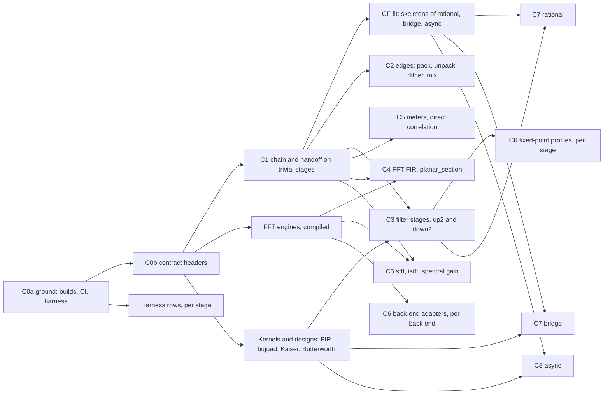

# catenae — plan (draft 24)

**catenae**: Chainable Audio Transforms for Embedded, Native & Accelerated Environments.

A C++17 library of audio processing *stages*, the *chain* that composes them, and the
*junctions* that join chains across threads and clocks. A stage has a contract stated as
numbers (ports, ratio, latency, tail); a chain is a type the caller writes from stages, and it
composes those numbers; a junction has a contract of the same kind for the place where two
call sites meet.

Status: draft for the maintainer's review. Nothing here is built. Draft 19 was audited by
seven reviewers and two verifiers (`docs/audits/2026-11-24-plan-draft-19.md`: 63 findings, no
blockers, none refuted); this draft carries the corrections, and section 1.1 holds the six
decisions the audit asks of the maintainer. The listings of section 9 compiled in the audit
with small changes, but they predate section 1.1 and are rewritten when it is decided.
Section 13 lists the open questions and section 14 maps the audit to the changes.

Evidence: the layout spike of November 2026 (DspTap and SampleRateTap branches
`ccr-ef01ff18-nxz8n4`; DspTap `bench.yml` runs 153, 157, 161) and the write-up
"Interleaved or Planar: A Short Book for the Tap Chain". Section 12 says what those two
libraries have changed since and what that does to the evidence.

---

## 0. Why a new library

`tap::dsp::chain` was built as the composition point for SampleRateTap's rate converters. Its
stage contract assumes one sample type, one channel count and interleaved frames, in and out.
That is right for a converter and too narrow for a general library of stages: it cannot
express a format converter, a layout converter, a mixer, a spectral region or an analysis
tap. Widening it in place would break every consumer of `chain.h` for needs those consumers
do not have. catenae starts from the wider contract instead, in C++17, with no compatibility
debt, and with the constraints of safety-related embedded code designed in from the first
header rather than retrofitted.

## 1. Decisions

Status: **settled** is the maintainer's own statement. **accepted** is a proposal the
maintainer reviewed on 2026-11-24 ("I mostly agree") without objecting to that row; it stays
open to change. **proposed** was new in its draft.

On 2026-11-24 the maintainer accepted the plan as a whole at draft 17 ("I like the plan").
Rows still marked proposed are accepted with it, and the open questions of section 13 stay
open.

| # | Decision | Status |
|---|---|---|
| D1 | The name is `catenae`; the repository is `tap/catenae`. | settled |
| D2 | The language is C++17, strictly: one code path, no C++20 feature, not even behind a feature test. What is checked: every file compiles without a warning at `-std=c++17`, 20 and 23, and the instruction-count ratchet's numbers are equal across the three. (Valid C++17 can change meaning later; section 7.2 lists the constructs to avoid.) Where the standard library only has a type from C++20 on, catenae writes its own (`catenae::span` first). | settled |
| D3 | DspTap and SampleRateTap are sources of material, not dependencies: no submodule, no link. Code is carried in by copy, ported, and recorded in `NOTICE.md` with the commit it came from. | settled |
| D4 | Not header-only: templates whose compile-time numbers matter stay in headers, and everything else is compiled once into a static library, `catenae` (section 7). The FFT is behind one compiled interface, its back end chosen when the library is built. | settled in principle (the maintainer rejected header-only); the split is accepted |
| D5 | The chain's native layout is interleaved, with the channel count a compile-time number. | accepted (measured: section 12) |
| D6 | A stage declares its input and output separately, each as a *port type* (section 3). Two stages join when one's output port and the next one's input port are the same type. | accepted; the port-as-a-type form is proposed |
| D7 | Planar is a typed region inside a chain: converter stages at its ends, a wrapper for convenience. | accepted |
| D8 | Byte order and packing exist only in *edge stages* at the ends of a chain: `unpack` and `pack`. They are stages, not junctions: one call, one thread, one clock, ratio 1:1. Only their outer port is unusual, a `wire_port` of bytes, which no other stage accepts, so the type system keeps them at the ends. Inside, every sample is native. | accepted; the stage-not-junction reading is this draft's answer |
| D9 | One latency report per stage (nominal, deviation, exactness, group delay) and one flush contract with a stated residue. | accepted |
| D10 | Capabilities are published as constants and checked by one `stage_traits<T>`; nothing detects a capability by probing for a member. A type says it is a stage by one explicit opt-in (a specialisation of `is_stage<T>`), which is what `operator|` is constrained on. | accepted (the opt-in is the audit's, finding 45) |
| D11 | Read-only analysis (meters, correlation, pitch) is a sibling `analyzer` concept; `tap<Analyzer>` is the stage that puts one in a chain, passing the audio through. | accepted |
| D12 | The Tap libraries' engineering discipline carries over: contracts as numbers pinned by tests; fixed-point profiles opt-in per stage; processing `noexcept`; published literature only; honest limits stated and pinned. Three points of it are made stricter here: D21, D22 and D24. | accepted |
| D13 | A chain is written by the caller as a type. Nothing is looked up from a rate pair or built from a run-time description. | accepted |
| D14 | catenae is not part of the TapHouse family. Its namespace is `catenae::` and its banner is `Copyright 2026 Timothy Place and the catenae contributors`. | settled |
| D15 | catenae and SampleRateTap coexist for good. Neither depends on the other, and catenae's stage contract owes `tap::dsp::sync_stage` nothing. | settled |
| D16 | Once the architecture is settled and stable, catenae duplicates all of SampleRateTap's functionality (`rational`, `bridge`, `async`), re-implemented on catenae's contracts. The architecture is not called stable until it is shown that they fit. | settled |
| D17 | A port has a *signal kind*: time-domain audio, frames of transform coefficients, or wire bytes. Each kind is its own port template, so a transform-domain region (analysis, coefficient stages, synthesis) is typed in a chain and a time-domain stage after an analysis does not compile. | accepted |
| D18 | The stage contract is fixed-ratio: every stage's ratio is a compile-time L/M and `outputs_for` is exact. The ratio is the long-run one: a call of n frames need not return n L/M (D35). | accepted |
| D19 | A *junction* is a first-class concept beside the stage, with its own contract (section 6), for the place where two threads or two clocks meet. The asynchronous converter is a junction. A chain never contains one. | accepted |
| D20 | The naming and formatting rules are the Tap rules, enforced by `.clang-format` and `.clang-tidy` in CI; the files are owned here, with no drift check against TapHouse. | settled |
| D21 | No exceptions and no RTTI, ever. Every build is `-fno-exceptions -fno-rtti`; no `throw`, `try`, `dynamic_cast` or `typeid` appears; there is no second configuration. Whatever can fail does so through a returned `status` or `expected<T, status>`, and only outside the audio path (section 3.3). | settled |
| D22 | No heap. The library never calls `new`, `malloc` or an allocating standard container, at construction or afterwards. Every buffer is a member whose size is a template argument, or storage the caller supplies as a span. | proposed (follows from D23; it replaces the Tap rule "allocate at construction") |
| D23 | catenae is written with MISRA C++:2023 and ASIL B in mind, as a precaution: there is no requirement today, one may come, and there is no checker. So the constraints that are expensive to retrofit are designed in now (section 8), and nothing is claimed: no compliance statement, no compliance matrix, no safety case. | settled |
| D24 | `float` is the default sample type and `double` is the golden model. An unsuffixed name is the `float` stage (`gain<2>`); `_f64`, `_q15` and `_q31` name the others. Every profile's numbers are stated against the `double` one, which never changes for speed. | settled (the naming is proposed) |
| D25 | A frame of transform coefficients is, per channel, N/2 + 1 bins of `complex<S>` (real then imaginary, adjacent), DC to Nyquist, all stored; channels follow one another whole (section 5.2). | proposed |
| D26 | Build systems: CMake first; waf supported and built in CI from C0a; a Zephyr module when a consumer needs it. One amalgamated source file exists for anything else. | settled as to which; the timing is proposed |
| D27 | Joints inside a chain are checked at compile time and cost nothing at run time: the port types match, and the chain's scratch is proven large enough by a `static_assert` on each stage's `max_outputs_for`. A run-time *boundary* check exists only where the caller's own buffers enter, at a chain's `process` and a junction's `push` and `pull`; it is written once, generically, from the traits, and is on in every build. With fixed-extent spans that check is compile-time too. An *audit* check, inside the library's own loops or on what the host is responsible for, is on in debug builds only. The level is an explicit build option written into one configuration header, and it is part of an inline namespace, so an image that mixes levels cannot link (section 3.3). | proposed (the maintainer's correction of draft 8: no run-time checks between stages) |
| D28 | FFT back ends (section 7.1): catenae's own engines are the default on every target and the only ones in this repository. CMSIS-DSP and Apple's vDSP are opt-in, chosen when the library is built, and never vendored: the consumer's own copy is used, through a CMake target that carries its configuration. | proposed |
| D29 | A fixed-point port names its Q format, and the format is part of the port's type: `port<fixed<std::int32_t, 27>, Ch>` is Q4.27 audio, and joining it to a Q0.31 port does not compile. The format is a compile-time tag only; buffers hold raw `int16_t` and `int32_t`, never a wrapper class. Moving between formats is an explicit `convert` stage (a shift, with its rounding and saturation stated). Any format can be named, so one that becomes useful later (Q1.14 between 16-bit stages) is an addition and not a redesign; a stage accepts only the formats its battery pins (section 3.1). The first set: `q15`, `q31` and Q4.27. Every wire format unpacks to one of the first two: 16-bit to `q15`; 24-bit, packed or in 32, left-justified to `q31`; 32-bit to `q31`. | accepted (2026-11-24) |
| D30 | Public constants have no prefix. A stage's contract reads as the standard library's traits do: `rate_ratio`, `is_in_place`, `has_exact_latency` (compare `std::numeric_limits<T>::is_signed`, `std::chrono::steady_clock::is_steady`). The `k_` prefix stays for constants that are not part of the public interface: private members and everything in `detail`. This is the first place catenae's style departs from the Tap rules (D20). `clang-tidy` can check the case of a constant but not its access, so the prefix rule is enforced by a script in the tidy job (section 7.2). | settled (the names chosen are proposed) |
| D31 | Warnings are errors, and the set is strict (section 7.2): the conversion, sign, shadowing, double-promotion, old-style-cast and switch warnings of every compiler in CI, on catenae's own code and on a consumer's view of its headers. A suppression is a recorded deviation, never a habit. | settled as a direction; the flag sets are proposed |
| D32 | Documentation is four kinds of document with one job each (README, guide, reference, record), plus executed notebooks and generated measurement tables, under rules that keep it short: one home per fact, a fixed contract card per stage, headers that describe only the present, and length budgets enforced in CI (section 11). | proposed |
| D33 | The license is not chosen. It is decided after the coding is complete, and until then the repository carries no license file and no SPDX line. Files carry the copyright banner of D14 only. `NOTICE.md` still records where every carried file came from and the license it was under there (DspTap and SampleRateTap are MIT), so that whatever is chosen can honour it. | settled |
| D40 | Headers use include guards in the style of the C++ Core Guidelines (SF.8), not `#pragma once`: `#ifndef CATENAE_<PATH>_<FILE>_H`, `#define`, and a closing `#endif // CATENAE_<PATH>_<FILE>_H`, the name spelled from the header's path under the include root so that it is unique. A check in the tidy job from C0a derives the expected name from the path and fails on a mismatch, a missing guard or a `#pragma once`. | settled |
| D41 | The guide is written for one reader: an experienced software engineer who has not worked on embedded hardware, and it is their tutorial (section 11.4). The reference, not the guide, is where an embedded engineer who already knows why looks things up. | proposed (the maintainer's suggestion, 2026-11-24; this draft recommends it) |

### 1.1 Decisions the audit asks for

Each row is a problem the audit confirmed, the options, and this draft's recommendation.
D34, D36 and D39 were accepted on 2026-11-24. The rest are **proposed**. D35 and D37 change
the contract headers, so they are settled before C0b (section 10). D34, D35 and D37 are
written out as compiled code in `docs/sketches/config-state/`, with the measurement of where the
memory lands: for the overdrive chain on a Cortex-M33, no flash for its data, 6,184 bytes of
`.bss`, no start-up code, and a 64-byte stack frame in the audio callback.

| # | The problem | Recommendation | Other options |
|---|---|---|---|
| D34 (accepted) | **Where a chain's memory lands.** An object with one non-zero member (a gain, a coefficient, a pointer to taps) is initialised data: its scratch and histories, nearly all zeros, are stored in flash as well as RAM (8,180 bytes measured for the overdrive chain of 9.3). The alternative is construction at start-up, with a 12 to 20 KB stack frame, which `a \| b \| c` over objects that carry their histories makes worse. (Findings 8, 10, 17, 36.) | **Split configuration from state.** A stage's *configuration* is a small constant value (its design, a view of its taps): `constexpr`, in ROM. Its *state* (histories, scratch) is a separate type that is valid when all zero, so it lives in `.bss` and costs no flash and no start-up code. `a \| b \| c` composes configurations, which are a few bytes each; `state_of<Chain>` is the memory. One configuration can serve many states (voices), and a run-time parameter change becomes "swap the configuration", which also answers how a new design reaches a running chain. | (a) Keep one object and accept flash equal to its size for every chain with a non-zero member. (b) One object, built in place at start-up from designs, with the start-up stack and ordering that implies. |
| D35 | **A 1:1 ratio is not n frames out for n in.** `stft \| ... \| istft` with a hop of 128, fed 64 frames, returns 0 then 128; a by-3 down then up returns 66, 63, 63. The fixed-extent entry cannot compile for such a chain, a callback that must return n for n cannot use it, and `fed_by` overshoots: a chain by 16 asked for 100 frames writes 112. SampleRateTap's `pull(out, k)` stops at exactly k; the stage contract has no such form. (Findings 23, 33, 37.) | **State it, and provide the two adapters.** (1) A stage publishes `is_frame_synchronous` (`outputs_for(n)` is always n L/M); the fixed-extent entry and an n-for-n callback require it. (2) `steady<Chain>` wraps a bursting chain with a member FIFO and presents a frame-synchronous stage with its true, larger latency (511 frames for the 512/128 region, not 384); it is how a spectral region meets an audio callback. (3) `fed_by` owns a holdover array of the chain's worst overshoot, a `constexpr` number from the traits, and so delivers exactly k: that is where SampleRateTap's `pull` lands. `frames_needed(k)` is defined as the smallest n with `outputs_for(n) >= k`. | Add an output-bounded `run` to every stage (it may leave input unconsumed), and redo the chain's scratch proof for banked outputs. More general; it complicates every stage for the sake of two adapters. |
| D36 (accepted) | **The float default runs in software double on two targets.** The carried FIR arithmetic accumulates a `float` filter in `double`, on purpose and with explicit casts no warning sees. On the Cortex-M4F and M33 (single-precision FPUs) every FIR, `up2` / `down2`, L/M stage and converter would do a software-double multiply-add per tap; DspTap's own header records about 19 times Q15's instruction count on the M33. That contradicts D24 and the purpose section 7.2 gives for the double-promotion warning. (Findings 1, 26.) | **The `float` profile accumulates in `float`.** It is the profile for cores with a single-precision FPU, so it must not leave it. Its noise floor is measured and stated per stage (lower than the carried one; `_f64` stays the golden model and the choice for a host). C7's comparison with SampleRateTap is then to a tolerance for `float` and bit for bit only where the arithmetic is unchanged (`double`, Q15, Q31). A link-stage gate enforces it: a `float`-profile image on those cores may not reference a software-double routine. | Keep `double` accumulation as carried, record it as an exception, and tell M4F and M33 users to use fixed point, which pulls the fixed-point profiles forward from C6. |
| D37 | **A design is more than "a small value".** (1) A design's validity depends on the sample format: a cutoff that is stable in `double` can lose a pole in `float`, and the tail is computed from the rounded coefficients. A format-free design cannot give the infallible constructor section 3.3 promises. (2) `bridge` and `async` design tables of 12 to 164 KB from run-time arguments, using up to 328 KB of `double` scratch; such a table cannot be returned by value, and its tap count sizes the stage's storage. (3) `latency()` as one report recomputes a 1,025-point group-delay scan that DspTap split out for its cost (28 M instructions on the M33). (Findings 5, 11, 12, 13, 35, 55.) | **Designs carry their format, hold their numbers, and come in two kinds.** `butterworth_design<S, N>`: `make()` validates for that `S` and stores coefficients already in the kernel's coefficient type, with the tail and the latency numbers computed once. So a stage built from a ROM design links no `double` and no `libm`, and `latency()` returns stored numbers; `group_delay(f)` is a design-time free function, not a stage member. *Small* designs are returned by value. *Table* designs are generated ROM tables with a bit pin, or are built by `make(spec, table, workspace)` into storage the caller supplies, with `constexpr` size functions. Where a profile fixes a tap count that sizes storage, the profile is a template argument. A design is a class with a `constexpr` constructor, not an open aggregate, so only `make()` and the table generator can produce one. | Keep format-free designs and let the stage constructor validate and fail, which gives up "a stage cannot fail". |
| D38 | **Fixed-point resynthesis does not survive fixed scaling.** A fixed-scaling forward transform followed by its inverse returns the signal about log2 N + 1 bits down: 36 dB of signal-to-noise at N = 512 in Q15, 24 dB at 2048 (measured on DspTap's engine). DspTap says its fixed policy is for magnitude consumers and block floating for round trips; CMSIS-DSP's fixed-point transforms have only the fixed kind. (Finding 25.) | **At 1.0, fixed-point transform regions are analysis only.** A Q15 or Q31 `stft` feeds analyzers and magnitude consumers, with its format in the spectrum's type (D29) and no exponent travelling. `istft` and coefficient-domain processing are `float` and `double`. Fixed-point resynthesis waits for a design of its own (block floating with the exponent in the frame, or an inverse for a spectrum of known format), outside 1.0. A CMSIS-DSP fixed-point back end can serve analysis only. | Carry block floating now and decide where the exponent travels and what a spectral stage does when exponents differ. |
| D39 (accepted) | **Latency needs an exact form, and a 4x oversampler is half a sample out.** A linear-phase half-band's delay is odd at its own rate, so `up2 \| up2 \| ... \| down2 \| down2` has a latency of k + 1/2 base-rate frames (18.5 and 23.5 measured on SampleRateTap's chains), and "delay the dry path by the nominal latency" cannot be done with an integer delay. A pair of doubles also cannot pin "this latency is exactly 80/3". (Findings 27, 55.) | **An exact stage reports an exact rational.** `latency()` returns `{nominal, deviation}` as numbers for every stage, and a stage with `has_exact_latency` also has `exact_latency()`, a reduced rational, which is what a chain of exact stages composes and what a test pins. `oversample<Factor, Stage>` builds the up and down stages with the one-frame delay at the inner rate that makes its latency a whole number of base-rate frames; bare `up2` / `down2` beyond 2x are documented as fractionally delayed. | Doubles only, with the oversampler's delay left to the caller. |

## 2. Charter

**In:** 1:1 stages (filters, gain, delay, mixing, nonlinearities, dynamics without a side
chain), rate-changing stages by a compile-time ratio L/M, sample-format, layout and wire
converters, transform-domain regions (analysis, coefficient stages, synthesis), the chain,
analyzers and their tap, junctions, and the measurement harness that tells us which layout
each stage wants.

**In, after the architecture is stable (D16):** everything SampleRateTap does: `rational`
first (its stages are already chain stages), then `bridge` (one fixed-ratio converter), then
`async` (a junction).

**Out, at least until 1.0:**

- Stages with two audio inputs (side-chain compressors, convolution against a live signal).
  Two signals meet only as channels of one wider port: `mix` and cross-correlation take
  them that way. Running different chains on groups of channels (a dry path beside a wet
  one) is the caller's code until a `parallel` combinator is decided (section 13).
- A run-time graph: no dynamic routing, no plug-in host, no patch format.
- Pitch shifters and other processes with their own framing and latency model.
- Elastic processes inside one clock domain (time-stretch, varispeed).
- Anything defined by imitating a product rather than by a published method.

## 3. Ports and the stage contract

### 3.1 Ports

A port is a type. Two stages join when the types are the same, so the joint rule is one
`std::is_same` and one `static_assert` message.

| Port | Carries | A frame is |
|---|---|---|
| `port<S, Ch, layout::interleaved>` (the default layout) | time-domain audio in sample format `S`: `float`, `double`, or a fixed-point format (below) | `Ch` samples |
| `port<S, Ch, layout::planar>` | the same, a channel at a time | `Ch` samples, each channel's run contiguous within a call |
| `spectrum<S, Ch, Bins>` | transform coefficients (D25) | `Ch * Bins` values of `complex<S>` |
| `wire_port<Format, Ch>` | bytes on their way in or out; the formats are in namespace `wire` (`wire::s16le`, `wire::s24le_packed`, `wire::s24be_in_32`, ...) | `Ch * bytes_per_sample` bytes |

**Fixed-point formats (D29).** `fixed<Storage, F>` is a signed two's-complement format with
`F` fractional bits in `Storage` (`std::int16_t` or `std::int32_t`); the integer bits are
what is left after the sign. `q15` is `fixed<std::int16_t, 15>` and `q31` is
`fixed<std::int32_t, 31>`, the two formats that match a wire. A raw `int16_t` is not a
sample format: a port always says where its binary point is. The notation is stated once
because the industry's differ: here Q4.27 means one sign bit, 4 integer bits and 27
fractional bits.

A format tag is stripped before a kernel is called: kernels are instantiated on the storage
type, so Q4.27 and Q0.31 share one copy of the code.

What the formats between Q0.15 and Q0.31 are for is headroom. A chain in Q0.31 saturates at
every stage whose output can exceed full scale (a peaking filter's boost, a resonance's
overshoot, a mix's sum), and each saturation is audible. A chain in Q4.27 carries 24 dB
above full scale between its stages and saturates once, at the `convert` back to the wire
format, which is how fixed-point audio processors are conventionally built. Because the
format is in the port's type, the joint check of D27 covers it at compile time and every
shift is a constant.

**What exists already.** There are no fixed-point *types* in the Tap libraries, on purpose:
the arithmetic lives in traits over raw integers, so that the headroom bits, the
pre-shifts and the single rounding point of each datapath stay visible and pinned. Three
sets are carried in (section 12):

| Traits | For | What they fix |
|---|---|---|
| `sample_traits` | FIR datapaths | Q1.14 and Q1.30 coefficients, a 64-bit accumulator, one rounding point (round half up), a saturating output |
| `iir_traits` | recursive kernels | Q2.29 and Q2.60 states with two guard bits, Q2.30 coefficients, exact 64- and 96-bit products, truncation chosen per section so no limit cycle survives, saturation at the output only |
| `fft_arith` | FFT butterflies | Q1.30 twiddles, saturating add and subtract, a rounding shift, block headroom |

They are keyed on `int16_t` and `int32_t` and named for Q0.15 and Q0.31, but a linear
kernel does not know where the binary point is: the same integer arithmetic filters Q4.27
and Q0.31 alike, bit for bit (the audit ran it: no sample differs at nominal level or 20 dB
above it). So for a linear stage a new format costs no new kernel and no new measurement. Its floor in LSBs is the one already pinned, and its signal-to-noise ratio
against nominal full scale is that floor less the headroom (24 dB less in Q4.27), a derived
number with one test to pin it.

What has to be written:

- the `fixed<Storage, F>` tag and the traits' lookup through it;
- `convert` between formats: a shift with stated rounding and saturation (the rounding and
  saturating helpers exist);
- a small set of scalar helpers for stages that are not filters (a saturating multiply for
  `gain`, a saturating sum for `mix`);
- the places where the binary point does matter: a nonlinearity, dither's amplitude, a
  threshold or a meter in dBFS. These take `F` from the format.

Three limits of the carried recursive kernel, which a headroom format does not remove
(finding 24):

- Its states have two guard bits above the *integer* full scale. A section that exceeds them
  does not saturate; it wraps, and the wrapped value is fed back. DspTap proved the guard
  bits sufficient for its tabulated designs only, so a fixed-point design's `make()` checks
  the section's gain against them and fails with a `status`.
- Its coefficients are Q2.30, below 2 in magnitude, and the carried conversion saturates
  silently: a shelf or a peak above about 6 dB becomes a different filter. `make()` rejects
  a coefficient out of range.
- A general fixed-point biquad or Butterworth needs a section-scaling design that the source
  libraries do not have. It is new work, at C6.

The carried arithmetic is defined behaviour in C++20 and not all of it is in C++17
(findings 16, 58): a right shift of a negative value is implementation-defined, a left shift
of one is undefined (and a compile error when a `constexpr` function meets it), and an
out-of-range unsigned-to-signed conversion is implementation-defined. Every shift of a
signed value goes through one helper (left as a multiplication, right with one recorded
deviation), a script rejects a raw shift of a signed operand elsewhere, and a compile-time
test evaluates the helpers with negative operands so that the error class fails every build.

The limit: a stage's noise floor and saturation-free level are numbers that depend on the
format, and a number nobody measured is not a contract. So a stage's fixed-point profile
lists the formats its battery pins and a `static_assert` refuses the rest; widening the list
is adding rows to the battery, which for a linear stage is the derived row above.

The same tag carries a fixed-point spectrum's format: an FFT with the fixed scaling policy
grows its output by a known number of bits for a given length (log2 N for Q15, log2 N + 1
for Q31 in the carried engine), so the format is the spectrum's type and no exponent travels
with the frame. That serves analysis. It does not serve resynthesis, which D38 leaves to
`float` and `double`.

### 3.2 What a stage declares

Read through `stage_traits<T>`, which fails with one readable `static_assert` per missing or
ill-typed member.

| Member | Meaning |
|---|---|
| `input_port`, `output_port` | The two port types. |
| `rate_ratio` | `ratio{up, down}`, reduced. For an analysis stage it is 1 / hop. |
| `is_in_place` | Whether `in.data() == out.data()` is allowed. It may be declared only when the two ports are the same type and the ratio is 1:1, which `stage_traits` asserts; a stage whose ports differ simply gets two buffers. |
| `is_frame_synchronous` | Whether `outputs_for(n)` is n L/M on every call (D35). False for a hopped transform and for a stage whose phase makes its output count vary. |
| `has_exact_latency` | Whether the stage delays every frequency alike. |
| `run(in, out)` | The stage's work, trusted: spans of the ports' value types, already known to be the right sizes; consumes all of `in`; returns the frames written. `noexcept`, no allocation, no failure, no boundary check. Called by a chain, not by the caller's code (section 3.3). |
| `outputs_for(n)`, `frames_needed(k)` | From the current position: `outputs_for(n)` is exactly what the next call of n frames writes; `frames_needed(k)` is the smallest n with `outputs_for(n) >= k`, which for an interpolating stage can write more than k. |
| `max_outputs_for(n)` | An upper bound from any state, `constexpr`. The chain sizes its scratch from this. |
| `reset()` | Back to the constructed state. |
| `latency()` | `{nominal, deviation}` in output frames, stored numbers from the design (D37); deviation 0 when exact. A stage with `has_exact_latency` also has `exact_latency()`, a reduced rational (D39). |
| `tail_frames()`, `flush_residue()` | Zero input frames after which the stage's own output is silence within the residue (0 for FIR; a stated bound, with the range of designs it holds for, for a floating-point recursion). |

`stage_traits`'s joint check is a helper `joint<Index, OutputPort, InputPort>` with one
`static_assert` and one fixed message for each way two ports can differ (kind, sample format,
channel count, layout, bins). A C++17 `static_assert` cannot print a type, so the message is
the fixed sentence and the compiler's own note, which names `joint<...>` with its arguments,
is where the two port types are read (finding 42).

### 3.3 Failure, without exceptions (D21)

- **The audio path cannot fail.** `run`, `process`, `push`, `pull` and `reset` return counts,
  never errors. What they require of the caller is a precondition.
- **Design is where failure lives.** Anything computed from run-time numbers (a cutoff, a
  set of taps) is a *design*: a small value type produced by `T::make(args)`, which returns
  `expected<T, status>`: the value or the reason there is none, held by value (no pointer,
  no heap). `catenae::expected` is written here because the standard library only has it
  from C++23, and it follows `std::expected`'s interface as `catenae::span` follows
  `std::span`'s: `has_value()`, `operator bool`, `operator*`, `operator->`, `value()`,
  `error()`, `value_or()`. So it reads as the standard type does and can be replaced by it
  one day. Two differences, both forced by D21: `value()` on an empty one cannot throw, so
  it is a violated precondition (the handler), and so is `operator*`, which the standard
  leaves undefined. `expected` and `status` are `[[nodiscard]]`, so an ignored failure is a
  warning and, under D31, an error.

**Where checks happen (D27).**

| Where | What is checked | When |
|---|---|---|
| A joint between two stages | The port types are the same; the scratch between them holds `max_outputs_for` of a block | Compile time. Nothing at run time. |
| The caller's entry: `chain::process`, a junction's `push` and `pull` | The input is a whole number of frames; the output span holds `outputs_for(n)` frames | Once per call, in every build. At compile time instead, when the caller passes fixed-extent spans. |
| Inside the library: a kernel's indices, a state invariant, a stage returning more than its own `max_outputs_for`, the host's flush-to-zero setting | The library's own promises, and the host's | Debug builds only (audit). The battery and its coverage are the proof. |

- **A stage has no checked entry of its own.** It implements `run`, which trusts its spans.
  The checked entry is the chain's `process`, so a stage used alone is a chain of one. The
  boundary check is therefore one function, written from `stage_traits` and tested once, and
  a stage author cannot forget it or get it wrong.
- **Fixed blocks need no run-time check at all.** Most embedded callers process a fixed
  block. `process` has overloads that take `std::array<T, N>&`, `T(&)[N]` and a fixed-extent
  span, deduce the two extents as they are, and `static_assert` that each is a whole number
  of frames and that the output holds `max_outputs_for` of the input. (The bound is the
  maximum, so the fixed form can ask for a frame more than one call uses; and it needs
  `is_frame_synchronous`, D35.) The dynamic-extent overload is the one that checks at run
  time, against `outputs_for(n)`.
- **The count is not to be ignored.** `process`, `push` and `pull` are `[[nodiscard]]`: on
  a junction the count is the only sign of an overrun or an underrun.
- **Content is not a precondition.** Any bytes are valid samples, so a wire stage needs no
  check on what it reads. A non-finite float from outside is not a memory fault either; it
  poisons a recursive state until `reset()`. A caller who cannot vouch for its input puts an
  explicit `sanitize` stage at the edge, which is a stage with a cost, not a hidden check.
- **A failed check** calls one `[[noreturn]]` handler. The library defines none: the
  integrator must, and it is where their system enters its safe state (a default that traps
  ships as a separate source file for examples, tests and anyone who wants it). That needs
  no weak symbol and cannot collide in the amalgamated build (finding 41). The handler
  receives a small enumerated code, not a file name and a message, so checks add no strings
  to ROM.
- **One level per image, enforced by names.** Checks are inline functions, not macros. The
  level is an explicit option, `CATENAE_CHECKS` = `boundary` (the default) or `audit`,
  independent of the build type (a generated header cannot follow a multi-configuration
  generator, and "debug" means nothing to waf or the amalgamation); CI's debug legs set
  `audit`. Each build system writes it into `catenae/config.h`, and a default `config.h`
  ships beside the amalgamation. The level and the FFT choices of section 7.1 are spelled
  into an inline namespace, as DspTap does for its FFT engine, so every symbol that crosses
  into the library carries them and two files that disagree do not link. (A symbol that
  exists only to be a guard does not work: the audit showed the linker discards it under
  `--gc-sections`, on exactly the embedded builds it is for. Findings 15, 28, 57.) C0b has a
  link-fail test of this on an embedded leg at `-Os` with `--gc-sections`.

## 4. The chain

- `chain<Stages...>`, built by `a | b | c`.
- At each joint the output port of one stage is the input port of the next, or the chain
  does not compile.
- Composes ratio, `outputs_for`, `frames_needed`, latency and tail. A chain is itself a
  stage, so chains nest. It does not compose a residue: a recursion's residue under
  flush-to-zero is a standing limit cycle that every later stage amplifies by a gain the
  contract does not carry, so a chain says what DspTap's does, that flushing equals zero
  padding its input, and each stage's card states its own residue (finding 54).
- `flush(out)` is the end-of-stream operation: it feeds each stage, in order, its
  `tail_frames()` of zeros through the stages after it, from a zero block that is part of
  the chain's all-zero state, and returns the frames written; `flush_output_frames()` says
  how many beforehand. A chain that holds a chain flushes (DspTap needed 0.5.0 for that).
- The block length is given by `with_block<128>(a | b | c)`, which is a different type; a
  bare `a | b | c` has the default. `a | b | c` flattens, so the type lists the stages once.
  Class templates meant for deduction have explicit deduction guides.
- Scratch is a member array (D22), sized from each stage's `max_outputs_for` at a
  compile-time block length (64 frames unless the chain is told otherwise), with a
  `static_assert` that each buffer holds what the stage before it can write. `process` is
  the caller's entry and the only place a run-time size check is made; it accepts any length
  and works through it a block at a time, calling each stage's `run`. A chain has `run` as
  well, which is what an enclosing chain calls. A run of `is_in_place` stages
  shares one buffer.
- Bit-identical for any chunking of a stream at contraction off. The compiled core is built
  that way; a header-template stage compiles under the consumer's flags, so for it the claim
  is the consumer's to keep, and the stage's card says so (finding 6).
- One call, one thread, one clock. A chain holds no junction (D19).

## 5. Layout and signal kind

### 5.1 Time-domain audio

- Interleaved, compile-time channel count, is the default for every stage with state.
- `deinterleave<S, Ch>` and `interleave<S, Ch>` are 1:1 stages between the two layouts.
- `planar_section<Stages...>` de-interleaves once per block, runs mono stages over contiguous
  channels, re-interleaves, and presents itself as an interleaved stage.
- Each stage's row in the layout benchmark is the evidence for its preferred layout.

### 5.2 Transform coefficients: the format of a spectrum (D25)

For a real input of N samples per channel, one frame of `spectrum<S, Ch, N/2 + 1>` is:

```
channel 0:  re[0] im[0]  re[1] im[1]  ...  re[N/2] im[N/2]
channel 1:  re[0] im[0]  re[1] im[1]  ...  re[N/2] im[N/2]
...
```

- **Real and imaginary parts are interleaved**, as `catenae::complex<S>`, a plain
  `{S re; S im;}`. (`std::complex` is specified only for floating types, and Q15 and Q31
  need the same shape.) This is the layout of `std::complex` and the shape most back ends
  are nearest to. No back end produces the frame with no work: catenae's own engine and
  CMSIS-DSP's `float` transform pack the Nyquist bin beside DC and need a fix-up of two
  bins, and vDSP is split complex (section 7.1).
- **Every bin from DC to Nyquist is stored, zero imaginary parts included**: N + 2 scalars
  per channel. DspTap's packing saves the two zeros by keeping the Nyquist bin's real part
  at index 1; catenae spends them so that a coefficient stage is one uniform loop over bins
  with no special index.
- **Channels are not interleaved.** Each channel's spectrum is contiguous and the channels
  follow one another. An FFT transforms one channel's contiguous samples, so the analysis
  stage de-interleaves as it windows (the FFT FIR stage in the spike already did, and still
  beat a stage per channel by 4 to 16 %). A spectrum is therefore always "planar by
  channel", and has no layout parameter.
- **Sign and scale.** Forward is `sum x[n] exp(-i 2 pi k n / N)`, unnormalized: the textbook
  convention and the accelerated back ends'. DspTap's engine uses `exp(+i)`; the carried
  engine is conjugated in its post-pass. An analysis and synthesis pair states its overall
  gain (1) and its reconstruction error as numbers.
- **Fixed point.** A Q15 or Q31 spectrum's format is in its type and it is for analysis
  (D29, D38).
- **A frame's time.** A spectrum frame is stamped by the first sample of its window; the
  region's latency is stated against that.
- **The alternative, split complex** (all real parts, then all imaginary: vDSP's native
  form) vectorizes magnitude and gain loops more easily. It is measured against the
  interleaved form in the layout benchmark at C4, where the first stage that consumes a
  spectrum is built, and D25 is frozen then; a vDSP back end converts
  at its boundary either way.

A transform-domain region is an analysis stage (audio in, spectrum out, ratio 1 / hop),
stages whose ports are both spectra, and a synthesis stage back to audio.

## 6. Junctions

A stage lives inside one call, on one thread, in one clock domain. A junction is where two
call sites meet: two threads, two clocks, or both. It is defined the way a stage is, by a
contract read through `junction_traits<T>`.

| Member | Meaning |
|---|---|
| `sink_port`, `source_port` | Port types, as a stage's. |
| `clocking` | `clocks::shared` (two threads on one clock) or `clocks::independent`. |
| `rate_ratio` | The nominal rate ratio between the two sides (1:1 for a near-unity converter). |
| `tolerance_ppm()` | Independent clocks only: the offset and drift the junction absorbs. |
| `push(in)` | Called by exactly one thread. Returns the frames accepted; what happens to the rest (dropped, counted) is stated. `noexcept`, wait-free. |
| `pull(out)` | Called by exactly one other thread. Always fills `out`; the frames it could not supply are silence, and it returns how many were real. |
| `report()` | Any thread. Each field (state, fill, underruns, overruns, the rate estimate where there is one) is individually atomic and 32 bits wide; there is no snapshot across fields, and the fill is computed in a stated read order and clamped to the capacity. This is new design: the carried ring has no query that a third thread may call (finding 22). Named `report`, not `status`, which is the error type. |
| `latency()` | `{nominal, range}` in source frames: a junction's delay breathes with its fill, so it is never exact. |
| `capacity_frames` | A template argument (D22), a power of two for the carried ring's index scheme (asserted). |
| `reset()` | Only while neither side is running; a stated precondition. |

Instances: `handoff<S, Ch, Capacity>` (a single-producer, single-consumer ring: shared clock,
two threads; the trivial junction, which proves the contract as `gain` proves the stage's);
the asynchronous converter (D16); later and outside today's charter, a jitter buffer.

`feeding(chain, junction)` runs a chain and pushes what it wrote; `fed_by(junction, chain)`
pulls what a chain needs and runs it. Each checks the port where it joins. Both are
long-lived objects, not per-call temporaries: the frames in transit between chain and ring
need somewhere to be, and for a chain that decimates by 16 that is a kilobyte of frames per
64 out, which does not belong on an audio thread's stack. Their staging is a member array
(D22), and `fed_by`'s includes the holdover of D35 (finding 50). There is no `|`
across a junction and no type that holds both sides: the thread boundary stays visible in
the caller's code. Latency across a junction composes as nominal only.

What a junction assumes of its callers is an assumption of use (section 8): one thread per
side, where an interrupt handler counts as a thread, and `reset()` only at rest. A violation
is a data race that no check can see, so junctions are verified under the thread sanitizer
and on real weakly ordered hardware (section 7.2).

### 6.1 Analyzers (D11)

An analyzer is read through `analyzer_traits<T>`, as a stage is through its traits.

| Member | Meaning |
|---|---|
| `input_port` | What it reads; it has no output port. |
| `hop_frames`, `window_frames` | Its framing: a result every `hop_frames`, over the last `window_frames`. |
| `analyze(in)` | Trusted, as a stage's `run`. `noexcept`, no allocation. |
| `result_type`, `result()` | The latest result: a value, or a view of storage the analyzer owns. |
| `results_ready()` | How many results have completed since the last read. |
| `reset()` | Back to the constructed state. |

`tap<Analyzer>` is the stage that holds one and passes its input through, 1:1, in place,
with no latency. A stage inside a chain is reached by its index, `chain.stage<I>()`, which
is how an analyzer's results are read on the chain's own thread. How results, or a new
configuration, cross to another thread is open (section 13).

## 7. Headers, the compiled core and the build

| Parameterized on | Where it lives | Examples |
|---|---|---|
| A compile-time number measured to matter (channel count, section count, ratio, block length), or a loop that must inline into a stage's per-sample loop | Header template | The stages, the chain, `feeding` / `fed_by`, the FIR dot kernels, the biquad block kernel, `span`, the traits |
| Only the storage type (a closed set of four: `float`, `double`, `int16_t`, `int32_t`; a Q format is a tag over one of them) and sizes passed at run time | Compiled, explicitly instantiated for the four types | The FFT engines, bulk wire `pack` / `unpack`, the asynchronous converter's servo, the analysis instruments |
| Nothing (design-time arithmetic in `double`) | Compiled | The Kaiser and Nyquist designers, the Butterworth and biquad designs, the flush-window computation, group delay |

What this buys:

1. **One definition per image.** The spike hit the header-only failure twice: two files
   built with different contraction flags shared one inline kernel, and DspTap needs an ABI
   tag on every class that embeds the FFT. A compiled FFT has one back end per library build.
   It works on storage it is handed and allocates nothing (D22). Its trigonometric tables
   are constant, so they are a separate object, `fft_tables<S, N>`, in ROM and shared by
   every transform of that length (generated where C++17 cannot evaluate them); the
   workspace handed to a transform is scratch only. The audit found the first sketch of
   this put the tables in RAM once per stage (finding 14).
2. **The numeric contract is the library's.** The compiled core is built with catenae's own
   contraction policy, so its bit pins hold whatever the consumer passes. Header templates
   still compile under the consumer's flags, and the contract says so.
3. **ROM.** Compiled code is one copy, can be built for size, and is dropped when unused,
   provided the library is built with `-ffunction-sections -fdata-sections` and each
   function has its own section, which the build sets and a size probe confirms.
   Design code in `double` need not link at all when a design is a table (section 3.3).
   These are predictions: each component that could go either way gets a size probe in both
   forms on the embedded targets, and the table above is corrected where a probe disagrees.

### 7.1 FFT back ends (D28)

| Back end | Sample types | Where | How it arrives |
|---|---|---|---|
| catenae's own floating engine (DspTap's srdif engine, ported) | `float`, `double` | everywhere; the default | source in this repository |
| catenae's own fixed-point engine (DspTap's, ported) | Q15, Q31 | everywhere; the default | source in this repository |
| CMSIS-DSP | `float`, Q15 and Q31. The `float` adapter for Helium (Cortex-M55) first; the fixed-point ones with C6, for analysis (D38); a Neon adapter is a separate one, written when a consumer needs it | Arm, opt-in | the consumer's copy, as a CMake target that carries its include directories and its compile definitions. CI fetches one pinned release by hash. |
| vDSP (Accelerate) | `float` first | Apple, opt-in | the system framework; nothing to bring in |

- **Own engines are the reference.** They are the only FFT code in the repository, the only
  ones inside D21 to D23, and the ones whose output bits are pinned. An accelerated back end
  re-presents the same contract (D25's frame, the sign, the scale) within a stated tolerance
  of the `double` engine, proven by a parity battery on the leg that has the hardware.
- **Not vendored, because an embedded consumer nearly always has CMSIS-DSP already**, pinned
  by its silicon vendor's SDK. A second copy inside catenae would define the same symbols
  and either fail to link or, worse, link the wrong one. So catenae compiles its thin
  adapter against the copy it is pointed at, and under Zephyr uses Zephyr's CMSIS-DSP
  module. The adapter must be compiled with the consumer's CMSIS-DSP configuration macros,
  because the library's public structures change layout with them and a mismatch is silent
  memory corruption: hence a target that carries its definitions (a bare path is accepted
  only with an explicit definitions variable), `static_assert`s in the adapter on the size
  of the instance structures and on the version macros, and a tested version window stated
  as a contract number (finding 32).
- **One back end per sample type, chosen when the library is built.** Four options, each a
  choice from a validated list, all defaulting to `own`:

  | Option | Choices |
  |---|---|
  | `CATENAE_FFT_F32` | `own`, `cmsis`, `vdsp`, `none` |
  | `CATENAE_FFT_F64` | `own`, `vdsp`, `none` |
  | `CATENAE_FFT_Q15` | `own`, `cmsis`, `none` |
  | `CATENAE_FFT_Q31` | `own`, `cmsis`, `none` |

  An option per type, rather than one list of pairs such as `cmsis-f32;own-q15`, because
  every type then has exactly one back end by construction (a list can name two for a type
  or none), CMake validates and offers each choice, and the same four options map one to
  one onto waf options and Zephyr Kconfig choices. `none` leaves that type's FFT out of the
  build, so an image carries no transform it does not use, and a stage that needs it fails
  to compile with a message naming the option. The choices are written into
  `catenae/config.h` and into the same inline namespace as the check level (section 3.3).
- **No silent fallback.** A back end serves its own range of lengths. A stage whose length
  is a template argument outside that range fails to compile; a run-time length outside it
  is a `status` from `make()`. Falling back to `own` would change the output bits without
  the caller knowing.
- **What each back end really produces** (checked in the audit against CMSIS-DSP's source
  and Apple's documentation, finding 53), and so what its adapter does:

  | Back end | Output | Lengths | To be handled |
  |---|---|---|---|
  | CMSIS-DSP `float` | N floats, the Nyquist bin's real part in bin 0's imaginary slot; forward is exp(-i) | 32 to 4096 | It overwrites its input. Fix up bins 0 and N/2. |
  | CMSIS-DSP Q15, Q31 | Halved at every stage: the output's Q format depends on the length (Q15: 6.10 at 32 to 14.2 at 8192). No packing of DC and Nyquist. No block-floating mode. | 32 to 8192 | Scalar builds write 2N values, so the buffer is larger. Q15's format is the same as catenae's own fixed policy; Q31's differs by one bit, which the adapter shifts. |
  | vDSP | Split complex, exp(-i), forward scaled by 2, DC and Nyquist packed together | powers of two | Its setup allocates. Its workspace has an alignment requirement. Interleave on the way out. |

- **Honest limits.** A back end's code is not catenae's: vDSP allocates when a setup is
  created, which is a recorded exception to D22 on Apple hosts only; and each back end
  serves its own range of transform lengths, stated as contract numbers.
- **Not planned:** FFTW (GPL); a Hexagon HVX back end until a consumer needs one, where it
  would link the vendor's library from the consumer's SDK in the same way.

### 7.2 Warnings and errors (D31)

**The sets.** Each is `-Werror` (`/WX`) in CI, on every leg.

| Compiler | Flags |
|---|---|
| GCC (hosted and `arm-none-eabi`) | `-Wall -Wextra -Wpedantic -Wshadow -Wconversion -Wsign-conversion -Warith-conversion -Wdouble-promotion -Wfloat-equal -Wold-style-cast -Wuseless-cast -Wcast-align=strict -Wcast-qual -Wundef -Wnull-dereference -Wformat=2 -Wimplicit-fallthrough -Wswitch-enum -Wduplicated-cond -Wduplicated-branches -Wlogical-op -Wmissing-declarations -Wredundant-decls -Wzero-as-null-pointer-constant -Wextra-semi -Wvla`, and `-Wstack-usage=` at each target's stack ceiling |
| Clang (hosted, Apple, Hexagon) | `-Weverything`, less a list that is written down with a reason for each entry. It starts as: the C++98 compatibility groups; `-Wpadded`; `-Wunsafe-buffer-usage` (it fires inside `span` itself and on every indexed kernel loop, which is the code section 9.1 keeps as plain loops on purpose); `-Wswitch-default` (it contradicts `-Wswitch-enum` and `-Wcovered-switch-default`, which are kept); `-Wglobal-constructors` and `-Wexit-time-destructors` where a test framework needs them off. Starting from everything means a new Clang's new warnings arrive switched on. |
| MSVC | `/W4 /permissive-` and the level-4-off conversion and shadowing warnings raised to errors by number |

**Why each strict group is there.**

- **Shadowing** (`-Wshadow` in GCC's full form, Clang's `-Wshadow-all`, MSVC's C4456 to
  C4459): a local, a parameter or a lambda capture never hides a member, an enclosing local
  or a global. Private members' `m_` prefix keeps constructor parameters clear of them.
  Public value types have unprefixed fields (`ratio{up, down}`, `complex{re, im}`,
  `latency_report{nominal, deviation}`), so a parameter takes a different word
  (`up_factor`), and the warning enforces it.
- **Double promotion and float conversion**: with `float` the default (D24), one stray
  `double` literal in a loop is software floating point on a core without a double FPU.
  These two warnings are how that is caught at compile time and not in the ratchet.
- **Conversion and sign conversion**: the fixed-point arithmetic is where a silent
  narrowing is a wrong sample. `-Warith-conversion` is in the set because without it GCC
  says nothing about `int16_t = int16_t + int16_t`, the commonest Q15 wrap; Clang has no
  equivalent, so that case rests on the GCC legs and on the sanitizer.
- **A link-stage gate for what warnings cannot see.** A `float`-profile image for a core
  with a single-precision FPU, or none, may not reference a software-double routine
  (`__aeabi_dmul` and its family, a `double` `libm` entry). An explicit cast silences the
  warning and still costs the routine; the gate sees every path (finding 31, D36).
- **Useless casts**: conversions between fixed-width types and `int`, `long` and `size_t`
  go through one named helper, which keeps `-Wuseless-cast` satisfiable on targets where
  the types coincide.
- **Float equality**: an exact comparison is sometimes right (a state that is exactly
  zero). It goes through one named helper, so each use is deliberate.

**The rules around the flags.**

- **A consumer's view is tested too.** Header templates compile in the consumer's files
  under the consumer's flags. Each public header is compiled alone, in a file of its own,
  under each compiler's set as section 7.2 defines it. The promise to a consumer is that:
  clean under those sets, with Clang's exclusion list published for anyone who builds with
  `-Weverything`. (Clean under bare `-Weverything` would need a suppression block in every
  public header, which is the habit this section rules out.) catenae's headers are never
  marked as system headers to hide a warning; third-party ones (CMSIS-DSP, the test
  framework) are.
- **Warnings as errors is the default where catenae is the project being built, and off
  where it is consumed** (`add_subdirectory`, a waf subproject): a consumer on a newer
  compiler must not have their build broken by a warning that did not exist when a release
  was cut. CI adds each new compiler version deliberately and fixes what it finds.
- **A suppression is a deviation.** A `#pragma` that silences a diagnostic, or a `NOLINT`,
  carries a reference to an entry in the deviation log (section 8), and CI counts them
  against the log.
- **Beyond warnings:** `clang-tidy` findings are errors, with a ceiling on each function's
  complexity among them. One hosted leg runs the battery under the address and
  undefined-behaviour sanitizers at `-std=c++17` (a later standard defines shifts that
  C++17 does not, and would hide them). Every junction also runs under the thread sanitizer,
  and under stress on real weakly ordered hardware (an arm64 runner), as SampleRateTap does
  for the same ring: x86 cannot reorder as Arm does and QEMU does not help.
- **Constructs to avoid**, because they are valid C++17 and change meaning or stop compiling
  later (finding 46): an aggregate with a user-declared constructor, `[=]` capturing `this`,
  a default-initialised `std::atomic`, compound assignment to a `volatile`, arithmetic
  between different enumerations, and an unqualified call with explicit template arguments.

**What D30 and strict shadowing cost each other.** The `k_` prefix was doing a second job:
a public constant named `channels` now shares a namespace with every parameter someone
would naturally call `channels`, and `-Wshadow` reports it. Likewise a member named `ratio`
cannot be of a type named `ratio`. So public constants take names that do not collide
(`rate_ratio`; the channel count is read from the port type, not from a member), and the
shadowing warning is what enforces it. The same lesson named two more things in the audit:
the port of bytes is `wire_port` and its formats live in namespace `wire`, and a junction
reports through `report()` because `status` is the error type. `clang-tidy`'s naming check
classifies a static constant without regard to its access (the audit tried it), so it
checks case only, with the Tap configuration's `k_` requirement on constants switched off;
D30's rule (the prefix on private and `detail` constants, none on public ones) is enforced
by a script in the tidy job from C0a.

**Build systems (D26).** The library is always built from source in the consumer's build,
with the consumer's target flags, and never shipped prebuilt.

- **CMake**: the reference build. `add_subdirectory`, one target.
- **waf**: a maintained `wscript`, built and tested in CI from C0a, so it cannot rot.
- **Zephyr**: a module file and Kconfig over the CMake build, added when a consumer needs it.
- **Anything else**: one amalgamated `catenae.cpp`, generated in CI, with a default
  `catenae/config.h` beside it (own engines, the `boundary` level) for its consumer to
  edit. One CI leg builds and runs the battery against the amalgamated file.

## 8. MISRA C++:2023 and ASIL B (D23)

MISRA C++:2023 is written for C++17, which is the language D2 already fixed. ISO 26262 does
not certify a library on its own: a component is developed as a safety element out of
context, against assumed requirements, and the integrator's safety case takes it from
there. What catenae can do is be built so that this is possible and cheap. The posture:

**Designed in from the first code, because retrofitting them is expensive:**

- No exceptions, no RTTI (D21); no heap (D22); no recursion; every loop bounded by a
  number the contract states.
- No undefined or implementation-defined behaviour relied on: fixed-width integer types,
  no signed overflow (fixed point saturates or widens by rule), spans in place of pointer
  arithmetic in every interface.
- Every contract point is a requirement with an identifier (`CAT-STAGE-007`), and the test
  that pins it cites the identifier. The house rule "a test is named for the promise it
  pins" becomes requirement-to-test traceability with no new tool.
- Cost is measured and gated: the instruction-count ratchet's largest single call and the
  stack ceilings (both carried from SampleRateTap's harness) are per-stage numbers. They
  are the largest value observed over stated workloads, not a proven worst case, and the
  contract calls them that.
- An assumptions-of-use register from the first commit (`docs/assumptions.md`, each with an
  identifier): what the library requires of its integrator and cannot check. One thread per
  side of a junction; no aliasing of `in` and `out` unless `is_in_place`; the host's
  flush-to-zero setting; the handler does not return. Today these are scattered through
  the plan as preconditions.
- A deviation log from the first commit. Its opening entries, from the audit's reading of
  public summaries of the guidelines and unverified against the text (finding 52):
  compiler extensions (`restrict`, inlining control,
  reading the floating-point control register), which go in one header so that each is one
  deviation; `memcpy`-based bit casts; the signed right shift; early returns against a
  single exit point; `-Wunsafe-buffer-usage` off. An overloaded `|` is not expected to need
  one, and include guards (D40) remove the entry the audit listed for `#pragma once`.
- Positions an assessor reads off ISO 26262-6's tables at ASIL B, recorded now because they
  touch every function (finding 51): guard-clause early returns are the project's style,
  with its rationale as a deviation; a complexity ceiling per function, kernels included,
  is enforced in CI; each `@req` states its equivalence classes and boundary values; and a
  change to a contract header or a kernel is reviewed with a retained record.
- **What is tested is what ships.** The battery runs at both check levels. Coverage is
  measured on the configuration that ships (`boundary`, optimised), not only on the debug
  one. The configuration space is finite and written down (the check level, the four FFT
  options, exceptions of D22 per host), and CI names which combinations it runs.

**In CI from C0a:** statement and branch coverage of the compiled core and of each
instantiation the battery makes; the static analysis that is free (`clang-tidy`'s checks,
compiler warnings as errors). These approximate a MISRA checker; they are not one.

**Deferred until a requirement arrives:** a MISRA checker for the 2023 edition, the
guideline-by-guideline compliance matrix, a safety plan, a safety manual for integrators and
an assessment. The deviation log is kept from the start anyway, as a plain list of the
places where the code knowingly does what a strict reading would forbid, because it is
cheap to write as the code is written and expensive to reconstruct.

A caution on this section: the MISRA document is licensed and was not available while this
plan was drafted. No rule is quoted or numbered here, and the list of likely deviations is
from memory. It should be checked against the text when a copy is to hand.

## 9. What the code is proposed to look like

Sketches. Their purpose is to make the contracts concrete enough to argue with. 9.1 to 9.3
are in the configuration-and-state form of D34 and are excerpts of
`docs/sketches/config-state/`, which compiles without a warning on GCC 13 and Clang 18 at
C++17, 20 and 23 and runs. 9.4 to 9.6 are from before D34: the audit compiled them with
small changes, they still show one object per stage, and they are rewritten when D35 and
D37 are decided.

### 9.1 A stage: its configuration, its state, and a parameter that changes

A stage is a *configuration*: a small value. What it remembers between calls is a nested
`state` that is valid when every byte of it is zero. A fixed gain needs no class at all:

```cpp
struct times {
    float factor;
    constexpr float operator()(float x) const noexcept { return x * factor; }
};

constexpr auto trim = chain(map<2, times>{times{0.5f}});   // a fixed gain is map<> with a multiplication
```

A gain worth a class is one whose level changes without a click. The level and the ramp
length are configuration; where the ramp has got to is state.

```cpp
template <std::size_t Ch>
class gain {
  public:
    using input_port  = port<float, Ch>;
    using output_port = port<float, Ch>;
    static constexpr ratio rate_ratio{1, 1};
    static constexpr bool  is_frame_synchronous = true;

    struct state {
        float         current;    // the level being applied now
        float         goal;       // the level the ramp is heading for
        float         step;       // per frame, while a ramp runs
        std::uint32_t remaining;  // frames of ramp left
        std::uint32_t started;    // 0 until the first call, which starts at the level with no fade-in
    };

    constexpr gain(float level, std::uint32_t ramp_frames) noexcept;

    constexpr float level() const noexcept { return m_level; }
    constexpr void  set_level(float level) noexcept { m_level = level; }   // a ramp, from the next run()

    // Trusted: the chain has already proven the spans' sizes (section 3.3).
    std::size_t run(state& st, span<const float> in, span<float> out) const noexcept;

    static constexpr std::size_t max_outputs_for(std::size_t n) noexcept { return n; }
    static constexpr std::size_t outputs_for(const state&, std::size_t n) noexcept { return n; }
    static constexpr std::size_t frames_needed(const state&, std::size_t k) noexcept { return k; }

  private:
    float         m_level;
    std::uint32_t m_ramp_frames;
};
```

Two rules follow from the split. A state's reset value is all zeros, so anything with another
starting value belongs in the configuration (a dither's seed) or behind a flag like
`started`. And a setter is not synchronised: it is called on the thread that runs the chain,
between calls (section 13, question 4, for the other case).

**Algorithms or loops.** A stage that maps each sample on its own (gain, `map`, `convert`,
a fill of silence) is written with a standard algorithm, as above: there is no index to
get wrong, the intent is in the name, and `std::transform` may write over its own input,
which is what `is_in_place` promises. `gain` is in effect `map` with a multiply, and may
simply be defined as that, leaving one audited loop for all of them. A kernel with state
carried from sample to sample, or a pattern across channels (a biquad, an FIR dot product,
a per-channel gain over interleaved frames), stays a plain indexed loop inside its kernel
function: no algorithm expresses it, and those loops are the seams for the vector back
ends. The kernels are then the only places with index arithmetic, which keeps what must be
reviewed for it small. Two conditions: the ratchet confirms on every target that the
algorithm form counts the same as the loop (it compiles to the same loop, but that is a
measurement, not an assumption), and nothing meant to be evaluated at compile time uses
one, because the standard algorithms are not `constexpr` before C++20.

### 9.2 A stage with a design: a low-pass filter

The design can fail and uses `double` and `tan`; the stage is built from a design, cannot
fail and never sees a `double`. (The design carrying its sample format and its latency as a
stored number is D37, proposed.)

```cpp
template <typename S>
class lowpass_design {
  public:
    static expected<lowpass_design, status> make(double cutoff) noexcept;   // may fail
    static constexpr lowpass_design from_table(const std::array<S, 5>& coefficients,
                                               float latency_frames) noexcept;

    constexpr const std::array<S, 5>& coefficients() const noexcept;        // already in S
    constexpr float                   nominal_latency() const noexcept;     // a stored number
};

template <std::size_t Ch>
class lowpass {
  public:
    struct state {
        std::array<std::array<float, 2>, Ch> z;   // the filter's history, per channel
    };

    explicit constexpr lowpass(const lowpass_design<float>& design) noexcept;
    constexpr void set_design(const lowpass_design<float>& design) noexcept;   // cannot fail

    std::size_t run(state& st, span<const float> in, span<float> out) const noexcept;
};
```

```cpp
// A configuration whose parameters will change is a variable. It starts here from a design
// that is a table in ROM: no designer has run and none need be linked.
static auto                        s_strip = lowpass<2>{k_lowpass_at_0_1} | gain<2>{1.0f, 96};
static state_of<decltype(s_strip)> s_strip_state;

static_cast<void>(s_strip.process(s_strip_state, in, out));   // the audio callback

// A new cutoff, off the audio path: design it (this can fail), then hand it over (this cannot).
const auto retuned = lowpass_design<float>::make(0.02);
if (retuned) {
    s_strip.stage<0>().set_design(*retuned);
}
s_strip.stage<1>().set_level(0.25f);                          // ramps over 96 frames
```

On a Cortex-M33 the strip's configuration is 32 bytes of `.data`, its state 548 bytes of
`.bss`, its callback's stack frame 20 bytes, and the file holding the audio path calls no
software floating point; the designer's file calls `tan` and seven software-double routines.

### 9.3 A chain: four-times oversampling around a tanh overdrive

```cpp
struct soft_clip {
    float drive;
    float operator()(float x) const noexcept { return std::tanh(drive * x); }
};

using namespace catenae;

// The configuration: a constant. The type is the topology; the object is 8 bytes (the drive).
constexpr auto overdrive = up2<2>{} | up2<2>{} | map<2, soft_clip>{soft_clip{4.0f}} | down2<2>{} | down2<2>{};

static_assert(decltype(overdrive)::rate_ratio == (ratio{1, 1}));

// The memory: one zero-initialised object per instance. Two voices share one configuration.
static state_of<decltype(overdrive)> s_voice_a;
static state_of<decltype(overdrive)> s_voice_b;

// The audio callback. Both arguments are arrays, so every size is checked by the compiler.
void audio_callback(const std::array<float, 64 * 2>& in, std::array<float, 64 * 2>& out) noexcept {
    static_cast<void>(overdrive.process(s_voice_a, in, out));
}
```

| On a Cortex-M33, `-Os` | One object per chain (the audit) | Configuration and state |
|---|---:|---:|
| Flash for the chain's data | 8,180 bytes | 0 |
| RAM | 8,180 bytes | 6,184 bytes of `.bss` |
| Start-up code or stack to construct it | none, or a 12 KB frame | none |
| Stack of the callback | not measured | 64 bytes |

The RAM figures are from different mock stages; the flash figure is the comparison. What the
sketch leaves open: `up2` and `down2` take a profile, the pairs here are toys, and with real
linear-phase half-bands the latency is k + 1/2 frames, which `oversample<4, ...>` makes whole
(D39). The layout benchmark decides whether `map` wants a planar section on a wide vector
unit.

### 9.4 A chain with a transform-domain region: a spectral gate

```cpp
using namespace catenae;

// Mono. 512-sample Hann frames every 128 samples: 257 bins of complex<float> per frame.
auto denoise = stft<512, 128, 1>{window::hann}
             | spectral_gate<257, 1>{k_gate_design}
             | istft<512, 128, 1>{window::hann};

//   stft's ports:          port<float, 1>             ->  spectrum<float, 1, 257>
//   spectral_gate's ports: spectrum<float, 1, 257>    ->  spectrum<float, 1, 257>
//   istft's ports:         spectrum<float, 1, 257>    ->  port<float, 1>

static_assert(stage_traits<decltype(denoise)>::rate_ratio == ratio{1, 1});   // 1/128 then 128/1

// What the type system refuses:
//   stft<512, 128, 1>{window::hann} | gain<1>{0.5f}
//   error: static assertion failed: catenae: a spectrum cannot feed a time-domain port
//   note:  in instantiation of joint<0, spectrum<float, 1, 257>, port<float, 1>>
// and what it does not promise: 64 frames in give 0 or 128 out. steady<> makes it n for n (D35).
```

### 9.5 Edges and a junction

```cpp
using namespace catenae;

// Audio callback thread: 24-bit packed little-endian stereo off the wire, into float.
auto input = unpack<wire::s24le_packed, 2>{}          // wire_port<wire::s24le_packed, 2> -> port<q31, 2>
           | convert<q31, float, 2>{}                 // port<q31, 2>                     -> port<float, 2>
           | butterworth<4, 2>{k_lowpass_design};

handoff<float, 2, 1024> link;                         // capacity is a template argument: no heap

static auto into_link = feeding(input, link);         // long-lived: it owns its staging memory
const std::size_t pushed = into_link.process(wire_bytes_in);   // runs the chain, pushes what it wrote

// Worker thread, same clock: mix to mono and meter it.
auto metering = mix<2, 1>{k_mono_mix} | tap<1, rms_meter>{};
static auto from_link = fed_by(link, metering);       // owns its staging and its holdover (D35)
const std::size_t real = from_link.process(mono_out); // exactly mono_out's frames; `real` were not silence
```

### 9.6 Where the memory is, without a heap (D22)

Three patterns cover every case.

**Storage inside the object, sized by template arguments.** The object's size is known to
the compiler, so it can be static, and its RAM is a number in the map file.

```cpp
template <typename S, std::size_t Ch, std::size_t MaxFrames>
class basic_delay {
    // ...
    std::array<S, MaxFrames * Ch> m_line{};   // was: std::vector<S> m_line(max_frames * channels)
    std::size_t                   m_write = 0;
};

static catenae::delay<2, 480> s_align;                    // 10 ms of stereo float at 48 kHz, in .bss
static_assert(sizeof(s_align) <= 3840 + 2 * sizeof(std::size_t));
```

**Constant data stays in ROM and is viewed, not copied.**

```cpp
constexpr std::array<float, 63> k_taps = { /* generated, bit-pinned */ };   // .rodata

catenae::fir<63, 2> lowpass(k_taps);   // holds a span over k_taps: no RAM copy of the taps;
                                       // its only RAM is the history, std::array<float, 62 * 2>
```

**Storage the caller supplies, where a size is only known at run time.** The compiled core
never owns memory; it is handed a workspace and says how much it needs.

```cpp
// Compiled FFT: the length is a run-time number, the workspace is the caller's.
static std::array<float, catenae::fft_workspace_size<float>(1024)> s_workspace;   // constexpr size
const auto plan = catenae::fft_plan<float>::make(1024, s_workspace);              // expected<...>:
                                                                                  // status::workspace_too_small

// A header stage does this for its user: stft<512, 128, 1> has the right array as a member.
```

A chain follows the first pattern: its scratch is a member array, so `sizeof(overdrive)` is
the chain's whole memory, known at compile time, and a size probe records it.

What D22 costs, stated plainly:

- A size chosen at run time (taps read from a file) needs a maximum chosen at compile time
  or a caller's workspace.
- Objects are as large as their buffers. They belong in static storage or in a
  caller-owned arena, not on a small thread's stack.
- A template argument per size means an instantiation per size. The rule that keeps ROM
  flat: the storage is in the template, the arithmetic is in a kernel that takes spans, so
  `delay<2, 480>` and `delay<2, 960>` share their code.

## 10. Milestones

Each ends with its battery green on every CI leg and its numbers recorded.

| | Milestone | Contents |
|---|---|---|
| C0a | Ground | Repository layout, `NOTICE.md`, style files (no license file: D33). The CMake build and the waf build, both in CI: hosted GCC, Clang, MSVC and Apple at `-std=c++17`, 20 and 23, always `-fno-exceptions -fno-rtti`; the Cortex-M and Hexagon QEMU legs; the sanitizer legs; the warning sets, `clang-tidy` and the naming script. The harness: the instruction-count ratchet, the size probes (`.text`, `.rodata`, `.data` and `.bss` apart, and the start-up stack), coverage. The amalgamation. A smoke test of the documentation tools on one header and one page, before their conventions are fixed. No library code beyond a first compiled unit. |
| C0b | Contracts | After section 1.1 is decided. `span`, `status` / `expected`, the checks and the handler, `catenae/config.h` with its inline namespace and the link-fail test, `sample_traits` and the `fixed<>` tags, the ports, `stage_traits` (with `is_stage` and `joint`), `junction_traits`, `analyzer_traits`. The contract documents with requirement identifiers, the assumptions-of-use register, the deviation log. The compile-fail battery for what exists here: a missing or ill-typed contract member, an ignored `expected`. |
| C1 | The chain on trivial stages | `chain` with its checked `process` (dynamic and fixed extent), `flush`, its compile-time joint proofs and their compile-fail tests (one per way two ports can differ; a junction in a chain). `gain`, `map`, integer `delay`, `interleave` / `deinterleave`, `convert` among `float`, `q15` and `q31`. `steady`. `handoff`, with `feeding` and `fed_by` and its holdover, under the thread sanitizer and on arm64 hardware. The layout benchmark. The example chain's `.data`, `.bss` and start-up stack as pinned numbers. This proves D6, D7, D9, D10, D19, D21, D22, D27 and section 1.1 on the simplest instances. |
| CF | Fit (D16) | Throwaway skeletons, with no quality bar on the signal processing, written against C0b's and C1's headers: one `rational` chain with its pull and its flush, one `bridge` stage with its table design, and the `async` junction. Beside them, a table of every public member of SampleRateTap's three engines and where it lands here or why it is dropped, and the shape of the C ABI decided. Passing CF is what "shown that they fit" means. What it forces on the contracts is changed here, before C2 to C6 build on them. |
| C2 | The edges | `unpack` / `pack` (16, 24-packed, 24-in-32, 32; either byte order), TPDF dither, the mix matrix. |
| C3 | Filters | The biquad block kernel, the biquad family and the Butterworth with their designs, a direct-form FIR, `up2` / `down2` and the L/M stage machine with one pinned design (profiles and named chains are C7's), `oversample`. The overdrive chain of 9.3 as a tested example. The Butterworth's layout measured again. |
| C4 | Blocks | The FFT behind its compiled interface with its ROM tables, the overlap-save FFT FIR, `planar_section`. The split-complex measurement, and D25 frozen. |
| C5 | Analysis and the transform domain | Meters, auto- and cross-correlation over `tap`. `stft` / `istft` in `float` and `double` and a spectral gain: the gate of 9.4, inside `steady`, as a tested example. |
| C6 | Profiles | Q15, Q31 and Q4.27 for the stages that take them, with the section-scaling design a fixed-point biquad needs. The accelerated back ends (vDSP, CMSIS-DSP Helium) behind the golden contract; the fixed-point CMSIS-DSP adapters for analysis. The C ABI as CF shaped it, and the executed notebooks. |
| C7 | The synchronous converters (D16) | `rational`'s stages, named chains and profiles; `bridge`. Each is checked against vectors committed from SampleRateTap (fidelity of the port, to a tolerance where D36 changed the arithmetic) and against a reference independent of both libraries, as SampleRateTap checks itself. |
| C8 | The asynchronous converter (D16) | `async`, as a junction. |
| C9 | Freeze | The 1.0 contract freeze, once C7 and C8 have shown the architecture holds all of it. |

### 10.1 What can run in parallel

The milestones are numbered by what they prove, not by the order they must be done in. Only
three things are strictly serial: the ground (C0a), then the contract headers (C0b), then
C1's proof of them on trivial stages, which gates every stage that will be judged against
the contract. CF follows C1 at once and runs beside the stage work.



| Workstream | Needs | Can start |
|---|---|---|
| Harness rows (a stage's counts, sizes and layout row) | C0a's harness | With each stage |
| FFT engines in the compiled core | C0b's storage and `expected` patterns | With C1: nothing in it depends on the chain |
| Kernels and designs (FIR dot products, the biquad cascade, Kaiser, Nyquist, Butterworth) | C0b's `sample_traits` and `expected`, and D36 and D37 decided | With C1: a kernel takes spans and knows nothing of stages |
| Fit (CF) | C1 | At once after C1, beside everything below |
| Edges (C2) | C1 | After C1, beside filters and analysis |
| Filter stages (C3) | C1 and the kernels | After C1 |
| Analysis (C5: meters, direct correlation) | C1 | After C1; needs no filter and no FFT |
| Block stages (C4) and the transform domain (C5: `stft`, `istft`) | C1 and the FFT engines | When both are in |
| Fixed-point profiles (C6) | The stage being given one | Per stage, independently |
| Back-end adapters (C6) | The FFT engines' interface | Per back end, independently |
| `rational`, `bridge`, `async` (C7, C8) | CF passed; then `rational` needs the L/M stages, `bridge` and `async` the FIR kernels, `async` also `handoff` | The three in parallel |

Inside C1, `handoff` is independent of `chain`; only `feeding` and `fed_by` need both.

What keeps parallel work from colliding:

- **The contract headers have one owner.** The ports, `stage_traits`, `junction_traits` and
  the chain change only by a decision in section 1. A workstream that finds the contract
  wrong raises it; it does not patch it in passing.
- **A workstream adds files; it does not edit shared ones.** Each stage is its own header,
  its own test file and its own benchmark row. The build lists are per directory, so two
  workstreams never edit the same list.
- **Every workstream merges through the same gates**: the strict warnings, the compile-fail
  battery, the ratchet and the size ceilings.

Optional, after C1: a time-boxed experiment (an hour or two) modelling port, stage, junction
and chain in SysML v2's textual notation, compared against the working code and the
compile-fail battery, and kept only if it exposes something they missed. D23 makes
requirement traceability a real need, but the identifiers in the contract documents and
tests meet it without a modelling tool.

C7 and C8 start after CF. The maintainer's call that the architecture is stable (D16) is
made on CF's evidence; before the audit nothing came before that call, which made it
circular (finding 34).

## 11. Documentation (D32)

### 11.1 Who reads what

Four kinds of document, each answering one kind of question for one kind of reader.

| Document | Answers | Reader | Made with |
|---|---|---|---|
| `README.md` | What is this, and how do I build my first chain? | Someone deciding whether to use it | Hand-written, short |
| The guide | Why is the library shaped this way, and how do I use it and write a stage for it? | An experienced software engineer new to embedded hardware (section 11.4) | A small book (mdBook, as SampleRateTap's), its code included from compiled examples |
| The reference | What exactly does this stage promise? | An integrator with the header open | Doxygen, from the headers |
| The record | Why is it this way, what changed, what knowingly departs from the rules? | The maintainer; a reviewer or assessor | `PLAN.md`, `CHANGELOG.md`, the deviation log |

Beside them, **notebooks** for what has to be seen and not read: frequency responses,
group delay, the layout comparison, the spectral gate at work. They are committed executed
and drive the shipping code through its C ABI, so they arrive with it (C6). And
**measurements** are tables generated from the benchmark's own output, with their
provenance in the data, not in sentences.

One published site carries the guide and the reference, cross-linked. The project's icon
and favicon are in `assets/icon/`.

### 11.2 Keeping it from becoming too much

The Tap libraries' documentation is accurate and heavy: a contract number can appear in a
header, a README, a plan and a benchmark page, each time wrapped in the story of how it was
measured, and a header comment can run to two hundred lines. catenae keeps the accuracy and
drops the weight by rule.

1. **One home for each fact.** A number lives in one place, and that place is checked by a
   machine: a test's pin or a generated table. Everywhere else links to it.
2. **A contract is a card, not an essay.** Every stage's header carries the same fixed
   fields, as a table, and its requirements. The contract's members (`run`, `outputs_for`
   and the rest) are documented once, on the stage contract's own page, and are excluded by
   name from the undocumented-member check, so a stage does not repeat a dozen comments:

   ```cpp
   /// @brief Butterworth low-pass, even order, as a 1:1 stage.
   ///
   /// | Contract   |                                                                   |
   /// |------------|-------------------------------------------------------------------|
   /// | Ports      | `port<S, Ch>` in and out                                          |
   /// | Ratio      | 1:1, in place                                                     |
   /// | Latency    | nominal: group delay at DC; deviation: its excess up to the cutoff |
   /// | Tail       | `tail_frames()`; residue <= 256 x min normal, orders 2-8, fc >= 0.002 |
   /// | Formats    | `float`, `double`                                                 |
   /// | Limits     | a non-finite input poisons the state until `reset()`              |
   /// | Method     | bilinear transform, pre-warped (Oppenheim and Schafer, sec. 7.2)  |
   /// | Rationale  | D9, D22                                                           |
   ///
   /// @req{CAT-BUTTERWORTH-001} |H| is -3.0103 dB at the cutoff, within 1e-4 dB.
   /// @req{CAT-BUTTERWORTH-002} ...
   ```

   Each `@req` line is one requirement with its identifier (D23). Doxygen collects them
   into a requirements page, and a script checks that every identifier is cited by a test
   and every test cites one. Whether `@req` is an alias or a built-in command, and how a
   Markdown table survives in a `///` comment and the formatter (a `CommentPragmas` line in
   catenae's own `.clang-format`), is settled by C0a's smoke test: Doxygen and mdBook were
   not installed where the audit ran, so nothing in this section has been tried.
3. **A header describes the present.** What the code used to do is the changelog's. Why it
   is this way is the plan's, cited by decision number. How a number was measured (the
   machine, the compiler, the run) is the generated table's.
4. **Budgets, enforced like the size ceilings.** A stage's header comment, the README and
   a guide page each have a length ceiling, checked in CI. A document that needs more
   needs splitting, or is holding something that belongs in another kind of document.
5. **A guide page answers one question**, starts with the answer, and shows code that
   compiles: every listing is included from an example that the build compiles and the
   battery runs. No listing is typed into a page.
6. **One glossary.** Stage, chain, junction, port, frame, design, tail, residue: each
   defined once and linked, never re-explained.
7. **Documentation is built with the same strictness as code.** Doxygen's warnings are
   errors (an undocumented public member fails the build), links are checked, and the
   README's quick start is compiled.

`CLAUDE.md` follows the same rule: a short map of where things are and which rules bind,
not a restatement of them.

### 11.3 When each part is written

| Milestone | Documentation it ships |
|---|---|
| C0a | The README (a placeholder with the icon exists from the planning stage); Doxygen, mdBook and the budgets tried on one header and one page, then put in CI; the site published |
| C0b | The glossary, the contract card and `@req` conventions, the stage, junction and analyzer contract pages |
| C1 | The guide's core: stage, chain, junction, checks and failure, memory without a heap; "Writing a stage", around `gain` |
| C2 to C5 | A guide page per idea as its code lands (edges and formats; filters and designs; the transform domain; analysis), each around a tested example; every stage's card |
| C6 | The notebooks; the fixed-point and back-end pages; the C ABI reference |
| C7, C8 | The converters' pages, and what differs from SampleRateTap for someone moving across |
| C9 | The guide read end to end as a book and trimmed |

A page is written with its code, in the same change, by the workstream that writes the
code (section 10.1). Nothing is documented before it exists.

### 11.4 The guide's reader (D41)

The guide has one reader in mind: an experienced software engineer who has not worked on
embedded hardware. It is their tutorial. The reason is that catenae's shape is strange to
that reader and obvious to an embedded one: a configuration apart from its state, no heap,
designs apart from stages, fixed blocks, `float` that must not touch `double`. Each of those
is the answer to a constraint the desktop never shows. A reader who has felt the constraint
needs the reference; a reader who has not needs to be shown it once, with a number.

So every chapter has the same three steps, and nothing else:

1. **What you would naturally write.** A class with a `std::vector`, a constructor that
   throws, a gain with a setter: correct code on a desktop.
2. **What it costs on the target, measured.** The flash, the RAM, the stack, the
   instructions, from a size probe or the ratchet on a Cortex-M. The reader is given the
   command that reproduces the number.
3. **What catenae does instead**, as code that compiles.

| Chapter | The constraint it shows | What it leads to |
|---|---|---|
| Where memory lives | Flash, RAM, `.data` and `.bss`, the stack; why there is no heap | Configuration and state (D22, D34) |
| The audio callback | A deadline every block; nothing in it may fail, wait or allocate | Checks at the edge, designs, `expected` (D21, D27, D37) |
| What arithmetic costs | An FPU that has no `double`; fixed point and where the binary point is | The `float` profile, Q formats, the golden model (D24, D29, D36) |
| Stages and chains | A mistake that should not survive compilation | Ports, joints, the compile-time proofs (D6, D17) |
| Rate, latency and bursts | A callback that must return n frames for n | Ratios, exact latency, `steady` (D18, D35, D39) |
| Threads and clocks | Two call sites that cannot share a lock | Junctions (D19) |
| Measuring | A cost that is not measured is not known | The ratchet, size probes, the layout benchmark |
| Writing a stage | | The contract, a card, a battery |

The first chapter's measurement already exists (`docs/sketches/config-state/`). The guide
assumes C++ and what a filter is; it does not teach signal processing, and it does not
re-explain to an embedded reader what they know, which is the reference's reader. It stays
under D32's rules: a page answers one question and has a length ceiling.

## 12. What is carried in, and what moved

### Carried from DspTap (ported, each with its tests)

`sample_traits.h`, `subnormals.h`, `math.h`; `fir_kernels.h`, `kaiser.h`, `nyquist.h`,
`quantize.h`, `decimate.h`; `iir_design.h` (sections, group delay), `iir_tables.h`,
`iir_kernels.h` (the biquad cascade, per sample and per block) and `detail/cx_math.h` under
them; `butterworth.h`; `chain.h` as the model for the chain; the FFT at C4 (`fft.h`, the
srdif engine, and the fixed-point engine with `fft/fft_arith.h`); `analysis/` for the test
instruments; the bench harness with the layout benchmark, the QEMU counting plugin (with the
page-boundary fix found in the spike) and the style files.

From the spike branch only, not on DspTap's `main`: `fft_fir.h`.

From SampleRateTap: `async`'s `spsc_ring.h` for `handoff` at C1; the L/M stage machine
(`rational`'s `basic_stage`) as the model for rate-changing stages at C3; its ratchet and
ceilings scripts. Its engines come later and whole (D16), with their plans' settled
decisions read first.

The port is more than C++20 to C++17. Concepts become traits and `static_assert`s and
`std::span` becomes `catenae::span`, which is mechanical. Five things are not:

- **Allocation.** The designers (`kaiser.h`, `nyquist.h`, `quantize.h`), `decimate.h`,
  `chain.h`, the FFT's tables and SampleRateTap's engines size `std::vector`s at
  construction; the kernels and `butterworth.h` do not. Each vector becomes a member array
  sized by a template argument, a ROM table, or a caller's span (D22, D37).
- **Rejection.** `butterworth.h` throws through `tap::dsp::raise` when it rejects a design,
  as SampleRateTap's engines do; the other headers state preconditions. Each rejection
  becomes a design with `make()` and an infallible constructor (D21, D37).
- **Compile-time designs.** DspTap's rest on `detail/cx_math.h`, which is built on
  `std::bit_cast` and so cannot be evaluated in C++17 `constexpr`. Every compile-time
  design therefore becomes a generated, committed table with a bit pin, and the generator
  is a host tool in the build (finding 44).
- **The float accumulator** (D36): the `float` FIR datapath is a new numeric design with
  new floors, not a copy.
- **Shifts** (section 3.1): what C++20 defines and C++17 does not goes through one helper.

Fixes will still travel between the libraries (D20's reason), but for these reasons a
carried file is a port, not a copy.

### What moved since the spike was measured

DspTap went from 0.3.0 to 0.7.0, SampleRateTap from 0.8.0 to 0.9.0 and past it:

- **The Butterworth stage is on DspTap's `main`** (0.6.0), with `set_cutoff()` redesigning it
  in place; 0.7.0 made that cheaper by taking the group-delay scan out of it.
- **The layout benchmark is on DspTap's `main`** too.
- **`biquad_cascade_block`** (0.7.0): the floating cascade a block at a time, the section count and
  channel count as template arguments, at 0.26 to 0.52 of the per-sample kernel's
  instructions at orders 2 to 8 on the M4F, M33, M55 and Hexagon. The fix the spike asked for.
- **A chain reports `window_frames()`** (0.5.0), so a chain that holds a chain flushes.
- **SampleRateTap 0.9.0** shipped `rational`'s recursive stages, the guard band filter and
  their C ABI.

Consequence for the evidence: the spike's Butterworth layout rows describe two kernels that
are both superseded; the FIR, FFT FIR, converter and gain rows stand. C3 measures the
Butterworth's layout again on the block kernel.

## 13. Open questions

Decided on 2026-11-24: D23 is a precaution with nothing claimed and no checker; cobra needs
nothing from the plan; the license waits for the code (D33).

Gating C0b, because each defines a contract header (the audit's finding 2 moved the first
three here from "gating C1"):

1. **Section 1.1: D35, D37 and D38.**
2. **The planar signature.** Recommended: a span per channel. One span with the channels end
   to end cannot be cut into blocks, which the chain's block-at-a-time `process` and a
   nested chain both need (finding 63).
3. **Run-time channel counts.** In the charter at all? The spike says to serve them through
   planar stages, where a run-time count costs under 2 %. D22 means a maximum count would
   still be a template argument.
4. **Changing a running chain, and reading from one.** With D34 a parameter is part of the
   configuration, so a stage's configuration has the accessor and the setter (`level()`,
   `set_level()`), a chain reaches a stage by position (`chain.stage<I>()`), and a
   configuration that changes at run time is an ordinary small object where a fixed one is a
   constant: 8 bytes of `.data` for the overdrive chain against 6,184 of `.bss` for its
   state (the sketch measures it). That is the same-thread form, and it is a step, not a
   ramp. What remains open: How does it reach the thread that runs the chain, and how do an
   analyzer's results leave it? One small primitive would serve both (a single-slot mailbox
   of a trivially copyable value, applied or read at a block boundary). Is it a kind of
   junction or a thing of its own, and is "when it takes effect, whether it is smoothed"
   part of the stage contract? (Finding 61; this replaces the earlier questions on run-time
   parameters and on analyzer results across threads.)
5. **Groups of channels.** Is `parallel<ChainA, ChainB>`, which runs two chains on two
   groups of one port's channels with their latencies aligned, part of C1's chain work? It
   is what a dry path beside a wet one, and later a side chain, would be built from
   (finding 62).

Gating CF:

6. **The C ABI's shape.** SampleRateTap's C ABIs choose chain, profile, format and channel
   count at run time behind a heap-allocated handle, which D13, D21 and D22 forbid.
   Recommended: a manifest, fixed when the library is built, of named instantiations, each
   exported under its name with storage the caller supplies (finding 38). It also decides
   what the notebooks can show.

Gating later milestones:

7. **Fixed point.** Q15 and Q31 from each stage's first version, or as the C6 pass? D36's
   alternative would pull it forward.
8. **The FFT.** Carry both of DspTap's engines at C4, or the floating one first and the
   fixed-point one with C6?
9. **Documentation tooling.** mdBook for the guide and Doxygen for the reference, as
   proposed, or Doxygen alone with Markdown pages (one tool, a plainer guide)? Is a print
   edition of the guide wanted, as SampleRateTap has? And should some notebooks arrive
   before the C ABI at C6, through a small command-line tool that writes data for them?

## 14. The audit of draft 19, and where each finding went

`docs/audits/2026-11-24-plan-draft-19.md` has every finding with its evidence. Numbers below
are that file's.

| Theme | Findings | In this draft |
|---|---|---|
| Where a chain's memory lands | 8, 10, 17, 36 | D34 (accepted); `docs/sketches/config-state/` |
| Per-call behaviour, pull, overshoot | 23, 33, 37, 50 | D35 (proposed); sections 3.2, 3.3, 6; the same sketch |
| The float accumulator | 1, 26, 31 | D36 (accepted); the link-stage gate in 7.2 |
| What a design is | 5, 11, 12, 13, 35, 55 | D37 (proposed) |
| Fixed point | 3, 9, 16, 24, 25, 49, 58 | D38 (proposed); D29 and section 3.1; the sketch of 9.5 |
| Latency | 27, 55 | D39 (accepted) |
| One level per image | 15, 28, 41, 57 | Section 3.3: an explicit option, an inline namespace, no default handler |
| The stage and chain contracts | 6, 42, 43, 45, 54, 56, 63 | Sections 3.2, 3.3 and 4; question 2 |
| Junctions | 22, 50 | Section 6: `report()`, the sanitizer and hardware legs, staging |
| Missing contracts | 7, 38, 61, 62 | `flush` in section 4; analyzers in 6.1; questions 4, 5 and 6 |
| Back ends | 4, 14, 32, 53 | Sections 5.2 and 7.1 |
| Warnings and tools | 30, 31, 46, 47, 59 | Section 7.2; D2, D30 |
| The safety posture | 18, 19, 20, 21, 51, 52 | Section 8 |
| Milestones | 2, 29, 34, 39 | Section 10: C0 split, CF added, the graph and tables reconciled; section 13 |
| The source libraries | 40, 44, 48 | Sections 7 and 12 |
| Documentation | 60 | Section 11 |

Not acted on: none of the 63 was refuted. Fifteen were judged partly right; in each case
the change above follows the second reviewer's narrower reading.
