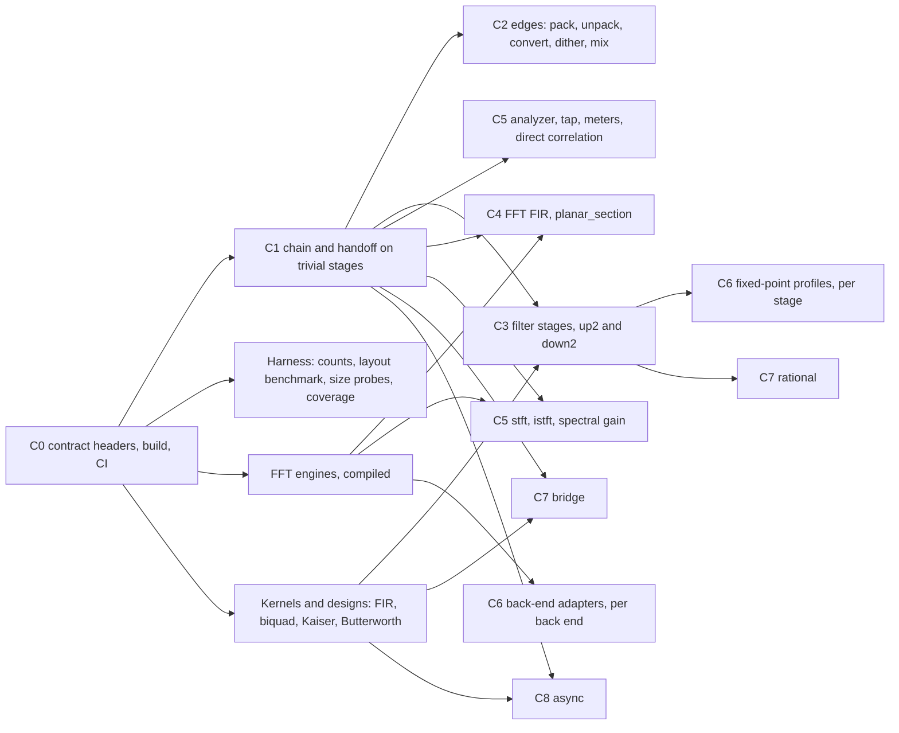

# catenae — plan (draft 18)

**catenae**: Chainable Audio Transforms for Embedded, Native & Accelerated Environments.

A C++17 library of audio processing *stages*, the *chain* that composes them, and the
*junctions* that join chains across threads and clocks. A stage has a contract stated as
numbers (ports, ratio, latency, tail); a chain is a type the caller writes from stages, and it
composes those numbers; a junction has a contract of the same kind for the place where two
call sites meet.

Status: draft for the maintainer's review. Nothing here is built, and every code listing in
section 9 is a proposal that has not been compiled. Section 13 lists the open questions.

Evidence: the layout spike of November 2026 (DspTap and SampleRateTap branches
`ccr-ef01ff18-nxz8n4`; DspTap `bench.yml` runs 153, 157, 161) and the write-up
"Interleaved or Planar: A Short Book for the Tap Chain". Section 12 says what those two
libraries have changed since and what that does to the evidence.

---

## 0. Why a new library

`tap::dsp::chain` was built as the composition point for SampleRateTap's rate converters. Its
stage contract assumes one sample type, one channel count and interleaved frames, in and out.
That is right for a converter and too narrow for a general library of stages: it cannot
express a format converter, a layout converter, a mixer, a spectral region or an analysis
tap. Widening it in place would break every consumer of `chain.h` for needs those consumers
do not have. catenae starts from the wider contract instead, in C++17, with no compatibility
debt, and with the constraints of safety-related embedded code designed in from the first
header rather than retrofitted.

## 1. Decisions

Status: **settled** is the maintainer's own statement. **accepted** is a proposal the
maintainer reviewed on 2026-11-24 ("I mostly agree") without objecting to that row; it stays
open to change. **proposed** was new in its draft.

On 2026-11-24 the maintainer accepted the plan as a whole at draft 17 ("I like the plan").
Rows still marked proposed are accepted with it, and the open questions of section 13 stay
open.

| # | Decision | Status |
|---|---|---|
| D1 | The name is `catenae`; the repository is `tap/catenae`. | settled |
| D2 | The language is C++17, strictly: one code path, and every file compiles to the same thing at `-std=c++17`, 20 and 23. No C++20 feature appears, not even behind a feature test. Where the standard library only has a type from C++20 on, catenae writes its own (`catenae::span` first). | settled |
| D3 | DspTap and SampleRateTap are sources of material, not dependencies: no submodule, no link. Code is carried in by copy, ported, and recorded in `NOTICE.md` with the commit it came from. | settled |
| D4 | MIT. Not header-only: templates whose compile-time numbers matter stay in headers, and everything else is compiled once into a static library, `catenae` (section 7). The FFT is behind one compiled interface, its back end chosen when the library is built. | settled in principle (the maintainer rejected header-only); the split is accepted |
| D5 | The chain's native layout is interleaved, with the channel count a compile-time number. | accepted (measured: section 12) |
| D6 | A stage declares its input and output separately, each as a *port type* (section 3). Two stages join when one's output port and the next one's input port are the same type. | accepted; the port-as-a-type form is proposed |
| D7 | Planar is a typed region inside a chain: converter stages at its ends, a wrapper for convenience. | accepted |
| D8 | Byte order and packing exist only in *edge stages* at the ends of a chain: `unpack` and `pack`. They are stages, not junctions: one call, one thread, one clock, ratio 1:1. Only their outer port is unusual, a `wire` port of bytes, which no other stage accepts, so the type system keeps them at the ends. Inside, every sample is native. | accepted; the stage-not-junction reading is this draft's answer |
| D9 | One latency report per stage (nominal, deviation, exactness, group delay) and one flush contract with a stated residue. | accepted |
| D10 | Capabilities are published as constants and checked by one `stage_traits<T>`; nothing detects a capability by probing for a member. | accepted |
| D11 | Read-only analysis (meters, correlation, pitch) is a sibling `analyzer` concept; `tap<Analyzer>` is the stage that puts one in a chain, passing the audio through. | accepted |
| D12 | The Tap libraries' engineering discipline carries over: contracts as numbers pinned by tests; fixed-point profiles opt-in per stage; processing `noexcept`; published literature only; honest limits stated and pinned. Three points of it are made stricter here: D21, D22 and D24. | accepted |
| D13 | A chain is written by the caller as a type. Nothing is looked up from a rate pair or built from a run-time description. | accepted |
| D14 | catenae is not part of the TapHouse family. Its namespace is `catenae::` and its banner is `Copyright 2026 Timothy Place and the catenae contributors`. | settled |
| D15 | catenae and SampleRateTap coexist for good. Neither depends on the other, and catenae's stage contract owes `tap::dsp::sync_stage` nothing. | settled |
| D16 | Once the architecture is settled and stable, catenae duplicates all of SampleRateTap's functionality (`rational`, `bridge`, `async`), re-implemented on catenae's contracts. The architecture is not called stable until it is shown that they fit. | settled |
| D17 | A port has a *signal kind*: time-domain audio, frames of transform coefficients, or wire bytes. Each kind is its own port template, so a transform-domain region (analysis, coefficient stages, synthesis) is typed in a chain and a time-domain stage after an analysis does not compile. | accepted |
| D18 | The stage contract is fixed-ratio: every stage's ratio is a compile-time L/M and `outputs_for` is exact. | accepted |
| D19 | A *junction* is a first-class concept beside the stage, with its own contract (section 6), for the place where two threads or two clocks meet. The asynchronous converter is a junction. A chain never contains one. | accepted |
| D20 | The naming and formatting rules are the Tap rules, enforced by `.clang-format` and `.clang-tidy` in CI; the files are owned here, with no drift check against TapHouse. | settled |
| D21 | No exceptions and no RTTI, ever. Every build is `-fno-exceptions -fno-rtti`; no `throw`, `try`, `dynamic_cast` or `typeid` appears; there is no second configuration. Whatever can fail does so through a returned `status` or `expected<T, status>`, and only outside the audio path (section 3.3). | settled |
| D22 | No heap. The library never calls `new`, `malloc` or an allocating standard container, at construction or afterwards. Every buffer is a member whose size is a template argument, or storage the caller supplies as a span. | proposed (follows from D23; it replaces the Tap rule "allocate at construction") |
| D23 | catenae is written with MISRA C++:2023 and ASIL B in mind, as a precaution: there is no requirement today, one may come, and there is no checker. So the constraints that are expensive to retrofit are designed in now (section 8), and nothing is claimed: no compliance statement, no compliance matrix, no safety case. | settled |
| D24 | `float` is the default sample type and `double` is the golden model. An unsuffixed name is the `float` stage (`gain<2>`); `_f64`, `_q15` and `_q31` name the others. Every profile's numbers are stated against the `double` one, which never changes for speed. | settled (the naming is proposed) |
| D25 | A frame of transform coefficients is, per channel, N/2 + 1 bins of `complex<S>` (real then imaginary, adjacent), DC to Nyquist, all stored; channels follow one another whole (section 5.2). | proposed |
| D26 | Build systems: CMake first; waf supported and built in CI from C0; a Zephyr module when a consumer needs it. One amalgamated source file exists for anything else. | settled as to which; the timing is proposed |
| D27 | Joints inside a chain are checked at compile time and cost nothing at run time: the port types match, and the chain's scratch is proven large enough by a `static_assert` on each stage's `max_outputs_for`. A run-time *boundary* check exists only where the caller's own buffers enter, at a chain's `process` and a junction's `push` and `pull`; it is written once, generically, from the traits, and is on in every build. With fixed-extent spans that check is compile-time too. An *audit* check, inside the library's own loops or on what the host is responsible for, is on in debug builds only. One generated header sets the level for the whole image and a link-time guard refuses a mix (section 3.3). | proposed (the maintainer's correction of draft 8: no run-time checks between stages) |
| D28 | FFT back ends (section 7.1): catenae's own engines are the default on every target and the only ones in this repository. CMSIS-DSP and Apple's vDSP are opt-in, chosen when the library is built, and never vendored: the consumer's own copy is used. | proposed |
| D29 | A fixed-point port names its Q format, and the format is part of the port's type: `port<fixed<std::int32_t, 27>, Ch>` is Q4.27 audio, and joining it to a Q0.31 port does not compile. The format is a compile-time tag only; buffers hold raw `int16_t` and `int32_t`, never a wrapper class. Moving between formats is an explicit `convert` stage (a shift, with its rounding and saturation stated). Any format can be named, so one that becomes useful later (Q1.14 between 16-bit stages) is an addition and not a redesign; a stage accepts only the formats its battery pins (section 3.1). The first set: `q15`, `q31` and Q4.27. | accepted (2026-11-24) |
| D30 | Public constants have no prefix. A stage's contract reads as the standard library's traits do: `rate_ratio`, `is_in_place`, `has_exact_latency` (compare `std::numeric_limits<T>::is_signed`, `std::chrono::steady_clock::is_steady`). The `k_` prefix stays for constants that are not part of the public interface: private members and everything in `detail`. This is the first place catenae's style departs from the Tap rules (D20). | settled (the names chosen are proposed) |
| D31 | Warnings are errors, and the set is strict (section 7.2): the conversion, sign, shadowing, double-promotion, old-style-cast and switch warnings of every compiler in CI, on catenae's own code and on a consumer's view of its headers. A suppression is a recorded deviation, never a habit. | settled as a direction; the flag sets are proposed |
| D32 | Documentation is four kinds of document with one job each (README, guide, reference, record), plus executed notebooks and generated measurement tables, under rules that keep it short: one home per fact, a fixed contract card per stage, headers that describe only the present, and length budgets enforced in CI (section 11). | proposed |

## 2. Charter

**In:** 1:1 stages (filters, gain, delay, mixing, nonlinearities, dynamics without a side
chain), rate-changing stages by a compile-time ratio L/M, sample-format, layout and wire
converters, transform-domain regions (analysis, coefficient stages, synthesis), the chain,
analyzers and their tap, junctions, and the measurement harness that tells us which layout
each stage wants.

**In, after the architecture is stable (D16):** everything SampleRateTap does: `rational`
first (its stages are already chain stages), then `bridge` (one fixed-ratio converter), then
`async` (a junction).

**Out, at least until 1.0:**

- Stages with two audio inputs (side-chain compressors, convolution against a live signal).
- A run-time graph: no dynamic routing, no plug-in host, no patch format.
- Pitch shifters and other processes with their own framing and latency model.
- Elastic processes inside one clock domain (time-stretch, varispeed).
- Anything defined by imitating a product rather than by a published method.

## 3. Ports and the stage contract

### 3.1 Ports

A port is a type. Two stages join when the types are the same, so the joint rule is one
`std::is_same` and one `static_assert` message.

| Port | Carries | A frame is |
|---|---|---|
| `port<S, Ch, layout::interleaved>` (the default layout) | time-domain audio in sample format `S`: `float`, `double`, or a fixed-point format (below) | `Ch` samples |
| `port<S, Ch, layout::planar>` | the same, a channel at a time | `Ch` samples, each channel's run contiguous within a call |
| `spectrum<S, Ch, Bins>` | transform coefficients (D25) | `Ch * Bins` values of `complex<S>` |
| `wire<Format, Ch>` | bytes on their way in or out (`s16le`, `s24le_packed`, `s24be_in_32`, ...) | `Ch * bytes_per_sample` bytes |

**Fixed-point formats (D29).** `fixed<Storage, F>` is a signed two's-complement format with
`F` fractional bits in `Storage` (`std::int16_t` or `std::int32_t`); the integer bits are
what is left after the sign. `q15` is `fixed<std::int16_t, 15>` and `q31` is
`fixed<std::int32_t, 31>`, the two formats that match a wire. A raw `int16_t` is not a
sample format: a port always says where its binary point is. The notation is stated once
because the industry's differ: here Q4.27 means one sign bit, 4 integer bits and 27
fractional bits.

What the formats between Q0.15 and Q0.31 are for is headroom. A chain in Q0.31 saturates at
every stage whose output can exceed full scale (a peaking filter's boost, a resonance's
overshoot, a mix's sum), and each saturation is audible. A chain in Q4.27 carries 24 dB
above full scale between its stages and saturates once, at the `convert` back to the wire
format, which is how fixed-point audio processors are conventionally built. Because the
format is in the port's type, the joint check of D27 covers it at compile time and every
shift is a constant.

**What exists already.** There are no fixed-point *types* in the Tap libraries, on purpose:
the arithmetic lives in traits over raw integers, so that the headroom bits, the
pre-shifts and the single rounding point of each datapath stay visible and pinned. Three
sets are carried in (section 12):

| Traits | For | What they fix |
|---|---|---|
| `sample_traits` | FIR datapaths | Q1.14 and Q1.30 coefficients, a 64-bit accumulator, one rounding point (round half up), a saturating output |
| `iir_traits` | recursive kernels | Q2.29 and Q2.60 states with two guard bits, Q2.30 coefficients, exact 64- and 96-bit products, truncation chosen per section so no limit cycle survives, saturation at the output only |
| `fft_arith` | FFT butterflies | Q1.30 twiddles, saturating add and subtract, a rounding shift, block headroom |

They are keyed on `int16_t` and `int32_t` and named for Q0.15 and Q0.31, but a linear
kernel does not know where the binary point is: the same integer arithmetic filters Q4.27
and Q0.31 alike, bit for bit. So for a linear stage a new format costs no new kernel and no
new measurement. Its floor in LSBs is the one already pinned, and its signal-to-noise ratio
against nominal full scale is that floor less the headroom (24 dB less in Q4.27), a derived
number with one test to pin it.

What has to be written:

- the `fixed<Storage, F>` tag and the traits' lookup through it;
- `convert` between formats: a shift with stated rounding and saturation (the rounding and
  saturating helpers exist);
- a small set of scalar helpers for stages that are not filters (a saturating multiply for
  `gain`, a saturating sum for `mix`);
- the places where the binary point does matter: a nonlinearity, dither's amplitude, a
  threshold or a meter in dBFS. These take `F` from the format.

One thing in the carried arithmetic needs a decision under D23: it shifts negative signed
integers right, which every compiler catenae targets does arithmetically but which C++17
leaves implementation-defined. It goes through one helper with one recorded deviation,
rather than being scattered.

The limit: a stage's noise floor and saturation-free level are numbers that depend on the
format, and a number nobody measured is not a contract. So a stage's fixed-point profile
lists the formats its battery pins and a `static_assert` refuses the rest; widening the list
is adding rows to the battery, which for a linear stage is the derived row above.

The same tag settles half of an open question: an FFT with the fixed scaling policy grows
its output by a known number of bits for a given length, so the spectrum's format can carry
that as its type and no exponent travels with the frame. Only the block-floating policy
still needs a run-time exponent.

### 3.2 What a stage declares

Read through `stage_traits<T>`, which fails with one readable `static_assert` per missing or
ill-typed member.

| Member | Meaning |
|---|---|
| `input_port`, `output_port` | The two port types. |
| `rate_ratio` | `ratio{up, down}`, reduced. For an analysis stage it is 1 / hop. |
| `is_in_place` | Whether `run` may read and write one buffer. |
| `has_exact_latency` | Whether the stage delays every frequency alike. |
| `run(in, out)` | The stage's work, trusted: spans of the ports' value types, already known to be the right sizes; consumes all of `in`; returns the frames written. `noexcept`, no allocation, no failure, no boundary check. Called by a chain, not by the caller's code (section 3.3). |
| `outputs_for(n)`, `frames_needed(k)` | Exact, from the current position. |
| `max_outputs_for(n)` | An upper bound from any state, `constexpr`. The chain sizes its scratch from this. |
| `reset()` | Back to the constructed state. |
| `latency()` | `{nominal, deviation}` in output frames; deviation 0 when exact. Plus `group_delay(f)`. |
| `tail_frames()`, `flush_residue()` | Zero input frames after which the output is silence within the residue (0 for FIR; a stated bound for a floating-point recursion). |

### 3.3 Failure, without exceptions (D21)

- **The audio path cannot fail.** `run`, `process`, `push`, `pull` and `reset` return counts,
  never errors. What they require of the caller is a precondition.
- **Design is where failure lives.** Anything computed from run-time numbers (a cutoff, a
  set of taps) is a *design*: a small value type produced by `T::make(args)`, which returns
  `expected<T, status>`: the value or the reason there is none, held by value (no pointer,
  no heap). `catenae::expected` is written here because the standard library only has it
  from C++23, and it follows `std::expected`'s interface as `catenae::span` follows
  `std::span`'s: `has_value()`, `operator bool`, `operator*`, `operator->`, `value()`,
  `error()`, `value_or()`. So it reads as the standard type does and can be replaced by it
  one day. Two differences, both forced by D21: `value()` on an empty one cannot throw, so
  it is a violated precondition (the handler), and so is `operator*`, which the standard
  leaves undefined. `expected` and `status` are `[[nodiscard]]`, so an ignored failure is a
  warning and, under D31, an error.

**Where checks happen (D27).**

| Where | What is checked | When |
|---|---|---|
| A joint between two stages | The port types are the same; the scratch between them holds `max_outputs_for` of a block | Compile time. Nothing at run time. |
| The caller's entry: `chain::process`, a junction's `push` and `pull` | The input is a whole number of frames; the output span holds `outputs_for(n)` frames | Once per call, in every build. At compile time instead, when the caller passes fixed-extent spans. |
| Inside the library: a kernel's indices, a state invariant, a stage returning more than its own `max_outputs_for`, the host's flush-to-zero setting | The library's own promises, and the host's | Debug builds only (audit). The battery and its coverage are the proof. |

- **A stage has no checked entry of its own.** It implements `run`, which trusts its spans.
  The checked entry is the chain's `process`, so a stage used alone is a chain of one. The
  boundary check is therefore one function, written from `stage_traits` and tested once, and
  a stage author cannot forget it or get it wrong.
- **Fixed blocks need no run-time check at all.** Most embedded callers process a fixed
  block. `process(span<const S, N * Ch>, span<S, M * Ch>)` checks `M >= max_outputs_for(N)`
  with a `static_assert`; the dynamic-extent overload is the one that checks at run time.
- **Content is not a precondition.** Any bytes are valid samples, so a wire stage needs no
  check on what it reads. A non-finite float from outside is not a memory fault either; it
  poisons a recursive state until `reset()`. A caller who cannot vouch for its input puts an
  explicit `sanitize` stage at the edge, which is a stage with a cost, not a hidden check.
- **A failed check** calls one `[[noreturn]]` handler that the integrator supplies at link
  time (the default traps). It receives a small enumerated code, not a file name and a
  message, so checks add no strings to ROM.
- **One level per image.** Checks are inline functions, not macros. Whether audit checks
  are on is one generated header, `catenae/config.h`; each object file refers to a symbol
  named for its level and the compiled library defines only its own, so an image that mixes
  levels fails to link.

## 4. The chain

- `chain<Stages...>`, built by `a | b | c`.
- At each joint the output port of one stage is the input port of the next, or the chain
  does not compile.
- Composes ratio, `outputs_for`, `frames_needed`, latency, tail and residue. A chain is
  itself a stage, so chains nest.
- Scratch is a member array (D22), sized from each stage's `max_outputs_for` at a
  compile-time block length (64 frames unless the chain is told otherwise), with a
  `static_assert` that each buffer holds what the stage before it can write. `process` is
  the caller's entry and the only place a run-time size check is made; it accepts any length
  and works through it a block at a time, calling each stage's `run`. A chain has `run` as
  well, which is what an enclosing chain calls. A run of `is_in_place` stages
  shares one buffer.
- Bit-identical for any chunking of a stream, under the library's floating-point contraction
  policy.
- One call, one thread, one clock. A chain holds no junction (D19).

## 5. Layout and signal kind

### 5.1 Time-domain audio

- Interleaved, compile-time channel count, is the default for every stage with state.
- `deinterleave<S, Ch>` and `interleave<S, Ch>` are 1:1 stages between the two layouts.
- `planar_section<Stages...>` de-interleaves once per block, runs mono stages over contiguous
  channels, re-interleaves, and presents itself as an interleaved stage.
- Each stage's row in the layout benchmark is the evidence for its preferred layout.

### 5.2 Transform coefficients: the format of a spectrum (D25)

For a real input of N samples per channel, one frame of `spectrum<S, Ch, N/2 + 1>` is:

```
channel 0:  re[0] im[0]  re[1] im[1]  ...  re[N/2] im[N/2]
channel 1:  re[0] im[0]  re[1] im[1]  ...  re[N/2] im[N/2]
...
```

- **Real and imaginary parts are interleaved**, as `catenae::complex<S>`, a plain
  `{S re; S im;}`. (`std::complex` is specified only for floating types, and Q15 and Q31
  need the same shape.) This is the layout of `std::complex`, CMSIS-DSP's real FFT and most
  other back ends, so their output is the frame with no copy.
- **Every bin from DC to Nyquist is stored, zero imaginary parts included**: N + 2 scalars
  per channel. DspTap's packing saves the two zeros by keeping the Nyquist bin's real part
  at index 1; catenae spends them so that a coefficient stage is one uniform loop over bins
  with no special index.
- **Channels are not interleaved.** Each channel's spectrum is contiguous and the channels
  follow one another. An FFT transforms one channel's contiguous samples, so the analysis
  stage de-interleaves as it windows (the FFT FIR stage in the spike already did, and still
  beat a stage per channel by 4 to 16 %). A spectrum is therefore always "planar by
  channel", and has no layout parameter.
- **Sign and scale.** Forward is `sum x[n] exp(-i 2 pi k n / N)`, unnormalized: the textbook
  convention and the accelerated back ends'. DspTap's engine uses `exp(+i)`; the carried
  engine is conjugated in its post-pass. An analysis and synthesis pair states its overall
  gain (1) and its reconstruction error as numbers.
- **Fixed point.** A Q15 or Q31 spectrum needs a block exponent per channel per frame, as
  DspTap's fixed FFT returns one. Where it travels is open (section 13).
- **The alternative, split complex** (all real parts, then all imaginary: vDSP's native
  form) vectorizes magnitude and gain loops more easily. It is measured against the
  interleaved form in the layout benchmark before D25 is frozen; a vDSP back end converts
  at its boundary either way.

A transform-domain region is an analysis stage (audio in, spectrum out, ratio 1 / hop),
stages whose ports are both spectra, and a synthesis stage back to audio.

## 6. Junctions

A stage lives inside one call, on one thread, in one clock domain. A junction is where two
call sites meet: two threads, two clocks, or both. It is defined the way a stage is, by a
contract read through `junction_traits<T>`.

| Member | Meaning |
|---|---|
| `sink_port`, `source_port` | Port types, as a stage's. |
| `clocking` | `clocks::shared` (two threads on one clock) or `clocks::independent`. |
| `rate_ratio` | The nominal rate ratio between the two sides (1:1 for a near-unity converter). |
| `tolerance_ppm()` | Independent clocks only: the offset and drift the junction absorbs. |
| `push(in)` | Called by exactly one thread. Returns the frames accepted; what happens to the rest (dropped, counted) is stated. `noexcept`, wait-free. |
| `pull(out)` | Called by exactly one other thread. Always fills `out`; the frames it could not supply are silence, and it returns how many were real. |
| `status()` | Any thread: state (filling, locked), fill, underruns, overruns, the rate estimate where there is one. |
| `latency()` | `{nominal, range}` in source frames: a junction's delay breathes with its fill, so it is never exact. |
| `capacity_frames` | A template argument (D22). |
| `reset()` | Only while neither side is running; a stated precondition. |

Instances: `handoff<S, Ch, Capacity>` (a single-producer, single-consumer ring: shared clock,
two threads; the trivial junction, which proves the contract as `gain` proves the stage's);
the asynchronous converter (D16); later and outside today's charter, a jitter buffer.

`feeding(chain, junction)` runs a chain and pushes what it wrote; `fed_by(junction, chain)`
pulls what a chain needs and runs it. Each checks the port where it joins. There is no `|`
across a junction and no type that holds both sides: the thread boundary stays visible in
the caller's code. Latency across a junction composes as nominal only.

## 7. Headers, the compiled core and the build

| Parameterized on | Where it lives | Examples |
|---|---|---|
| A compile-time number measured to matter (channel count, section count, ratio, block length), or a loop that must inline into a stage's per-sample loop | Header template | The stages, the chain, `feeding` / `fed_by`, the FIR dot kernels, the biquad block kernel, `span`, the traits |
| Only the sample type (a closed set of four) and sizes passed at run time | Compiled, explicitly instantiated for the four types | The FFT engines, bulk wire `pack` / `unpack`, the asynchronous converter's servo, the analysis instruments |
| Nothing (design-time arithmetic in `double`) | Compiled | The Kaiser and Nyquist designers, the Butterworth and biquad designs, the flush-window computation, group delay |

What this buys:

1. **One definition per image.** The spike hit the header-only failure twice: two files
   built with different contraction flags shared one inline kernel, and DspTap needs an ABI
   tag on every class that embeds the FFT. A compiled FFT has one back end per library build.
   It works on storage it is handed (a member array sized by the transform length, or a
   caller's span); it allocates nothing (D22).
2. **The numeric contract is the library's.** The compiled core is built with catenae's own
   contraction policy, so its bit pins hold whatever the consumer passes. Header templates
   still compile under the consumer's flags, and the contract says so.
3. **ROM.** Compiled code is one copy, can be built for size, and is dropped when unused.
   Design code in `double` need not link at all when a design is a table (section 3.3).
   These are predictions: each component that could go either way gets a size probe in both
   forms on the embedded targets, and the table above is corrected where a probe disagrees.

### 7.1 FFT back ends (D28)

| Back end | Sample types | Where | How it arrives |
|---|---|---|---|
| catenae's own floating engine (DspTap's srdif engine, ported) | `float`, `double` | everywhere; the default | source in this repository |
| catenae's own fixed-point engine (DspTap's, ported) | Q15, Q31 | everywhere; the default | source in this repository |
| CMSIS-DSP | `float`, Q15 and Q31, which it provides alike (Helium on the Cortex-M55, Neon on Cortex-A); the `float` adapter first, the fixed-point ones with C6 | Arm, opt-in | the consumer's copy: an existing CMake target or a path given at configure time. CI fetches one pinned release by hash. |
| vDSP (Accelerate) | `float` first | Apple, opt-in | the system framework; nothing to bring in |

- **Own engines are the reference.** They are the only FFT code in the repository, the only
  ones inside D21 to D23, and the ones whose output bits are pinned. An accelerated back end
  re-presents the same contract (D25's frame, the sign, the scale) within a stated tolerance
  of the `double` engine, proven by a parity battery on the leg that has the hardware.
- **Not vendored, because an embedded consumer nearly always has CMSIS-DSP already**, pinned
  by its silicon vendor's SDK. A second copy inside catenae would define the same symbols
  and either fail to link or, worse, link the wrong one. So catenae compiles its thin
  adapter against the copy it is pointed at, states the versions it is tested with, and
  under Zephyr uses Zephyr's CMSIS-DSP module.
- **One back end per sample type, chosen when the library is built.** Four options, each a
  choice from a validated list, all defaulting to `own`:

  | Option | Choices |
  |---|---|
  | `CATENAE_FFT_F32` | `own`, `cmsis`, `vdsp`, `none` |
  | `CATENAE_FFT_F64` | `own`, `vdsp`, `none` |
  | `CATENAE_FFT_Q15` | `own`, `cmsis`, `none` |
  | `CATENAE_FFT_Q31` | `own`, `cmsis`, `none` |

  An option per type, rather than one list of pairs such as `cmsis-f32;own-q15`, because
  every type then has exactly one back end by construction (a list can name two for a type
  or none), CMake validates and offers each choice, and the same four options map one to
  one onto waf options and Zephyr Kconfig choices. `none` leaves that type's FFT out of the
  build, so an image carries no transform it does not use, and a stage that needs it fails
  to compile with a message naming the option. The choices are written into
  `catenae/config.h`, under the same link-time guard as the check level (section 3.3).
- **No silent fallback.** A back end serves its own range of lengths. A stage whose length
  is a template argument outside that range fails to compile; a run-time length outside it
  is a `status` from `make()`. Falling back to `own` would change the output bits without
  the caller knowing.
- **The adapter converts** the back end's native packing to D25's frame (CMSIS-DSP packs
  the Nyquist bin beside DC; vDSP is split complex).
- **CMSIS-DSP's fixed-point transforms scale differently from catenae's own.** They shift
  down as they go, by an amount fixed by the length, so their output is in a Q format that
  depends on the length, and they have no block-floating mode. That fits D29: the format
  is a compile-time number the spectrum's type can carry. What has to be settled when the
  adapters are written is whether the contract's format for a length is CMSIS-DSP's or
  catenae's own engine's (the adapter shifts where they differ), and the floor each is
  held to against the `double` engine, since a fixed down-scaling costs low-order bits
  that block floating keeps. This paragraph is from memory of CMSIS-DSP's documentation
  and is checked against it then.
- **Honest limits.** A back end's code is not catenae's: vDSP allocates when a setup is
  created, which is a recorded exception to D22 on Apple hosts only; and each back end
  serves its own range of transform lengths, stated as contract numbers.
- **Not planned:** FFTW (GPL); a Hexagon HVX back end until a consumer needs one, where it
  would link the vendor's library from the consumer's SDK in the same way.

### 7.2 Warnings and errors (D31)

**The sets.** Each is `-Werror` (`/WX`) in CI, on every leg.

| Compiler | Flags |
|---|---|
| GCC (hosted and `arm-none-eabi`) | `-Wall -Wextra -Wpedantic -Wshadow -Wconversion -Wsign-conversion -Wdouble-promotion -Wfloat-equal -Wold-style-cast -Wuseless-cast -Wcast-align -Wcast-qual -Wundef -Wnull-dereference -Wformat=2 -Wimplicit-fallthrough -Wswitch-enum -Wduplicated-cond -Wduplicated-branches -Wlogical-op -Wmissing-declarations -Wredundant-decls -Wzero-as-null-pointer-constant -Wextra-semi -Wvla`, and `-Wstack-usage=` at each target's stack ceiling |
| Clang (hosted, Apple, Hexagon) | `-Weverything`, less a short list that is written down with a reason for each entry: the C++98 compatibility groups, `-Wpadded`, and whatever else earns its place there. Starting from everything means a new Clang's new warnings arrive switched on. |
| MSVC | `/W4 /permissive-` and the level-4-off conversion and shadowing warnings raised to errors by number |

**Why each strict group is there.**

- **Shadowing** (`-Wshadow` in GCC's full form, Clang's `-Wshadow-all`, MSVC's C4456 to
  C4459): a local, a parameter or a lambda capture never hides a member, an enclosing local
  or a global. Private members' `m_` prefix already keeps constructor parameters clear.
- **Double promotion and float conversion**: with `float` the default (D24), one stray
  `double` literal in a loop is software floating point on a core without a double FPU.
  These two warnings are how that is caught at compile time and not in the ratchet.
- **Conversion and sign conversion**: the fixed-point arithmetic is where a silent
  narrowing is a wrong sample.
- **Float equality**: an exact comparison is sometimes right (a state that is exactly
  zero). It goes through one named helper, so each use is deliberate.

**The rules around the flags.**

- **A consumer's view is tested too.** Header templates compile in the consumer's files
  under the consumer's flags. Each public header is compiled alone, in a file of its own,
  under the strictest set of each compiler, so a consumer who builds with `-Weverything`
  sees nothing from catenae. catenae's headers are never marked as system headers to hide
  a warning; third-party ones (CMSIS-DSP, the test framework) are.
- **Warnings as errors is the default where catenae is the project being built, and off
  where it is consumed** (`add_subdirectory`, a waf subproject): a consumer on a newer
  compiler must not have their build broken by a warning that did not exist when a release
  was cut. CI adds each new compiler version deliberately and fixes what it finds.
- **A suppression is a deviation.** A `#pragma` that silences a diagnostic, or a `NOLINT`,
  carries a reference to an entry in the deviation log (section 8), and CI counts them
  against the log.
- **Beyond warnings:** `clang-tidy` findings are errors; one hosted leg runs the battery
  under the address and undefined-behaviour sanitizers, which is where the arithmetic that
  the warnings cannot see (a shift, a signed overflow) is caught.

**What D30 and strict shadowing cost each other.** The `k_` prefix was doing a second job:
a public constant named `channels` now shares a namespace with every parameter someone
would naturally call `channels`, and `-Wshadow` reports it. Likewise a member named `ratio`
cannot be of a type named `ratio`. So public constants take names that do not collide
(`rate_ratio`; the channel count is read from the port type, not from a member), and the
shadowing warning is what enforces it. One thing to verify at C0: whether `clang-tidy`'s
naming check can tell a public constant from a private one. If it cannot, a small script
checks D30.

**Build systems (D26).** The library is always built from source in the consumer's build,
with the consumer's target flags, and never shipped prebuilt.

- **CMake**: the reference build. `add_subdirectory`, one target.
- **waf**: a maintained `wscript`, built and tested in CI from C0, so it cannot rot.
- **Zephyr**: a module file and Kconfig over the CMake build, added when a consumer needs it.
- **Anything else**: one amalgamated `catenae.cpp`, generated in CI.

## 8. MISRA C++:2023 and ASIL B (D23)

MISRA C++:2023 is written for C++17, which is the language D2 already fixed. ISO 26262 does
not certify a library on its own: a component is developed as a safety element out of
context, against assumed requirements, and the integrator's safety case takes it from
there. What catenae can do is be built so that this is possible and cheap. The posture:

**Designed in from C0, because retrofitting them is expensive:**

- No exceptions, no RTTI (D21); no heap (D22); no recursion; every loop bounded by a
  number the contract states.
- No undefined or implementation-defined behaviour relied on: fixed-width integer types,
  no signed overflow (fixed point saturates or widens by rule), spans in place of pointer
  arithmetic in every interface.
- Every contract point is a requirement with an identifier (`CAT-STAGE-007`), and the test
  that pins it cites the identifier. The house rule "a test is named for the promise it
  pins" becomes requirement-to-test traceability with no new tool.
- Worst-case behaviour is a number: the instruction-count ratchet's worst single call and
  the stack ceilings (both carried from SampleRateTap's harness) are per-stage contract
  points.
- A deviation log from the first commit. Some family habits will need a recorded deviation
  or a replacement: function-like macros for preconditions, `memcpy`-based bit casts, the
  `|` operator as a builder.

**In CI from C0:** statement and branch coverage of the compiled core and of each
instantiation the battery makes; the static analysis that is free (`clang-tidy`'s checks,
compiler warnings as errors). These approximate a MISRA checker; they are not one.

**Deferred until a requirement arrives:** a MISRA checker for the 2023 edition, the
guideline-by-guideline compliance matrix, a safety plan, a safety manual for integrators and
an assessment. The deviation log is kept from the start anyway, as a plain list of the
places where the code knowingly does what a strict reading would forbid, because it is
cheap to write as the code is written and expensive to reconstruct.

A caution on this section: the MISRA document is licensed and was not available while this
plan was drafted. No rule is quoted or numbered here, and the list of likely deviations is
from memory. It should be checked against the text when a copy is to hand.

## 9. What the code is proposed to look like

Sketches, not compiled. Their purpose is to make the contracts above concrete enough to
argue with.

### 9.1 A stateless stage: gain

```cpp
namespace catenae {

    /// out = in * g on every channel. The floating form; Q15 and Q31 go through sample_traits.
    template <typename S, std::size_t Ch>
    class basic_gain {
      public:
        using input_port  = port<S, Ch>;   // interleaved audio unless a port says otherwise
        using output_port = port<S, Ch>;
        static constexpr ratio rate_ratio{1, 1};
        static constexpr bool  is_in_place      = true;
        static constexpr bool  has_exact_latency = true;

        explicit constexpr basic_gain(S g) noexcept
            : m_gain(g) {}

        // Trusted: the chain has already proven the spans' sizes (section 3.3).
        std::size_t run(span<const S> in, span<S> out) noexcept {
            const S g = m_gain;
            std::transform(in.begin(), in.end(), out.begin(), [g](S x) noexcept { return x * g; });
            return in.size() / Ch;
        }

        static constexpr std::size_t    outputs_for(std::size_t n) noexcept { return n; }
        static constexpr std::size_t    frames_needed(std::size_t k) noexcept { return k; }
        static constexpr std::size_t    max_outputs_for(std::size_t n) noexcept { return n; }
        static constexpr latency_report latency() noexcept { return {0.0, 0.0}; }
        static constexpr std::size_t    tail_frames() noexcept { return 0; }
        void                            reset() noexcept {}

      private:
        S m_gain;
    };

    template <std::size_t Ch> using gain     = basic_gain<float, Ch>;  // float is the default (D24)
    template <std::size_t Ch> using gain_f64 = basic_gain<double, Ch>; // the golden model

} // namespace catenae
```

**Algorithms or loops.** A stage that maps each sample on its own (gain, `map`, `convert`,
a fill of silence) is written with a standard algorithm, as above: there is no index to
get wrong, the intent is in the name, and `std::transform` may write over its own input,
which is what `is_in_place` promises. `gain` is in effect `map` with a multiply, and may
simply be defined as that, leaving one audited loop for all of them. A kernel with state
carried from sample to sample, or a pattern across channels (a biquad, an FIR dot product,
a per-channel gain over interleaved frames), stays a plain indexed loop inside its kernel
function: no algorithm expresses it, and those loops are the seams for the vector back
ends. The kernels are then the only places with index arithmetic, which keeps what must be
reviewed for it small. Two conditions: the ratchet confirms on every target that the
algorithm form counts the same as the loop (it compiles to the same loop, but that is a
measurement, not an assumption), and nothing meant to be evaluated at compile time uses
one, because the standard algorithms are not `constexpr` before C++20.

### 9.2 A stage with a design: Butterworth

The design can fail and runs in `double`; the stage cannot fail and runs in its sample type.

```cpp
// At start-up, outside the audio path. `designed` is a value, not a pointer:
// catenae::expected<butterworth_design<4>, status>, with std::expected's interface.
const auto designed = catenae::butterworth_design<4>::make(0.1);
if (!designed) {
    return designed.error();                                     // status::cutoff_out_of_range
}
catenae::butterworth<4, 2> lowpass(*designed);                   // order 4, stereo, float; noexcept

// Or with no designer in the image: the same value type as a table in ROM.
constexpr catenae::butterworth_design<4> k_lowpass_design = { /* generated, bit-pinned */ };
catenae::butterworth<4, 2> fixed_lowpass(k_lowpass_design);

// In the audio path. A stage on its own is a chain of one, which supplies the checked entry:
auto filter = catenae::chain(lowpass);
filter.process(in, out);                                         // one size check, then run()
const catenae::latency_report l = lowpass.latency();             // {4.02, 2.51} frames at fc = 0.1
```

### 9.3 A chain: four-times oversampling around a tanh overdrive

```cpp
// A stateless nonlinearity: any noexcept callable, a sample at a time, through map<>.
struct soft_clip {
    float drive;
    float operator()(float x) const noexcept { return std::tanh(drive * x); }
};

using namespace catenae;

// Stereo, float. The type is the topology; nothing is looked up from a rate.
auto overdrive = up2<2>{} | up2<2>{} | map<2, soft_clip>{{4.0f}} | down2<2>{} | down2<2>{};

static_assert(stage_traits<decltype(overdrive)>::rate_ratio == ratio{1, 1});

const latency_report l = overdrive.latency();   // delay the dry path by l.nominal to mix it in
overdrive.process(in, out);                     // any length: one size check here, none between stages

// With a fixed block, no run-time check at all:
std::array<float, 64 * 2> block_in{}, block_out{};
overdrive.process(span<const float, 128>(block_in), span<float, 128>(block_out));   // static_assert
```

What the sketch leaves open: `up2` and `down2` take a profile (how much attenuation, how
wide a passband), and the second pair may relax theirs because they run at twice the rate.
The layout benchmark decides whether `map` wants a planar section on a wide vector unit.

### 9.4 A chain with a transform-domain region: a spectral gate

```cpp
using namespace catenae;

// Mono. 512-sample Hann frames every 128 samples: 257 bins of complex<float> per frame.
auto denoise = stft<512, 128, 1>{window::hann}
             | spectral_gate<257, 1>{k_gate_design}
             | istft<512, 128, 1>{window::hann};

//   stft's ports:          port<float, 1>             ->  spectrum<float, 1, 257>
//   spectral_gate's ports: spectrum<float, 1, 257>    ->  spectrum<float, 1, 257>
//   istft's ports:         spectrum<float, 1, 257>    ->  port<float, 1>

static_assert(stage_traits<decltype(denoise)>::rate_ratio == ratio{1, 1});   // 1/128 then 128/1

// What the type system refuses:
//   stft<512, 128, 1>{window::hann} | gain<1>{0.5f}
//   error: static assertion failed: catenae: joint 0: spectrum<float, 1, 257> feeds port<float, 1>
```

### 9.5 Edges and a junction

```cpp
using namespace catenae;

// Audio callback thread: 24-bit packed little-endian stereo off the wire, into float.
auto input = unpack<wire::s24le_packed, 2>{}          // wire<s24le_packed, 2> -> port<int32_t, 2>
           | convert<std::int32_t, float, 2>{}        // port<int32_t, 2>      -> port<float, 2>
           | butterworth<4, 2>{k_lowpass_design};

handoff<float, 2, 1024> link;                         // capacity is a template argument: no heap

feeding(input, link).process(wire_bytes_in);          // runs the chain, pushes what it wrote

// Worker thread, same clock: mix to mono and meter it.
auto metering = mix<2, 1>{k_mono_mix} | tap<1, rms_meter>{};
fed_by(link, metering).process(mono_out);             // pulls what the chain needs, runs it
```

### 9.6 Where the memory is, without a heap (D22)

Three patterns cover every case.

**Storage inside the object, sized by template arguments.** The object's size is known to
the compiler, so it can be static, and its RAM is a number in the map file.

```cpp
template <typename S, std::size_t Ch, std::size_t MaxFrames>
class basic_delay {
    // ...
    std::array<S, MaxFrames * Ch> m_line{};   // was: std::vector<S> m_line(max_frames * channels)
    std::size_t                   m_write = 0;
};

static catenae::delay<2, 480> s_align;                    // 10 ms of stereo float at 48 kHz, in .bss
static_assert(sizeof(s_align) <= 3840 + 2 * sizeof(std::size_t));
```

**Constant data stays in ROM and is viewed, not copied.**

```cpp
constexpr std::array<float, 63> k_taps = { /* generated, bit-pinned */ };   // .rodata

catenae::fir<63, 2> lowpass(k_taps);   // holds a span over k_taps: no RAM copy of the taps;
                                       // its only RAM is the history, std::array<float, 62 * 2>
```

**Storage the caller supplies, where a size is only known at run time.** The compiled core
never owns memory; it is handed a workspace and says how much it needs.

```cpp
// Compiled FFT: the length is a run-time number, the workspace is the caller's.
static std::array<float, catenae::fft_workspace_size<float>(1024)> s_workspace;   // constexpr size
const auto plan = catenae::fft_plan<float>::make(1024, s_workspace);              // expected<...>:
                                                                                  // status::workspace_too_small

// A header stage does this for its user: stft<512, 128, 1> has the right array as a member.
```

A chain follows the first pattern: its scratch is a member array, so `sizeof(overdrive)` is
the chain's whole memory, known at compile time, and a size probe records it.

What D22 costs, stated plainly:

- A size chosen at run time (taps read from a file) needs a maximum chosen at compile time
  or a caller's workspace.
- Objects are as large as their buffers. They belong in static storage or in a
  caller-owned arena, not on a small thread's stack.
- A template argument per size means an instantiation per size. The rule that keeps ROM
  flat: the storage is in the template, the arithmetic is in a kernel that takes spans, so
  `delay<2, 480>` and `delay<2, 960>` share their code.

## 10. Milestones

Each ends with its battery green on every CI leg and its numbers recorded.

| | Milestone | Contents |
|---|---|---|
| C0 | Skeleton | Repository layout, license, `NOTICE.md`, style files. The CMake build and the waf build, both in CI: hosted at `-std=c++17`, 20 and 23, always `-fno-exceptions -fno-rtti`; the Cortex-M and Hexagon QEMU legs. `span`, `status` / `expected`, the precondition handler, `sample_traits`, the ports, `stage_traits`, `junction_traits`, the contract documents with requirement identifiers. The static library with its first compiled unit, the amalgamation, a size probe per embedded target, coverage. The deviation log opened. The two precondition tiers, the handler and the link-time level guard. The compile-fail battery: one test per architectural rule (mismatched ports at a joint in each of the ways a port can differ; a junction inside a chain), each asserting on its message. |
| C1 | The chain on trivial stages | `chain` with its checked `process` (dynamic and fixed extent) and its compile-time joint proofs, `gain`, `map`, integer `delay`, `interleave` / `deinterleave`, the sample converters. `handoff`, with `feeding` and `fed_by`. The instruction-count harness and the layout benchmark, carried from the spike. This proves D6, D7, D9, D10, D19, D21 and D22 on the simplest instances. |
| C2 | The edges | `unpack` / `pack` (16, 24-packed, 24-in-32, 32; either byte order), TPDF dither, the mix matrix. |
| C3 | Filters | The biquad block kernel, the biquad family and the Butterworth with their designs, a direct-form FIR, `up2` / `down2` and the L/M stages. The overdrive chain of 9.3 as a tested example. |
| C4 | Blocks | The FFT behind its compiled interface, the overlap-save FFT FIR, `planar_section`. |
| C5 | Analysis and the transform domain | `analyzer`, `tap`, meters, auto- and cross-correlation. `stft` / `istft` and a spectral gain: the gate of 9.4 as a tested example. D25 frozen after its measurement. |
| C6 | Profiles | Q15 and Q31 for the stages that take them, the accelerated back ends (vDSP, CMSIS-DSP, HVX) behind the golden contract, the C ABI and executed notebooks. |
| C7 | The synchronous converters (D16) | `rational`'s stages, named chains and profiles; `bridge`. Each is compared against SampleRateTap's output as an independent reference. |
| C8 | The asynchronous converter (D16) | `async`, as a junction. |
| C9 | Freeze | The 1.0 contract freeze, once C7 and C8 have shown the architecture holds all of it. |

### 10.1 What can run in parallel

The milestones are numbered by what they prove, not by the order they must be done in. Only
two things are strictly serial: C0's contract headers come first, and C1's proof of them on
trivial stages gates every stage that will be judged against the contract.



| Workstream | Needs | Can start |
|---|---|---|
| Harness (instruction counts, layout benchmark, size probes, coverage, the QEMU legs) | C0's build | With C1, and it runs beside everything after |
| FFT engines in the compiled core | C0's storage and `expected` patterns | With C1: nothing in it depends on the chain |
| Kernels and designs (FIR dot products, the biquad cascade, Kaiser, Nyquist, Butterworth) | C0's `sample_traits` and `expected` | With C1: a kernel takes spans and knows nothing of stages |
| Edges (C2) | C1 | After C1, beside filters and analysis |
| Filter stages (C3) | C1 and the kernels | After C1 |
| Analysis (C5: `analyzer`, `tap`, meters, direct correlation) | C1 | After C1; needs no filter and no FFT |
| Block stages (C4) and the transform domain (C5: `stft`, `istft`) | C1 and the FFT engines | When both are in |
| Fixed-point profiles (C6) | The stage being given one | Per stage, independently |
| Back-end adapters (C6) | The FFT engines' interface | Per back end, independently |
| `rational`, `bridge`, `async` (C7, C8) | The stable call; then `rational` needs the L/M stages, `bridge` and `async` the FIR kernels, `async` also `handoff` | The three in parallel |

Inside C1, `handoff` is independent of `chain`; only `feeding` and `fed_by` need both.

What keeps parallel work from colliding:

- **The contract headers have one owner.** The ports, `stage_traits`, `junction_traits` and
  the chain change only by a decision in section 1. A workstream that finds the contract
  wrong raises it; it does not patch it in passing.
- **A workstream adds files; it does not edit shared ones.** Each stage is its own header,
  its own test file and its own benchmark row. The build lists are per directory, so two
  workstreams never edit the same list.
- **Every workstream merges through the same gates**: the strict warnings, the compile-fail
  battery, the ratchet and the size ceilings.

Optional, after C1: a time-boxed experiment (an hour or two) modelling port, stage, junction
and chain in SysML v2's textual notation, compared against the working code and the
compile-fail battery, and kept only if it exposes something they missed. D23 makes
requirement traceability a real need, but the identifiers in the contract documents and
tests meet it without a modelling tool.

C7 and C8 do not start until the maintainer calls the architecture stable.

## 11. Documentation (D32)

### 11.1 Who reads what

Four kinds of document, each answering one kind of question for one kind of reader.

| Document | Answers | Reader | Made with |
|---|---|---|---|
| `README.md` | What is this, and how do I build my first chain? | Someone deciding whether to use it | Hand-written, short |
| The guide | How do I think about stages, chains, junctions, layouts, formats, memory? How do I write a stage? | An integrator; a stage author | A small book (mdBook, as SampleRateTap's), its code included from compiled examples |
| The reference | What exactly does this stage promise? | An integrator with the header open | Doxygen, from the headers |
| The record | Why is it this way, what changed, what knowingly departs from the rules? | The maintainer; a reviewer or assessor | `PLAN.md`, `CHANGELOG.md`, the deviation log |

Beside them, **notebooks** for what has to be seen and not read: frequency responses,
group delay, the layout comparison, the spectral gate at work. They are committed executed
and drive the shipping code through its C ABI, so they arrive with it (C6). And
**measurements** are tables generated from the benchmark's own output, with their
provenance in the data, not in sentences.

One published site carries the guide and the reference, cross-linked. The project's icon
and favicon are in `assets/icon/`.

### 11.2 Keeping it from becoming too much

The Tap libraries' documentation is accurate and heavy: a contract number can appear in a
header, a README, a plan and a benchmark page, each time wrapped in the story of how it was
measured, and a header comment can run to two hundred lines. catenae keeps the accuracy and
drops the weight by rule.

1. **One home for each fact.** A number lives in one place, and that place is checked by a
   machine: a test's pin or a generated table. Everywhere else links to it.
2. **A contract is a card, not an essay.** Every stage's header carries the same fixed
   fields, as a table, and nothing else:

   ```cpp
   /// @brief Butterworth low-pass, even order, as a 1:1 stage.
   ///
   /// | Contract   |                                                                   |
   /// |------------|-------------------------------------------------------------------|
   /// | Ports      | `port<S, Ch>` in and out                                          |
   /// | Ratio      | 1:1, in place                                                     |
   /// | Latency    | nominal: group delay at DC; deviation: its excess up to the cutoff |
   /// | Tail       | `tail_frames()`; residue at most 256 x the smallest normal value  |
   /// | Formats    | `float`, `double`                                                 |
   /// | Limits     | a non-finite input poisons the state until `reset()`              |
   /// | Method     | bilinear transform, pre-warped (Oppenheim and Schafer, sec. 7.2)  |
   /// | Rationale  | D9, D22                                                           |
   ///
   /// @req{CAT-BUTTERWORTH-001} |H| is -3.0103 dB at the cutoff, within 1e-4 dB.
   /// @req{CAT-BUTTERWORTH-002} ...
   ```

   Each `@req` line is one requirement with its identifier (D23). Doxygen collects them
   into a requirements page, and a script checks that every identifier is cited by a test
   and every test cites one.
3. **A header describes the present.** What the code used to do is the changelog's. Why it
   is this way is the plan's, cited by decision number. How a number was measured (the
   machine, the compiler, the run) is the generated table's.
4. **Budgets, enforced like the size ceilings.** A stage's header comment, the README and
   a guide page each have a length ceiling, checked in CI. A document that needs more
   needs splitting, or is holding something that belongs in another kind of document.
5. **A guide page answers one question**, starts with the answer, and shows code that
   compiles: every listing is included from an example that the build compiles and the
   battery runs. No listing is typed into a page.
6. **One glossary.** Stage, chain, junction, port, frame, design, tail, residue: each
   defined once and linked, never re-explained.
7. **Documentation is built with the same strictness as code.** Doxygen's warnings are
   errors (an undocumented public member fails the build), links are checked, and the
   README's quick start is compiled.

`CLAUDE.md` follows the same rule: a short map of where things are and which rules bind,
not a restatement of them.

### 11.3 When each part is written

| Milestone | Documentation it ships |
|---|---|
| C0 | The README (a placeholder with the icon exists from the planning stage), the glossary, the contract card and `@req` conventions, Doxygen and the budgets in CI, the site published |
| C1 | The guide's core: stage, chain, junction, checks and failure, memory without a heap; "Writing a stage", around `gain` |
| C2 to C5 | A guide page per idea as its code lands (edges and formats; filters and designs; the transform domain; analysis), each around a tested example; every stage's card |
| C6 | The notebooks; the fixed-point and back-end pages; the C ABI reference |
| C7, C8 | The converters' pages, and what differs from SampleRateTap for someone moving across |
| C9 | The guide read end to end as a book and trimmed |

A page is written with its code, in the same change, by the workstream that writes the
code (section 10.1). Nothing is documented before it exists.

## 12. What is carried in, and what moved

### Carried from DspTap (ported, each with its tests)

`sample_traits.h`, `subnormals.h`, `math.h`; `fir_kernels.h`, `kaiser.h`, `nyquist.h`,
`quantize.h`, `decimate.h`; `iir_design.h` (sections, group delay), `iir_kernels.h` (the
biquad cascade, per sample and per block); `butterworth.h`; the FFT (`fft.h` and the srdif
engine) at C4; `analysis/` for the test instruments; the bench harness, the QEMU counting
plugin (with the page-boundary fix found in the spike) and the style files.

From the spike branch only, not on DspTap's `main`: `fft_fir.h` and the layout benchmark.

From SampleRateTap: `async`'s `spsc_ring.h` for `handoff` at C1; the L/M stage machine
(`rational`'s `basic_stage`) as the model for rate-changing stages at C3; its ratchet and
ceilings scripts. Its engines come later and whole (D16), with their plans' settled
decisions read first.

The port is more than C++20 to C++17. Concepts become traits and `static_assert`s and
`std::span` becomes `catenae::span`, which is mechanical. Three things are not:

- **Allocation.** Every carried class sizes `std::vector`s at construction. Each becomes a
  member array sized by a template argument, or works on a caller's span (D22).
- **Rejection.** Every carried constructor that validates its arguments throws through
  `tap::dsp::raise`. Each becomes a design with `make()` and an infallible constructor
  (D21, section 3.3).
- **Compile-time designs.** They need checking one by one; a design that cannot be
  evaluated in C++17 `constexpr` becomes a generated, committed table with a bit pin.

Fixes will still travel between the libraries (D20's reason), but for these three reasons a
carried file is a port, not a copy.

### What moved since the spike was measured

DspTap went from 0.3.0 to 0.7.0, SampleRateTap from 0.8.0 to 0.9.0 and past it:

- **The Butterworth stage is on DspTap's `main`** (0.6.0), with `set_cutoff()` redesigning it
  in place (0.7.0).
- **`biquad_cascade_block`**: the floating cascade a block at a time, the section count and
  channel count as template arguments, at 0.26 to 0.52 of the per-sample kernel's
  instructions at orders 2 to 8 on the M4F, M33, M55 and Hexagon. The fix the spike asked for.
- **A chain reports `window_frames()`** (0.5.0), so a chain that holds a chain flushes.
- **SampleRateTap 0.9.0** shipped `rational`'s recursive stages, the guard band filter and
  their C ABI.

Consequence for the evidence: the spike's Butterworth layout rows describe two kernels that
are both superseded; the FIR, FFT FIR, converter and gain rows stand. C3 measures the
Butterworth's layout again on the block kernel.

## 13. Open questions

Decided on 2026-11-24: D23 is a precaution with nothing claimed and no checker; cobra needs
nothing from the plan.

Gating C0: nothing, if D22, D27 and D28 are accepted.

Gating C1:

1. **The planar signature.** A span per channel, or one span with the channels end to end?
2. **Run-time channel counts.** In the charter at all? The spike says to serve them through
   planar stages, where a run-time count costs under 2 %. D22 means a maximum count would
   still be a template argument.
3. **Run-time parameters.** Under section 3.3 a parameter change is a new design applied to
   a running stage. Is applying one part of the stage contract (when it takes effect,
   whether it is smoothed), or each stage's own matter?

Gating later milestones:

4. **A fixed-point spectrum's exponent.** Under the fixed scaling policy it is in the
   port's type (D29). Under block floating it is a run-time number per channel per frame:
   in the frame (a header value) or beside it? Or is block floating left out?
5. **Analyzer results across threads.** Through a `handoff`, or each analyzer's own rule?
6. **Fixed point.** Q15 and Q31 from each stage's first version, or as the C6 pass?
7. **The FFT.** Carry both of DspTap's engines at C4, or the floating one first and the
   fixed-point one with C6?
8. **Documentation tooling.** mdBook for the guide and Doxygen for the reference, as
   proposed, or Doxygen alone with Markdown pages (one tool, a plainer guide)? Is a print
   edition of the guide wanted, as SampleRateTap has? And should some notebooks arrive
   before the C ABI at C6, through a small command-line tool that writes data for them?
