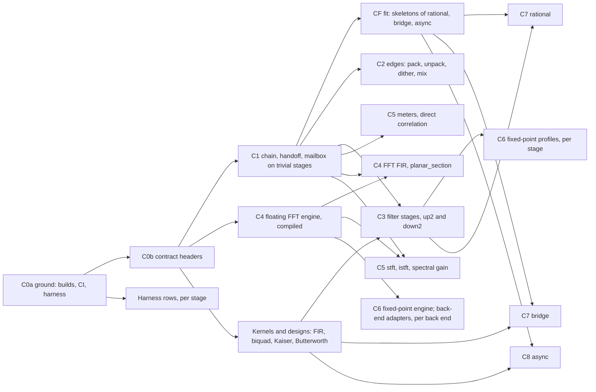

# catenae — plan

**catenae**: Chainable Audio Transforms for Embedded, Native & Accelerated Environments.

A C++17 library of audio processing *stages*, the *chain* that composes them, the *junctions*
that join chains across threads and clocks, and the *mailboxes* that carry a value between
threads. Each has a contract stated as numbers, and a chain is a type the caller writes.

Nothing is built yet. This file says what will be: the decisions, the contracts, the
milestones. How it came to be this way is elsewhere, by rule (one home per fact):

| Where | What |
|---|---|
| `git log -- PLAN.md` | The thirty-odd drafts and what each changed |
| `docs/audits/` | The audit of draft 19 (63 findings, with evidence) and where each finding went |
| `docs/sketches/config-state/` | The contracts of sections 3 to 6 as code that compiles and runs, with the Cortex-M33 measurements quoted here |

Every decision in section 1 is the maintainer's, settled on or before 2026-11-24.

## 1. Decisions

### Identity and scope

| # | Decision |
|---|---|
| D1 | The name is `catenae`; the repository is `tap/catenae`. |
| D14 | catenae is not part of the TapHouse family. Its namespace is `catenae::` and its banner is `Copyright 2026 Timothy Place and the catenae contributors`. |
| D33 | The license is not chosen. It is decided after the coding is complete; until then there is no license file and no SPDX line. `NOTICE.md` records where every carried file came from and the license it had there (DspTap and SampleRateTap are MIT). |
| D3 | DspTap and SampleRateTap are sources of material, not dependencies: no submodule, no link. Code is carried in by copy, ported, and recorded in `NOTICE.md` with the commit it came from. |
| D15 | catenae and SampleRateTap coexist for good. Neither depends on the other, and catenae's contracts owe `tap::dsp::sync_stage` nothing. |
| D16 | Once the architecture is stable, catenae duplicates all of SampleRateTap (`rational`, `bridge`, `async`), re-implemented on catenae's contracts. "Stable" is decided on the evidence of the fit milestone, CF (section 10). |

### Language and rules

| # | Decision |
|---|---|
| D2 | C++17, strictly: one code path, no C++20 feature, not even behind a feature test. Checked: every file compiles without a warning at `-std=c++17`, 20 and 23, and the instruction-count ratchet's numbers are equal across the three. Where the standard library only has a type later, catenae writes its own with the standard's interface (`span`, `expected`). |
| D21 | No exceptions and no RTTI, ever. Every build is `-fno-exceptions -fno-rtti`; there is no second configuration. Whatever can fail returns a `status` or an `expected<T, status>`, and only outside the audio path. |
| D22 | No heap. The library never calls `new`, `malloc` or an allocating container. Memory is a state whose size is fixed by template arguments, a constant table in ROM, or storage the caller supplies. |
| D23 | Written with MISRA C++:2023 and ASIL B in mind, as a precaution: there is no requirement and no checker. What is expensive to retrofit is designed in (section 8); nothing is claimed. |
| D20 | Naming and formatting are the Tap rules, enforced by `.clang-format` and `.clang-tidy` in CI; the files are owned here, with no drift check against TapHouse. |
| D30 | Public constants have no prefix and read as the standard library's traits do (`rate_ratio`, `is_in_place`). `k_` is for private members and `detail`. A script in the tidy job enforces it, because `clang-tidy` cannot see a constant's access. |
| D40 | Include guards in the C++ Core Guidelines' style, not `#pragma once`: `CATENAE_<PATH>_<FILE>_H`, spelled from the header's path, checked in the tidy job. |
| D31 | Warnings are errors and the sets are strict (section 7.3), on catenae's code and on a consumer's view of each header. A suppression is a recorded deviation. |
| D12 | The Tap libraries' discipline carries over: contracts as numbers pinned by tests; processing `noexcept`; published literature only; honest limits stated and pinned. |

### The architecture

| # | Decision |
|---|---|
| D13 | A chain is written by the caller as a type. Nothing is looked up from a rate pair or built from a run-time description. |
| D6 | A stage declares its input and its output as *port types*. Two stages join when one's output port and the next one's input port are the same type. |
| D17 | A port has a signal kind, each its own template: time-domain audio, frames of transform coefficients, wire bytes. A time-domain stage after an analysis does not compile. |
| D5 | The native layout is interleaved. |
| D42 | The channel count is a compile-time number in both layouts. A planar port is `Ch` spans, one per channel. Run-time counts are outside the library: a caller chooses among the configurations it instantiated, or runs one mono configuration over as many states as there are channels. |
| D7 | Planar is a typed region inside a chain: converter stages at its ends, `planar_section` for convenience. |
| D8 | Byte order and packing exist only in edge stages, `unpack` and `pack`, whose outer port is a `wire_port` that no other stage accepts. Inside a chain every sample is native. |
| D18 | The stage contract is fixed-ratio: a compile-time L/M, and `outputs_for` exact. The ratio is the long-run one (D35). |
| D34 | **Configuration apart from state.** A stage is a small constant value, its *configuration*. What it remembers is a separate *state* that is valid when all zero, so it lives in `.bss`: no flash, no start-up code. `a \| b \| c` composes configurations; `state_of<Chain>` is the memory. One configuration serves many states. A parameter is part of the configuration. |
| D35 | **A 1:1 ratio is not n frames out for n in.** A stage publishes `is_frame_synchronous`. `steady<>` wraps a bursting configuration with a FIFO and presents a frame-synchronous one with its true latency. The pull side keeps a holdover and delivers exactly the frames asked for. |
| D37 | **Designs.** Anything computed from run-time numbers is a *design*, made by `make()`, which can fail; a stage is built from a design and cannot. A design carries its sample format, holds its coefficients in the kernel's type, and stores its latency and tail as numbers. Small designs are returned by value; table designs are generated ROM tables or are built into storage the caller supplies. A design is a class, not an open aggregate. |
| D39 | **Latency.** Every stage reports `{nominal, deviation}`; a stage with `has_exact_latency` also reports an exact rational. `oversample<Factor, Stage>` adds the delay that makes an oversampler's latency a whole number of frames. |
| D9 | One latency report per stage and one flush contract: `tail_frames()` and a stated residue. |
| D10 | Capabilities are published constants read through `stage_traits<T>`; nothing probes for a member. A type opts in as a stage by specialising `is_stage<T>`. |
| D27 | **Checks.** Joints inside a chain are proven at compile time and cost nothing at run time. A run-time *boundary* check exists only where the caller's buffers enter (`process`, `push`, `pull`), is written once from the traits, and is on in every build; with fixed-size blocks it is compile-time too. An *audit* check, on the library's own promises, is an explicit build option. The level is part of an inline namespace, so an image cannot mix levels. |
| D19 | A *junction* is a first-class concept with its own contract, for the place where two threads or two clocks meet. The asynchronous converter is one. A chain never contains one. |
| D44 | A *mailbox* carries one value between two threads: one poster, one taker, the newest wins, nobody waits. A new configuration reaches the audio thread this way and a reading leaves it. A change takes effect at the next call after it is collected; whether it is smoothed is the stage's matter. |
| D11 | Read-only analysis is a sibling `analyzer` concept; `tap<Analyzer>` puts one in a chain and passes the audio through. |
| D43 | `parallel<ChainA, ChainB>` runs two chains on two groups of one port's channels with their latencies aligned. A stage with two audio inputs stays out of the charter. |

### Numbers

| # | Decision |
|---|---|
| D24 | `float` is the default sample type and `double` the golden model. An unsuffixed name is the `float` stage; `_f64`, `_q15`, `_q31` name the others. |
| D36 | The `float` profile accumulates in `float`, so it never leaves a single-precision FPU. Its floors are measured and stated per stage. A link-stage gate rejects a software-double routine in a `float` image. Comparison with SampleRateTap is to a tolerance for `float` and bit for bit where the arithmetic is unchanged. |
| D29 | A fixed-point port names its Q format in its type: `fixed<Storage, F>`, a tag over raw `int16_t` or `int32_t`, never a wrapper class. `convert` moves between formats. A stage accepts only the formats its battery pins. First set: `q15`, `q31`, Q4.27. Wire formats unpack to `q15` (16-bit) or `q31` (24-bit left-justified, 32-bit). |
| D47 | Fixed point arrives with a stage's first version where the carried code has it (FIR kernels, decimators, L/M stages, `convert`, `unpack`, `pack`) and at C6 where it is new design (recursive, nonlinear, ramped and spectral stages). From C1 every stage is written against the traits and CI instantiates its contract for `q31`. |
| D25 | A spectrum frame is, per channel, N/2 + 1 bins of `complex<S>`, DC to Nyquist, all stored, channels end to end (section 5.2). Frozen at C4 after the split-complex measurement. |
| D38 | Q15 spectra are for analysis only. Q31 resynthesis is offered under fixed scaling with the bits it loses stated per length. Block floating waits for a design of its own. |

### Build and tools

| # | Decision |
|---|---|
| D4 | Not header-only. Templates whose compile-time numbers matter are headers; everything else is compiled once into a static library, `catenae` (section 7). |
| D28 | FFT back ends: catenae's own engines are the default and the only ones in the repository. CMSIS-DSP and vDSP are opt-in, chosen per sample type when the library is built, never vendored. |
| D48 | The floating FFT engine arrives at C4 and the fixed-point one at C6; the interface for all four types is fixed at C4. |
| D26 | CMake first; waf built in CI from C0a; a Zephyr module when a consumer needs it; one amalgamated source for anything else. |
| D45 | The C ABI is a manifest: a list, fixed when the library is built, of named instantiations, each exported as C functions over storage the caller supplies. Nothing is chosen at run time behind a handle. |

### Documentation

| # | Decision |
|---|---|
| D32 | Four kinds of document with one job each (README, guide, reference, record), executed notebooks and generated tables, under rules that keep them short (section 11). |
| D41 | The guide is a tutorial for one reader: an experienced software engineer who has not worked on embedded hardware. |
| D46 | mdBook for the guide, Doxygen for the reference, one site. No print edition. Notebooks arrive with the C ABI. |

## 2. Charter

**In:** 1:1 stages (filters, gain, delay, mixing, nonlinearities, dynamics without a side
chain); rate-changing stages by a compile-time L/M; sample-format, layout and wire
converters; transform-domain regions; the chain and its combinators; analyzers; junctions;
mailboxes; and the measurement harness.

**In, after CF (D16):** everything SampleRateTap does: `rational`, `bridge`, then `async`
as a junction.

**Out, at least until 1.0:**

- Stages with two audio inputs. Two signals meet only as channels of one wider port (`mix`,
  cross-correlation) or as groups of channels (`parallel`).
- A run-time graph: no dynamic routing, no plug-in host, no patch format.
- Run-time channel counts (D42).
- Pitch shifters and other processes with their own framing; elastic processes (time-stretch,
  varispeed).
- Fixed-point resynthesis in Q15, and block-floating spectra (D38).
- Anything defined by imitating a product rather than by a published method.

## 3. Ports, stages and designs

### 3.1 Ports

A port is a type, and a joint is `std::is_same` on two of them.

| Port | Carries | A frame is |
|---|---|---|
| `port<S, Ch>` (interleaved) | time-domain audio in sample format `S` | `Ch` samples |
| `port<S, Ch, layout::planar>` | the same, as `Ch` spans, one per channel | one sample from each span |
| `spectrum<S, Ch, Bins>` | transform coefficients (section 5.2) | `Ch * Bins` values of `complex<S>` |
| `wire_port<Format, Ch>` | bytes; formats are in namespace `wire` (`wire::s16le`, `wire::s24le_packed`, ...) | `Ch * bytes_per_sample` bytes |

A sample format is `float`, `double`, or `fixed<Storage, F>`: signed two's complement with
`F` fractional bits in `std::int16_t` or `std::int32_t`. `q15` is `fixed<std::int16_t, 15>`
and `q31` is `fixed<std::int32_t, 31>`. Q4.27 means one sign bit, 4 integer bits, 27
fractional bits. A raw `int16_t` is not a sample format. The tag is stripped before a kernel
is called, so Q4.27 and Q0.31 share one copy of the code.

### 3.2 What a stage declares

A stage is a configuration (D34). It is read through `stage_traits<T>`, which fails with one
`static_assert` per missing or ill-typed member, and it opts in through `is_stage<T>`.

| Member | Meaning |
|---|---|
| `input_port`, `output_port` | The two port types. |
| `rate_ratio` | `ratio{up, down}`, reduced. For an analysis stage it is 1 / hop. |
| `state` | A nested type holding everything the stage remembers. All zero is its reset value: anything that starts elsewhere belongs in the configuration or behind a flag. Resetting a stage is zeroing its state. |
| `is_in_place` | Whether `in.data() == out.data()` is allowed. Declarable only when the two ports are the same type and the ratio is 1:1 (asserted). |
| `is_frame_synchronous` | Whether a call of n frames, n a whole number of the stage's input groups, always writes n L/M (D35). False for a stage that works in blocks. |
| `has_exact_latency` | Whether the stage delays every frequency alike. |
| `run(state&, in, out) const` | The stage's work, trusted: spans already known to be the right sizes; consumes all of `in`; returns the frames written. `noexcept`, no allocation, no failure, no boundary check. Called by a chain. |
| `outputs_for(const state&, n)` | Exactly what the next call of n frames writes. |
| `frames_needed(const state&, k)` | The smallest n with `outputs_for(n) >= k`. For an interpolating stage that n can write more than k. |
| `max_outputs_for(n)` | An upper bound from any state, `static constexpr`. The chain sizes its scratch from it. |
| `latency()` | `{nominal, deviation}` in output frames, stored numbers from the design; deviation 0 when exact. With `has_exact_latency`, also `exact_latency()`, a reduced rational. |
| `tail_frames()`, `flush_residue()` | Zero input frames after which the stage's own output is silence within the residue: 0 for FIR; for a floating-point recursion a stated bound and the range of designs it holds for. |
| accessors and setters | A parameter is the configuration's: `level()`, `set_level()`, `design()`, `set_design()`. A setter cannot fail and is not synchronised (section 6.3). |

The joint check is `joint<Index, OutputPort, InputPort>`: one `static_assert` with one fixed
message for each way two ports can differ (kind, sample format, channel count, layout,
bins). C++17 cannot print a type in the message; the compiler's note naming `joint<...>` is
where the two ports are read.

### 3.3 Designs and failure

- **The audio path cannot fail.** `run`, `process`, `push`, `pull`, `post` and `take` return
  counts or flags, never errors.
- **A design is where failure lives** (D37). `T::make(args)` returns `expected<T, status>`.
  `catenae::expected` has `std::expected`'s interface (`has_value()`, `operator bool`,
  `operator*`, `operator->`, `value()`, `error()`, `value_or()`), with two differences forced
  by D21: `value()` and `operator*` on an empty one are violated preconditions, not a throw
  and not undefined. `expected` and `status` are `[[nodiscard]]`.
- **A design is for one sample format.** `make()` validates for that format (a cutoff stable
  in `double` can lose a pole in `float`), stores coefficients in the kernel's type, and
  stores the latency and the tail. A stage built from a ROM design links no `double` and no
  `libm`. `group_delay(f)` is a design-time free function, not a stage member.
- **Two kinds.** A small design (a biquad, a Butterworth) is returned by value. A table
  design (a long FIR, `bridge`'s and `async`'s banks, 12 to 164 KB) is a generated ROM table
  with a bit pin, or is built by `make(spec, table, workspace)` into the caller's storage,
  with `constexpr` size functions. Where a profile fixes a tap count that sizes storage, the
  profile is a template argument.
- **Fixed-point designs check what the kernel cannot.** The carried recursive kernel has two
  guard bits above integer full scale and wraps beyond them, and its Q2.30 coefficients
  cannot exceed 2. `make()` rejects a section whose gain or coefficients do not fit.

### 3.4 Where checks happen (D27)

| Where | What is checked | When |
|---|---|---|
| A joint between two stages | The ports are the same type; the scratch between them holds `max_outputs_for` of a block | Compile time |
| The caller's entry: `process`, `push`, `pull` | The input is whole frames; the output holds `outputs_for(n)` frames | Once per call, in every build. Compile time for fixed-size blocks. |
| Inside the library: indices, invariants, a stage exceeding its own `max_outputs_for`, the host's flush-to-zero setting | The library's promises, and the host's | Only at the `audit` level |

- **A stage has no checked entry.** The checked entry is the chain's `process`; a stage used
  alone is a chain of one. The boundary check is one function, written from the traits.
- **Fixed blocks.** `process` has overloads for `std::array<T, N>&`, `T(&)[N]` and a
  fixed-extent span that deduce both extents and `static_assert` whole frames, room for
  `max_outputs_for`, and `is_frame_synchronous`. Only the dynamic-extent overload checks at
  run time.
- **Counts are `[[nodiscard]]`**: on a junction the count is the only sign of an overrun.
- **Content is not a precondition.** Any bytes are valid samples. A non-finite float poisons
  a recursive state until it is reset; a caller who cannot vouch for its input adds an
  explicit `sanitize` stage.
- **A failed check** calls one `[[noreturn]]` handler that receives an enumerated code (no
  strings in ROM). The library defines none: the integrator must, and it is where their
  system enters its safe state. A trapping default ships as a separate source file.
- **One level per image.** Checks are inline functions. `CATENAE_CHECKS` is `boundary` (the
  default) or `audit`, independent of the build type, written into `catenae/config.h` by
  each build system. The level and the FFT choices are spelled into an inline namespace, so
  every symbol crossing into the library carries them and two files that disagree do not
  link. C0b has a link-fail test of this on an embedded leg at `-Os` with `--gc-sections`.

## 4. The chain

- `chain<Stages...>`, built by `a | b | c` over configurations; it flattens, so the type
  lists the stages once. `chain(stage)` is a chain of one. `with_block<128>(a | b | c)` sets
  the block length (64 frames by default) and is a different type. Class templates meant
  for deduction have explicit guides.
- A chain is a stage: it has `state`, `run`, the constants and the counts, so chains nest.
  Its state holds its stages' states, the scratch between them and a zero block for
  flushing. `rate_ratio` and `is_frame_synchronous` compose; so do `outputs_for`,
  `frames_needed`, latency and tail.
- `process(state&, in, out)` is the caller's entry: the one size check, then the work a
  block at a time through each stage's `run`. A run of `is_in_place` stages shares a buffer.
- `stage<I>()` reaches one stage's configuration by position.
- `flush(state&, out)` is the end of a stream: each stage in order is fed its
  `tail_frames()` of zeros through the stages after it; `flush_output_frames()` says how
  many frames beforehand. A chain does not compose a residue: under flush-to-zero a
  recursion's residue is a standing limit cycle that later stages amplify by gains the
  contract does not carry, so flushing equals zero-padding the input and each stage's card
  states its own residue.
- `steady<Config>` (D35), `parallel<A, B>` (D43), `planar_section<Stages...>` (D7) and
  `oversample<Factor, Stage>` (D39) are the combinators.
- Bit-identical for any chunking at contraction off. The compiled core is built that way; a
  header-template stage compiles under the consumer's flags, and its card says so.
- One call, one thread, one clock.

## 5. Layout and signal kind

### 5.1 Time-domain audio

Interleaved with a compile-time channel count is the default for every stage with state.
`deinterleave` and `interleave` are 1:1 stages between the layouts. Each stage's row in the
layout benchmark is the evidence for the layout it prefers.

What the spike measured (planar cost over interleaved, across 2, 6 and 12 channels;
`docs/audits/` has the provenance): the FFT FIR, 1.04 to 1.16, interleaved cheaper on every
core; a stateless gain, 0.28 to 0.88 on x86-64 and the M55, planar cheaper where the vector
unit is wide; a compile-time channel count worth up to 12 times for interleaved and under
2 % for planar. The recursive stage's layout is measured again at C3 on the block kernel.

### 5.2 A spectrum's format (D25)

For a real input of N samples per channel, one frame of `spectrum<S, Ch, N/2 + 1>`:

```
channel 0:  re[0] im[0]  re[1] im[1]  ...  re[N/2] im[N/2]
channel 1:  re[0] im[0]  re[1] im[1]  ...  re[N/2] im[N/2]
```

- Real and imaginary parts are adjacent, as `catenae::complex<S>`, a plain `{S re; S im;}`
  (`std::complex` is specified only for floating types).
- Every bin from DC to Nyquist is stored, zero imaginary parts included: N + 2 scalars per
  channel, so a coefficient stage is one uniform loop.
- Channels are not interleaved: an FFT transforms one channel's contiguous samples, so the
  analysis stage de-interleaves as it windows.
- Forward is `sum x[n] exp(-i 2 pi k n / N)`, unnormalized. An analysis and synthesis pair
  states its overall gain (1) and its reconstruction error.
- A frame is stamped by the first sample of its window; latency is stated against that.
- A fixed-point spectrum's format is its type: the fixed scaling policy grows the output by
  a known number of bits for a length (log2 N for Q15, log2 N + 1 for Q31), so no exponent
  travels. Under D38 a Q15 inverse transform does not compile; a Q31 one states its loss.
- Split complex (vDSP's form) is measured against this at C4, and D25 is frozen then.

## 6. Junctions, analyzers and mailboxes

### 6.1 Junctions (D19)

A stage lives inside one call, on one thread, in one clock domain. A junction is where two
call sites meet. It is read through `junction_traits<T>`.

| Member | Meaning |
|---|---|
| `sink_port`, `source_port` | Port types. |
| `clocking` | `clocks::shared` (two threads, one clock) or `clocks::independent`. |
| `rate_ratio` | The nominal ratio between the sides. |
| `tolerance_ppm()` | Independent clocks only: the offset and drift it absorbs. |
| `push(in)` | Exactly one thread. Returns the frames accepted; what happens to the rest is stated. `noexcept`, wait-free. |
| `pull(out)` | Exactly one other thread. Always fills `out`; what it could not supply is silence; returns how many frames were real. |
| `report()` | Any thread. Each field (state, fill, underruns, overruns, a rate estimate) is individually atomic and 32 bits wide; there is no snapshot across fields; the fill is clamped to the capacity. New design: the carried ring has no query a third thread may call. |
| `latency()` | `{nominal, range}` in source frames: a junction's delay breathes with its fill. |
| `capacity_frames` | A template argument, a power of two (asserted). |
| `reset()` | Only while neither side is running. |

Instances: `handoff<S, Ch, Capacity>`, a single-producer single-consumer ring (shared clock,
two threads), which proves the contract; the asynchronous converter (D16); later, outside
the charter, a jitter buffer.

`feeding(chain, state, junction, in)` runs a chain and pushes what it wrote.
`fed_by(junction, chain, state, out)` fills `out` exactly, pulling what the chain needs. Each
has a state of its own, `feeding_state<Chain>` and `fed_by_state<Chain>`, holding the
chain's state and the frames in transit, `fed_by_state` also the holdover (D35); both are
valid when zero. There is no `|` across a junction: the thread boundary stays visible in
the caller's code. Latency across a junction composes as nominal only.

### 6.2 Analyzers (D11)

Read through `analyzer_traits<T>`.

| Member | Meaning |
|---|---|
| `input_port` | What it reads; it has no output port. |
| `hop_frames`, `window_frames` | A result every `hop_frames`, over the last `window_frames`. |
| `state` | As a stage's. |
| `analyze(state&, in) const` | Trusted, as a stage's `run`. |
| `result_type`, `result(const state&)` | The latest result: a value, or a view of storage in the state. |
| `results_ready(const state&)` | How many results have completed since the last read. |

`tap<Analyzer>` is the stage that holds one and passes its input through, 1:1, in place,
with no latency. Results are read on the chain's thread and leave it through a mailbox.

### 6.3 Mailboxes (D44)

| Member | Meaning |
|---|---|
| `post(value)` | Exactly one thread. Never waits. A value never collected is replaced by the newer one. |
| `take(apply)` | Exactly one other thread. If a value has arrived since the last take, calls `apply(value)` and returns true. Never waits. |
| `T` | Trivially copyable (asserted): a design, a level, a reading. |

Three slots and one atomic byte: each side owns a slot and swaps it with the middle one, so
a value is never read while it is written, and the object is valid when all zero.

A stage's setter is not synchronised. On the thread that runs the chain it is called between
calls; from any other thread the value is posted and the audio thread applies it at the top
of a call.

**Assumptions of use.** A junction and a mailbox each assume one thread per side, where an
interrupt handler counts as a thread. A violation is a data race no check can see, so both
are verified under the thread sanitizer and on real weakly ordered hardware (section 7.3).

## 7. The build

### 7.1 What is a header and what is compiled (D4)

| Parameterized on | Where | Examples |
|---|---|---|
| A compile-time number measured to matter (channel count, section count, ratio, block length), or a loop that must inline into a per-sample loop | Header template | Stages, the chain and its combinators, `feeding` / `fed_by`, the FIR dot kernels, the biquad block kernel, `span`, `mailbox`, the traits |
| Only the storage type (`float`, `double`, `int16_t`, `int32_t`) and sizes passed at run time | Compiled, explicitly instantiated for the four | The FFT engines, bulk `pack` / `unpack`, the asynchronous converter's servo, the analysis instruments |
| Nothing (design-time arithmetic in `double`) | Compiled | The designers (Kaiser, Nyquist, Butterworth, biquad), the tail computation, group delay |

- **One definition per image.** A compiled FFT has one back end per library build and needs
  no ABI tag on every class that embeds it.
- **The numeric contract is the library's.** The compiled core is built with catenae's own
  contraction policy, so its bit pins hold whatever the consumer passes.
- **ROM.** Compiled code is one copy, built with `-ffunction-sections -fdata-sections`, and
  dropped when unused. Design code need not link at all when a design is a table. Each
  component that could go either way gets a size probe in both forms on the embedded
  targets, and this table is corrected where a probe disagrees.
- **Template code is kept flat** by putting storage in the template and arithmetic in a
  kernel that takes spans, so two sizes of one stage share their code.

### 7.2 FFT back ends (D28, D48)

| Back end | Sample types | Where | How it arrives |
|---|---|---|---|
| catenae's own floating engine (DspTap's srdif engine, ported), at C4 | `float`, `double` | everywhere; the default | source here |
| catenae's own fixed-point engine (DspTap's, ported; fixed scaling only), at C6 | Q15, Q31 | everywhere; the default | source here |
| CMSIS-DSP | `float` for Helium first; Q15 and Q31 at C6; a Neon adapter is separate and waits for a consumer | Arm, opt-in | the consumer's copy, as a CMake target that carries its include directories and compile definitions; CI fetches one pinned release |
| vDSP | `float` first | Apple, opt-in | the system framework |

- **Own engines are the reference**: the only FFT code in the repository and the ones whose
  output bits are pinned. A back end re-presents the same contract within a stated tolerance
  of the `double` engine, proven by a parity battery on the leg that has the hardware.
- **The interface is fixed at C4 for all four types**: `fft_plan<S>`, `fft_tables<S, N>`,
  the build options, and the spectrum's format as a function of the length, with the
  fixed-point types declared and unimplemented until C6.
- **Tables are constant.** `fft_tables<S, N>` is in ROM and shared by every transform of
  that length (generated where C++17 cannot evaluate it); the workspace handed to a
  transform is scratch only.
- **One back end per sample type**, each option a choice from a validated list, all
  defaulting to `own`: `CATENAE_FFT_F32` (`own`, `cmsis`, `vdsp`, `none`), `CATENAE_FFT_F64`
  (`own`, `vdsp`, `none`), `CATENAE_FFT_Q15` and `CATENAE_FFT_Q31` (`own`, `cmsis`, `none`).
  `none` leaves that type's FFT out of the build, and a stage that needs it fails to compile
  with a message naming the option. The choices are in `catenae/config.h` and the inline
  namespace of section 3.4.
- **No silent fallback.** A length outside a back end's range fails to compile where it is a
  template argument and is a `status` from `make()` where it is not.
- **Not vendored**, because an embedded consumer nearly always has CMSIS-DSP already and a
  second copy would define the same symbols. The adapter is compiled with the consumer's
  CMSIS-DSP configuration macros (its structures change layout with them), `static_assert`s
  the size of the instance structures and the version, and states a tested version window.
- **What each produces, and so what its adapter does:**

  | Back end | Output | Lengths | To be handled |
  |---|---|---|---|
  | CMSIS-DSP `float` | N floats, the Nyquist bin's real part in bin 0's imaginary slot; exp(-i) | 32 to 4096 | Overwrites its input. Fix up bins 0 and N/2. |
  | CMSIS-DSP Q15, Q31 | Halved at every stage, so the output's Q format depends on the length (Q15: 6.10 at 32 to 14.2 at 8192). No block-floating mode. | 32 to 8192 | Scalar builds write 2N values. Q15's format equals catenae's fixed policy; Q31's differs by one bit. Its Q31 round trip is measured at C6. |
  | vDSP | Split complex, exp(-i), forward scaled by 2, DC and Nyquist packed together | powers of two | Its setup allocates (a recorded exception to D22, on Apple hosts). Its workspace has an alignment requirement. |

- **Not planned:** FFTW (GPL); HVX, until a consumer needs it.

### 7.3 Warnings, errors and sanitizers (D31)

Each set is `-Werror` (`/WX`) on every CI leg.

| Compiler | Flags |
|---|---|
| GCC (hosted and `arm-none-eabi`) | `-Wall -Wextra -Wpedantic -Wshadow -Wconversion -Wsign-conversion -Warith-conversion -Wdouble-promotion -Wfloat-equal -Wold-style-cast -Wuseless-cast -Wcast-align=strict -Wcast-qual -Wundef -Wnull-dereference -Wformat=2 -Wimplicit-fallthrough -Wswitch-enum -Wduplicated-cond -Wduplicated-branches -Wlogical-op -Wmissing-declarations -Wredundant-decls -Wzero-as-null-pointer-constant -Wextra-semi -Wvla`, and `-Wstack-usage=` at each target's stack ceiling |
| Clang (hosted, Apple, Hexagon) | `-Weverything` less a written list with a reason per entry, starting as: the C++98 compatibility groups; `-Wpadded`; `-Wunsafe-buffer-usage` (it fires inside `span` and on every indexed kernel loop); `-Wswitch-default` (it contradicts `-Wswitch-enum`, which is kept); `-Wglobal-constructors` and `-Wexit-time-destructors` where a test framework needs them off |
| MSVC | `/W4 /permissive-`, with the conversion and shadowing warnings raised to errors |

- **Shadowing.** A local, a parameter or a capture never hides a member, an enclosing local
  or a global. Public value types have unprefixed fields (`ratio{up, down}`), so parameters
  take a different word, and the warning enforces it. A member cannot have its type's name:
  hence `rate_ratio`, `wire_port` with formats in `wire`, and `report()` beside `status`.
- **Double promotion** catches a stray `double` at compile time. It cannot see an explicit
  cast, so a link-stage gate does: a `float`-profile image for a core with a
  single-precision FPU, or none, may not reference a software-double routine or a `double`
  `libm` entry (D36).
- **Conversions.** `-Warith-conversion` is what reports `int16_t = int16_t + int16_t`; Clang
  has no equivalent, so that case rests on the GCC legs and the sanitizer. Conversions
  between fixed-width types and `int`, `long`, `size_t` go through one named helper.
- **Float equality** goes through one named helper, so each exact comparison is deliberate.
- **A consumer's view.** Each public header is compiled alone under each compiler's set.
  The promise is: clean under those sets, with Clang's exclusion list published. catenae's
  headers are never marked as system headers; third-party ones are.
- **Warnings as errors is the default where catenae is the project being built and off where
  it is consumed**, so a newer compiler cannot break a consumer on a released version.
- **A suppression is a deviation**: a diagnostic pragma or a `NOLINT` cites an entry in the
  deviation log, and CI counts them against it.
- **Sanitizers.** One hosted leg runs the battery under the address and undefined-behaviour
  sanitizers at `-std=c++17` (a later standard defines shifts that C++17 does not). Every
  junction and the mailbox run under the thread sanitizer, and under stress on real weakly
  ordered hardware (an arm64 runner): x86 cannot reorder as Arm does and QEMU does not help.
- **`clang-tidy`** findings are errors, with a per-function complexity ceiling among them. It
  checks the case of names; scripts in the same job check D30's prefix rule and D40's guards.
- **Shifts.** A right shift of a negative value is implementation-defined in C++17, a left
  shift of one is undefined, and an out-of-range unsigned-to-signed conversion is
  implementation-defined. Every shift of a signed value goes through one helper, a script
  rejects a raw one elsewhere, and a compile-time test evaluates the helpers with negative
  operands.
- **Constructs to avoid**, valid in C++17 and different later: an aggregate with a
  user-declared constructor, `[=]` capturing `this`, a default-initialised `std::atomic`,
  compound assignment to a `volatile`, arithmetic between different enumerations, an
  unqualified call with explicit template arguments.

### 7.4 Build systems (D26)

The library is always built from source in the consumer's build, with the consumer's target
flags, and never shipped prebuilt.

- **CMake**: the reference. `add_subdirectory`, one target.
- **waf**: a maintained `wscript`, built and tested in CI from C0a.
- **Zephyr**: a module file and Kconfig over the CMake build, when a consumer needs it; it
  uses Zephyr's CMSIS-DSP module.
- **Anything else**: one amalgamated `catenae.cpp` generated in CI, with a default
  `catenae/config.h` beside it. One CI leg builds and runs the battery against it.

## 8. MISRA C++:2023 and ASIL B (D23)

MISRA C++:2023 is written for C++17. ISO 26262 does not certify a library on its own: a
component is developed as a safety element out of context and the integrator's safety case
takes it from there. catenae is built so that this is possible and cheap.

**Designed in from the first code:**

- No exceptions, no RTTI, no heap, no recursion; every loop bounded by a number the contract
  states.
- No undefined or implementation-defined behaviour relied on: fixed-width types, no signed
  overflow, spans in place of pointer arithmetic in every interface, the shift helper.
- Every contract point is a requirement with an identifier (`CAT-STAGE-007`), and the test
  that pins it cites the identifier.
- Cost is measured and gated: the ratchet's largest single call and the stack ceilings are
  per-stage numbers. They are the largest observed over stated workloads, not a proven worst
  case, and the contract calls them that.
- An assumptions-of-use register (`docs/assumptions.md`, each with an identifier): what the
  library requires of its integrator and cannot check. One thread per side of a junction or
  a mailbox; no aliasing of `in` and `out` unless `is_in_place`; the host's flush-to-zero
  setting; the handler does not return; a setter is called between calls.
- A deviation log. Its opening entries, from public summaries of the guidelines and
  unverified against the text: compiler extensions (`restrict`, inlining control, reading
  the floating-point control register), which go in one header so that each is one
  deviation; `memcpy`-based bit casts; the signed right shift; guard-clause early returns
  against a single exit point; `-Wunsafe-buffer-usage` off; vDSP's allocation.
- A complexity ceiling per function, kernels included; each `@req` states its equivalence
  classes and boundary values; a change to a contract header or a kernel is reviewed with a
  retained record.
- **What is tested is what ships.** The battery runs at both check levels. Coverage is
  measured on the configuration that ships (`boundary`, optimised). The configuration space
  is finite and written down, and CI names the combinations it runs.

**In CI from C0a:** statement and branch coverage of the compiled core and of each
instantiation the battery makes; `clang-tidy` and warnings as errors. These approximate a
MISRA checker; they are not one.

**Deferred until a requirement arrives:** a checker for the 2023 edition, the
guideline-by-guideline matrix, a safety plan, a safety manual, an assessment.

The MISRA document is licensed and was not to hand when this was written. No rule is quoted
or numbered here; this section is checked against the text when a copy is available.

## 9. What the code looks like

All of this is in `docs/sketches/config-state/`, which compiles without a warning on GCC 13
and Clang 18 at C++17, 20 and 23 and runs, except 9.5 and the edge side of 9.6, whose stages
(`stft`, `unpack`, `tap`) do not exist yet.

### 9.1 A stage: configuration, state, and a parameter that changes

A fixed gain needs no class: it is `map<>` with a multiplication.

```cpp
struct times {
    float factor;
    constexpr float operator()(float x) const noexcept { return x * factor; }
};

constexpr auto trim = chain(map<2, times>{times{0.5f}});
```

A gain worth a class changes level without a click. The level and the ramp length are
configuration; where the ramp has got to is state.

```cpp
template <std::size_t Ch>
class gain {
  public:
    using input_port  = port<float, Ch>;
    using output_port = port<float, Ch>;
    static constexpr ratio rate_ratio{1, 1};
    static constexpr bool  is_frame_synchronous = true;

    struct state {
        float         current;    // the level being applied now
        float         goal;       // the level the ramp is heading for
        float         step;       // per frame, while a ramp runs
        std::uint32_t remaining;  // frames of ramp left
        std::uint32_t started;    // 0 until the first call, which starts at the level with no fade-in
    };

    constexpr gain(float level, std::uint32_t ramp_frames) noexcept;

    constexpr float level() const noexcept { return m_level; }
    constexpr void  set_level(float level) noexcept { m_level = level; }   // a ramp, from the next run()

    std::size_t run(state& st, span<const float> in, span<float> out) const noexcept;

    static constexpr std::size_t max_outputs_for(std::size_t n) noexcept { return n; }
    static constexpr std::size_t outputs_for(const state&, std::size_t n) noexcept { return n; }
    static constexpr std::size_t frames_needed(const state&, std::size_t k) noexcept { return k; }

  private:
    float         m_level;
    std::uint32_t m_ramp_frames;
};
```

**Algorithms or loops.** A stage that maps each sample on its own (`map`, `convert`, a fill)
uses a standard algorithm: no index to get wrong, and `std::transform` may write over its
input. A kernel with state carried between samples or a pattern across channels (a biquad,
an FIR dot product, the ramp above) is a plain indexed loop in a kernel function, which is
also the seam for a vector back end. The ratchet confirms on every target that the algorithm
form counts the same as the loop, and nothing meant for compile-time evaluation uses one
(the standard algorithms are not `constexpr` before C++20).

### 9.2 A design: a low-pass filter

```cpp
template <typename S>
class lowpass_design {
  public:
    static expected<lowpass_design, status> make(double cutoff) noexcept;   // may fail; double, tan
    static constexpr lowpass_design from_table(const std::array<S, 5>& coefficients,
                                               float latency_frames) noexcept;

    constexpr const std::array<S, 5>& coefficients() const noexcept;        // already in S
    constexpr float                   nominal_latency() const noexcept;     // a stored number
};

template <std::size_t Ch>
class lowpass {
  public:
    struct state {
        std::array<std::array<float, 2>, Ch> z;   // the filter's history, per channel
    };

    explicit constexpr lowpass(const lowpass_design<float>& design) noexcept;
    constexpr void set_design(const lowpass_design<float>& design) noexcept;   // cannot fail

    std::size_t run(state& st, span<const float> in, span<float> out) const noexcept;
};
```

```cpp
// A configuration whose parameters will change is a variable. It starts from a design that is
// a table in ROM: no designer has run and none need be linked.
static auto                        s_strip = lowpass<2>{k_lowpass_at_0_1} | gain<2>{1.0f, 96};
static state_of<decltype(s_strip)> s_strip_state;

static_cast<void>(s_strip.process(s_strip_state, in, out));   // the audio callback

// A new cutoff, off the audio path: design it (this can fail), then hand it over (this cannot).
const auto retuned = lowpass_design<float>::make(0.02);
if (retuned) {
    s_strip.stage<0>().set_design(*retuned);
}
s_strip.stage<1>().set_level(0.25f);                          // ramps over 96 frames
```

Cortex-M33: the strip's configuration is 32 bytes of `.data`, its state 548 bytes of `.bss`,
its callback's stack frame 20 bytes; the audio path's file calls no software floating
point, the designer's file calls `tan` and seven software-double routines. A filter's
redesign is a step under a live history (a small transient); smoothing it would be that
stage's matter, as ramping is `gain`'s.

### 9.3 The same changes from another thread

```cpp
static mailbox<lowpass_design<float>> s_new_design;
static mailbox<float>                 s_new_level;

// Control thread: design, then post. It never touches the chain.
const auto wider = lowpass_design<float>::make(0.2);
if (wider) {
    s_new_design.post(*wider);
}
s_new_level.post(0.9f);

// Audio thread, at the top of its callback: collect, apply, process.
s_new_design.take([](const lowpass_design<float>& d) noexcept { s_strip.stage<0>().set_design(d); });
s_new_level.take([](const float& level) noexcept { s_strip.stage<1>().set_level(level); });
static_cast<void>(s_strip.process(s_strip_state, in, out));
```

Two threads put two million 64-byte values through a mailbox with none torn and none out of
order, clean under GCC's thread sanitizer. Cortex-M33: these two mailboxes are 76 and 16
bytes of `.bss`.

### 9.4 A chain: four-times oversampling around a tanh overdrive

```cpp
struct soft_clip {
    float drive;
    float operator()(float x) const noexcept { return std::tanh(drive * x); }
};

// The configuration: a constant. The type is the topology; the object is 8 bytes (the drive).
constexpr auto overdrive = up2<2>{} | up2<2>{} | map<2, soft_clip>{soft_clip{4.0f}} | down2<2>{} | down2<2>{};

static_assert(decltype(overdrive)::rate_ratio == (ratio{1, 1}));

// The memory: one zero-initialised object per instance. Two voices share one configuration.
static state_of<decltype(overdrive)> s_voice_a;
static state_of<decltype(overdrive)> s_voice_b;

// Both arguments are arrays, so every size is checked by the compiler.
void audio_callback(const std::array<float, 64 * 2>& in, std::array<float, 64 * 2>& out) noexcept {
    static_cast<void>(overdrive.process(s_voice_a, in, out));
}
```

| Cortex-M33, `-Os` | One object per chain (the audit's mock) | Configuration and state |
|---|---:|---:|
| Flash for the chain's data | 8,180 bytes | 0 |
| RAM | 8,180 bytes | 6,184 bytes of `.bss` |
| Start-up code or stack to construct it | none, or a 12 KB frame | none |
| Stack of the callback | not measured | 64 bytes |

The RAM figures are from different mock stages; the flash figure is the comparison. The
sketch's `up2` and `down2` are toys. With linear-phase half-bands the latency is k + 1/2
frames (18.5 and 23.5 measured on SampleRateTap's chains), which `oversample<4, ...>` makes
whole (D39).

### 9.5 A transform-domain region, bare and steady

```cpp
// Mono. 512-sample Hann frames every 128 samples: 257 bins of complex<float> per frame.
constexpr auto gate = stft<512, 128, 1>{window::hann}
                    | spectral_gate<257, 1>{k_gate_design}
                    | istft<512, 128, 1>{window::hann};

//   stft:          port<float, 1>           ->  spectrum<float, 1, 257>
//   spectral_gate: spectrum<float, 1, 257>  ->  spectrum<float, 1, 257>
//   istft:         spectrum<float, 1, 257>  ->  port<float, 1>

static_assert(decltype(gate)::rate_ratio == (ratio{1, 1}));   // 1/128 then 128/1
static_assert(!decltype(gate)::is_frame_synchronous);         // 64 frames in give 0 or 128 out

// For an audio callback, which must return n frames for n: the same region inside steady<>.
constexpr auto denoise = chain(steadied(gate));               // 127 frames later, and it says so

// What does not compile:
//   stft<512, 128, 1>{window::hann} | gain<1>{0.5f, 96}
//     error: catenae: a spectrum cannot feed a time-domain port
//     note:  in instantiation of joint<0, spectrum<float, 1, 257>, port<float, 1>>
//   gate.process(s_gate, block_in, block_out)        with two std::array<float, 64>
//     error: catenae: a fixed block needs a frame-synchronous chain; wrap it in steady<>
```

What `steady<>` does, call by call, drawn by `figure.py` from the output of `trace.cpp` (a
block stage of 128 frames standing in for the region):


The FIFO starts with one frame fewer than the largest burst, as silence: that is the added
latency (127 here; 511 in all for a 512/128 region, whose own latency is 384). It evens out
the frame counts, not the work: the transform still runs on every second call. A host whose
callback is a multiple of the hop and aligned to it needs no `steady<>`.

### 9.6 Edges and a junction

```cpp
// Audio callback thread: 24-bit packed little-endian stereo off the wire, into float.
constexpr auto input = unpack<wire::s24le_packed, 2>{}   // wire_port<wire::s24le_packed, 2> -> port<q31, 2>
                     | convert<q31, float, 2>{}          // port<q31, 2>                     -> port<float, 2>
                     | lowpass<2>{k_lowpass_at_0_1};

static handoff<2, 1024>               s_link;        // the junction
static feeding_state<decltype(input)> s_into_link;   // the chain's state and the frames in transit

const std::size_t pushed = feeding(input, s_into_link, s_link, wire_bytes_in);

// Worker thread, same clock: mix to mono and meter it.
constexpr auto metering = mix<2, 1>{k_mono_mix} | tap<1, rms_meter>{};
static fed_by_state<decltype(metering)> s_from_link; // chain state, staging and the holdover

const std::size_t got = fed_by(s_link, metering, s_from_link, span<float>(mono_out));
```

The pull side is compiled in the sketch with a chain that raises the rate by 4: asked for
102 frames it pulls 26, which make 104, delivers 102 and holds 2 for the next call.

### 9.7 Where the memory is, without a heap (D22)

| Pattern | For | Example |
|---|---|---|
| A state sized by template arguments | Histories, scratch, FIFOs | `struct state { std::array<S, MaxFrames * Ch> line; std::size_t write; };` in `delay<Ch, MaxFrames>`: zero-initialised, in `.bss` |
| A constant viewed, not copied | Taps, tables, designs | `constexpr std::array<float, 63> k_taps = {...};` in `.rodata`, and `fir<63, 2>{k_taps}` holds a view |
| Storage the caller supplies | A size known only at run time, in the compiled core | `fft_plan<float>::make(1024, s_workspace)`, with `fft_workspace_size<float>(1024)` a `constexpr` |

What it costs: a size chosen at run time needs a maximum chosen at compile time or a
caller's workspace; a state is as large as its buffers, so it belongs in static storage or a
caller's arena, never on a small thread's stack; and every chain has two names, its
configuration and its state.

## 10. Milestones

Each ends with its battery green on every CI leg and its numbers recorded.

| | Milestone | Contents |
|---|---|---|
| C0a | Ground | Repository layout, `NOTICE.md`, style files. The CMake and waf builds, both in CI: hosted GCC, Clang, MSVC and Apple at C++17, 20 and 23; the Cortex-M and Hexagon QEMU legs; the sanitizer legs; the warning sets, `clang-tidy`, the naming and guard scripts. The harness: the instruction-count ratchet, the size probes (`.text`, `.rodata`, `.data`, `.bss` apart, and the start-up stack), coverage. The amalgamation. A smoke test of Doxygen and mdBook on one header and one page before their conventions are fixed. No library code beyond a first compiled unit. |
| C0b | Contracts | `span`, `status` / `expected`, the checks and the handler, `catenae/config.h` with its inline namespace and the link-fail test, `sample_traits` and the `fixed<>` tags, the ports, `stage_traits` (with `is_stage` and `joint`), `junction_traits`, `analyzer_traits`. The contract documents with requirement identifiers, the assumptions-of-use register, the deviation log. The compile-fail battery for what exists: a missing or ill-typed contract member, an ignored `expected`. |
| C1 | The chain on trivial stages | `chain` with `process` (dynamic and fixed), `flush`, `stage<I>()`, `with_block`, the joint proofs and their compile-fail tests (one per way two ports can differ; a junction in a chain). `map`, `gain`, integer `delay`, `interleave` / `deinterleave`, `convert` among `float`, `q15` and `q31`. `steady`, `parallel`. `handoff` with `feeding` and `fed_by`, and `mailbox`, under the thread sanitizer and on arm64 hardware. The layout benchmark. The example chain's `.data`, `.bss` and start-up stack as pinned numbers. |
| CF | Fit (D16) | Throwaway skeletons, with no quality bar on the signal processing, against C0b's and C1's headers: one `rational` chain with its pull and its flush, one `bridge` stage with its table design, and the `async` junction. A table of every public member of SampleRateTap's three engines and where it lands here or why it is dropped. A first C ABI manifest (D45) written against them. Passing CF is what "shown that they fit" means; what it forces on the contracts is changed here. |
| C2 | The edges | `unpack` / `pack` (16, 24-packed, 24-in-32, 32; either byte order), TPDF dither, the mix matrix. |
| C3 | Filters | The biquad block kernel, the biquad family and the Butterworth with their designs, a direct-form FIR, `up2` / `down2` and the L/M stage machine with one pinned design, `oversample`. The overdrive chain as a tested example. The recursive stage's layout measured. |
| C4 | Blocks | The floating FFT behind its compiled interface, with the interface fixed for all four types (D48); the overlap-save FFT FIR; `planar_section`. The split-complex measurement, and D25 frozen. |
| C5 | Analysis and the transform domain | Meters, auto- and cross-correlation over `tap`. `stft` / `istft` in `float` and `double` and a spectral gain: the gate of 9.5, inside `steady`, as a tested example. |
| C6 | Profiles | The fixed-point profiles that are new design (D47), with the section-scaling design a fixed-point biquad needs. The fixed-point FFT engine and fixed-point spectra (D38). The back ends: vDSP, CMSIS-DSP for Helium, the fixed-point CMSIS-DSP adapters. The C ABI from its manifest, and the executed notebooks. |
| C7 | The synchronous converters | `rational`'s stages, named chains and profiles; `bridge`. Checked against vectors committed from SampleRateTap (to a tolerance where D36 changed the arithmetic) and against a reference independent of both libraries. |
| C8 | The asynchronous converter | `async`, as a junction. |
| C9 | Freeze | The 1.0 contract freeze, once C7 and C8 have shown the architecture holds all of it. |

### 10.1 What can run in parallel

Three things are strictly serial: C0a, then C0b, then C1. CF follows C1 at once and runs
beside the stage work.



| Workstream | Needs | Can start |
|---|---|---|
| Harness rows (a stage's counts, sizes and layout row) | C0a's harness | With each stage |
| The floating FFT engine | C0b | With C1: nothing in it depends on the chain |
| Kernels and designs | C0b | With C1: a kernel takes spans and knows nothing of stages |
| Fit (CF) | C1 | At once after C1 |
| Edges (C2), filter stages (C3), analysis (C5: meters, direct correlation) | C1; C3 also the kernels | After C1, beside each other |
| Block stages (C4) and the transform domain (C5: `stft`, `istft`) | C1 and the FFT engine | When both are in |
| Fixed-point profiles and back-end adapters (C6) | The stage, or the FFT interface | Per stage and per back end, independently |
| `rational`, `bridge`, `async` (C7, C8) | CF; then `rational` the L/M stages, `bridge` and `async` the FIR kernels, `async` also `handoff` | The three in parallel |

Inside C1, `handoff` and `mailbox` are independent of `chain`; only `feeding` and `fed_by`
need both.

What keeps parallel work from colliding:

- **The contract headers have one owner** and change only by a decision in section 1. A
  workstream that finds the contract wrong raises it; it does not patch it in passing.
- **A workstream adds files; it does not edit shared ones.** Each stage is its own header,
  test file and benchmark row. Build lists are per directory.
- **Every workstream merges through the same gates**: the warnings, the compile-fail
  battery, the ratchet and the size ceilings.

Optional, after C1: an hour or two modelling port, stage, junction and chain in SysML v2's
textual notation, kept only if it exposes something the code and the compile-fail battery
missed.

## 11. Documentation

### 11.1 Who reads what (D32, D46)

| Document | Answers | Reader | Made with |
|---|---|---|---|
| `README.md` | What is this, and how do I build my first chain? | Someone deciding whether to use it | Hand-written, short |
| The guide | Why is the library shaped this way, and how do I use it and write a stage for it? | An experienced software engineer new to embedded hardware | mdBook, its code included from compiled examples |
| The reference | What exactly does this stage promise? | An integrator with the header open | Doxygen, from the headers |
| The record | Why is it this way, what changed, what knowingly departs from the rules? | The maintainer; a reviewer or assessor | `PLAN.md`, `CHANGELOG.md`, the deviation log, `docs/audits/` |

**Notebooks** are for what has to be seen: responses, group delay, the layout comparison.
They are committed executed and drive the shipping code through its C ABI, so they arrive
with it. **Measurements** are tables generated from the benchmark's output, with their
provenance in the data.

**Figures.** One that shows behaviour (frames per call, a ramp, a response) is drawn by a
script from the output of the example it illustrates, and both are committed:
`docs/sketches/config-state/steady.svg` is the first. One that shows structure (a chain's
stages and ports, where a configuration and a state live) is drawn by hand as SVG. One
style: the icon's teal, values labelled where they first appear, light and dark, and a text
description for a reader who cannot see it.

One published site carries the guide and the reference, cross-linked. The icon and favicon
are in `assets/icon/`.

### 11.2 Keeping it short

1. **One home for each fact.** A number lives in one place that a machine checks: a test's
   pin or a generated table. Everywhere else links to it.
2. **A contract is a card, not an essay.** Every stage's header carries the same fixed
   fields as a table, then its requirements. The contract's own members are documented once,
   on the stage contract's page, and excluded by name from the undocumented-member check.

   ```cpp
   /// @brief Butterworth low-pass, even order, as a 1:1 stage.
   ///
   /// | Contract   |                                                                       |
   /// |------------|-----------------------------------------------------------------------|
   /// | Ports      | `port<S, Ch>` in and out                                              |
   /// | Ratio      | 1:1, in place, frame-synchronous                                      |
   /// | State      | two words per section and channel                                     |
   /// | Latency    | nominal: group delay at DC; deviation: its excess up to the cutoff    |
   /// | Tail       | `tail_frames()`; residue <= 256 x min normal, orders 2-8, fc >= 0.002 |
   /// | Formats    | `float`, `double`                                                     |
   /// | Limits     | a non-finite input poisons the state until it is reset               |
   /// | Method     | bilinear transform, pre-warped (Oppenheim and Schafer, sec. 7.2)      |
   /// | Rationale  | D9, D34, D37                                                          |
   ///
   /// @req{CAT-BUTTERWORTH-001} |H| is -3.0103 dB at the cutoff, within 1e-4 dB.
   ```

   Each `@req` is one requirement with its identifier. Doxygen collects them into a page,
   and a script checks that every identifier is cited by a test and every test cites one.
3. **A header describes the present.** What the code used to do is the changelog's; why is
   the plan's, by decision number; how a number was measured is the generated table's.
4. **Budgets, enforced like the size ceilings.** A header comment, the README and a guide
   page each have a length ceiling checked in CI.
5. **A guide page answers one question**, starts with the answer, and every listing is
   included from an example the build compiles and the battery runs.
6. **One glossary**: stage, configuration, state, chain, junction, mailbox, port, frame,
   design, tail, residue.
7. **Built as strictly as code**: Doxygen's warnings are errors, links are checked, the
   README's quick start is compiled.

`CLAUDE.md` follows the same rule: a short map of where things are and which rules bind.

Untried: Doxygen and mdBook were not installed where the plan was audited. Whether `@req`
is an alias or a built-in command, and how a Markdown table survives in a `///` comment and
the formatter, is settled by C0a's smoke test.

### 11.3 The guide's reader and shape (D41)

The reader is an experienced software engineer who has not worked on embedded hardware.
catenae's shape is strange to that reader and obvious to an embedded one, because each part
of it answers a constraint the desktop never shows. So every chapter has three steps and
nothing else: what you would naturally write; what it costs on the target, measured, with
the command that reproduces the number; what catenae does instead, as code that compiles.

| Chapter | The constraint it shows | What it leads to |
|---|---|---|
| Where memory lives | Flash, RAM, `.data` and `.bss`, the stack; why there is no heap | Configuration and state |
| The audio callback | A deadline every block; nothing in it may fail, wait or allocate | Checks at the edge, designs, `expected` |
| What arithmetic costs | An FPU that has no `double`; fixed point and where the binary point is | The `float` profile, Q formats, the golden model |
| Stages and chains | A mistake that should not survive compilation | Ports, joints, the compile-time proofs |
| Rate and latency | A stream that changes rate; a dry path that must line up with a wet one | Ratios, exact latency, `oversample`, `parallel` |
| Bursts and buffering | A callback that must return n frames for n, around a stage that works in blocks | `is_frame_synchronous`, `steady`, the exact pull; the figure of 9.5 |
| Threads and clocks | Two call sites that cannot share a lock | Junctions and mailboxes |
| Measuring | A cost that is not measured is not known | The ratchet, size probes, the layout benchmark |
| Writing a stage | | The contract, a card, a battery |

The guide assumes C++ and what a filter is. It does not teach signal processing, and it does
not re-explain to an embedded reader what they know: that reader has the reference.

### 11.4 When each part is written

| Milestone | Documentation it ships |
|---|---|
| C0a | The README; Doxygen, mdBook and the budgets tried on one header and one page, then in CI; the site published |
| C0b | The glossary, the card and `@req` conventions, the stage, junction, analyzer and mailbox contract pages |
| C1 | The guide's first chapters (memory, the callback, stages and chains, threads) and "Writing a stage" |
| C2 to C5 | A chapter or page as its code lands, each around a tested example; every stage's card |
| C6 | The notebooks; the fixed-point and back-end pages; the C ABI reference |
| C7, C8 | The converters' pages, and what differs from SampleRateTap for someone moving across |
| C9 | The guide read end to end and trimmed |

A page is written with its code, in the same change, by the workstream that writes the code.

## 12. What is carried in

**From DspTap** (ported, each with its tests): `sample_traits.h`, `subnormals.h`, `math.h`;
`fir_kernels.h`, `kaiser.h`, `nyquist.h`, `quantize.h`, `decimate.h`; `iir_design.h`,
`iir_tables.h`, `iir_kernels.h` (the biquad cascade, per sample and per block) and
`detail/cx_math.h` under them; `butterworth.h`; `chain.h` as a model; the FFT (`fft.h`, the
srdif engine at C4, the fixed-point engine with `fft/fft_arith.h` at C6); `analysis/` for
the test instruments; the bench harness with the layout benchmark and the QEMU counting
plugin; the style files. From its spike branch only: `fft_fir.h`.

**From SampleRateTap:** `async`'s `spsc_ring.h` for `handoff`; `rational`'s `basic_stage`
as the model for rate-changing stages; the ratchet and ceilings scripts. Its engines come at
C7 and C8, with their plans' settled decisions read first.

**The carried fixed-point arithmetic** is three sets of traits over raw integers, with no
wrapper types, on purpose:

| Traits | For | What they fix |
|---|---|---|
| `sample_traits` | FIR datapaths | Q1.14 and Q1.30 coefficients, a 64-bit accumulator, one rounding point, a saturating output |
| `iir_traits` | recursive kernels | Q2.29 and Q2.60 states with two guard bits, Q2.30 coefficients, exact wide products, truncation chosen so no limit cycle survives, saturation at the output only |
| `fft_arith` | FFT butterflies | Q1.30 twiddles, saturating add and subtract, a rounding shift, block headroom |

A linear kernel does not know where the binary point is: the same integer arithmetic filters
Q4.27 and Q0.31 alike, bit for bit. So for a linear stage a headroom format costs no new
kernel; its floor in LSBs is the one already pinned and its signal-to-noise against nominal
full scale is that less the headroom (24 dB in Q4.27). What the binary point does change is
a nonlinearity, dither's amplitude, a threshold, a meter in dBFS: those take `F` from the
format.

**The port is not mechanical in five places:**

- **Allocation.** The designers, `decimate.h`, `chain.h`, the FFT's tables and
  SampleRateTap's engines size `std::vector`s at construction. Each becomes a state sized by
  template arguments, a ROM table, or a caller's span.
- **Rejection.** `butterworth.h` and SampleRateTap's engines throw through
  `tap::dsp::raise`. Each becomes a design with `make()`.
- **Compile-time designs.** DspTap's rest on `detail/cx_math.h`, built on `std::bit_cast`,
  which C++17 `constexpr` cannot evaluate. Each becomes a generated, committed table with a
  bit pin, and the generator is a host tool in the build.
- **The float accumulator** (D36): a new numeric design with new floors.
- **Shifts** (section 7.3): what C++20 defines and C++17 does not goes through one helper.

Fixes will still travel between the libraries, but a carried file is a port, not a copy.
The versions the plan was written against: DspTap 0.7.0, SampleRateTap 0.9.0.

## 13. Open questions

None gates a milestone. Deferred designs, each named where it is deferred: block-floating
spectra and Q15 resynthesis (D38); a Neon adapter and an HVX back end (section 7.2); a
jitter buffer (section 6.1); a stage with two audio inputs (section 2); smoothing of a
filter's redesign (section 9.2); a MISRA checker and a safety case (section 8).
