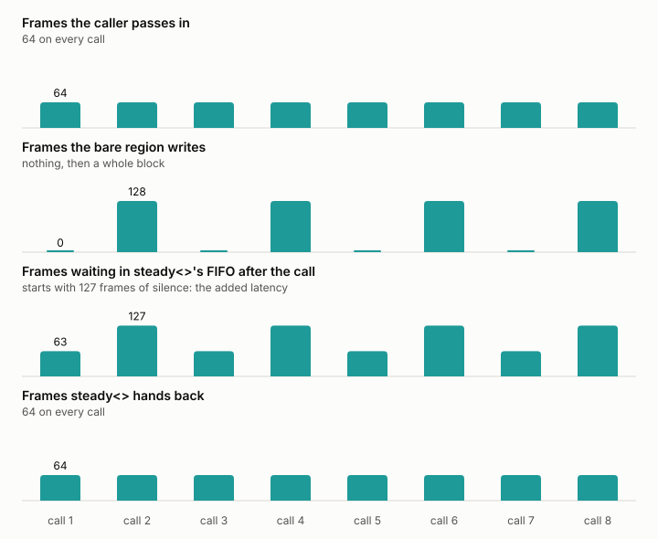
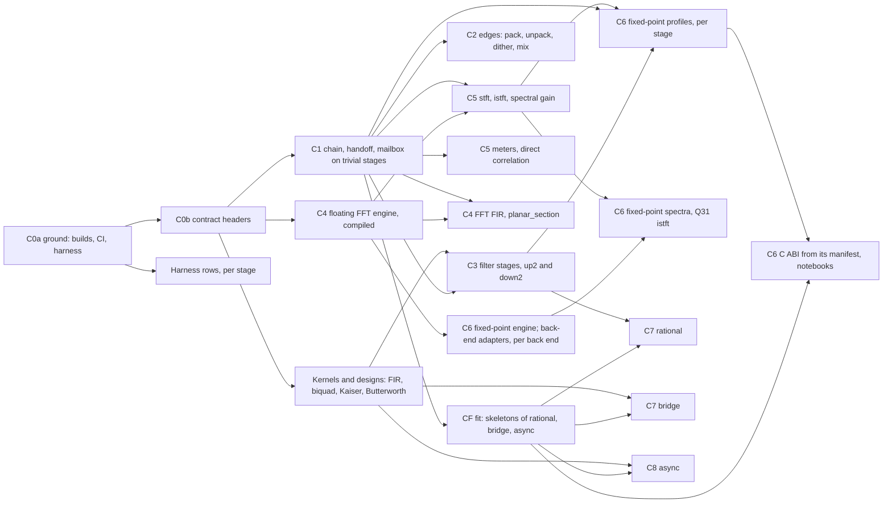

# catenae — plan

**catenae**: Chainable Audio Transforms for Embedded, Native & Accelerated Environments.

A C++17 library of audio processing *stages*, the *chain* that composes them, the *junctions*
that join chains across threads and clocks, and the *mailboxes* that carry a value between
threads. Each has a contract stated as numbers, and a chain is a type the caller writes.

Nothing is built yet. This file says what will be: the decisions, the contracts, the
milestones. How it came to be this way is elsewhere, by rule (one home per fact):

| Where | What |
|---|---|
| `git log -- PLAN.md` | The thirty-odd drafts and what each changed |
| `docs/audits/` | The three audits (63, 53 and 23 findings, with evidence), where each finding went, the alternatives each decision set aside, and the layout spike's tables |
| `docs/sketches/config-state/` | Part of sections 3 to 6 as code that compiles and runs, with the Cortex-M33 measurements quoted here; its README lists what it covers and what it does not |

Every decision in section 1 is the maintainer's, settled on or before 2026-11-25.

## 1. Decisions

### Identity and scope

| # | Decision |
|---|---|
| D1 | The name is `catenae`; the repository is `tap/catenae`. |
| D14 | catenae is not part of the TapHouse family. Its namespace is `catenae::` and its banner is `Copyright 2026 Timothy Place and the catenae contributors`. |
| D33 | The license is not chosen. It is decided after the coding is complete; until then there is no license file and no SPDX line. `NOTICE.md` records where every carried file came from and the license it had there (DspTap and SampleRateTap are MIT). |
| D3 | DspTap and SampleRateTap are sources of material, not dependencies: no submodule, no link. Code is carried in by copy, ported, and recorded in `NOTICE.md` with the commit it came from. |
| D15 | catenae and SampleRateTap coexist for good. Neither depends on the other, and catenae's contracts owe `tap::dsp::sync_stage` nothing. |
| D16 | Once the architecture is stable, catenae duplicates all of SampleRateTap (`rational`, `bridge`, `async`), re-implemented on catenae's contracts. "Stable" is decided on the evidence of the fit milestone, CF (section 10). |

### Language and rules

| # | Decision |
|---|---|
| D2 | C++17, strictly: one code path, no C++20 feature, not even behind a feature test. Checked: every file compiles without a warning at `-std=c++17`, 20 and 23, and the instruction-count ratchet's numbers are equal across the three. Where the standard library only has a type later, catenae writes its own with the standard's interface (`span`, `expected`). |
| D21 | No exceptions and no RTTI, ever. Every build is `-fno-exceptions -fno-rtti`; there is no second configuration. Whatever can fail returns a `status` or an `expected<T, status>`, and only outside the audio path. |
| D22 | No heap. The library never calls `new`, `malloc` or an allocating container. Memory is a state whose size is fixed by template arguments, a constant table in ROM, or storage the caller supplies. |
| D23 | Written with MISRA C++:2023 and ASIL B in mind, as a precaution: there is no requirement and no checker. What is expensive to retrofit is designed in (section 8); nothing is claimed. |
| D20 | Naming and formatting are the Tap rules, enforced by `.clang-format` and `.clang-tidy` in CI; the files are owned here, with no drift check against TapHouse. |
| D30 | Public constants have no prefix and read as the standard library's traits do (`rate_ratio`, `is_in_place`). `k_` is for private members and `detail`. A script in the tidy job enforces it, because `clang-tidy` cannot see a constant's access. |
| D40 | Include guards in the C++ Core Guidelines' style, not `#pragma once`: `CATENAE_<PATH>_<FILE>_H`, spelled from the header's path, checked in the tidy job. |
| D31 | Warnings are errors and the sets are strict (section 7.3), on catenae's code and on a consumer's view of each header. A suppression is a recorded deviation. |
| D12 | The Tap libraries' discipline carries over: contracts as numbers pinned by tests; processing `noexcept`; published literature only; honest limits stated and pinned. |

### The architecture

| # | Decision |
|---|---|
| D13 | A chain is written by the caller as a type. Nothing is looked up from a rate pair or built from a run-time description. |
| D6 | A stage declares its input and its output as *port types*. Two stages join when one's output port and the next one's input port are the same type. |
| D17 | A port has a signal kind, each its own template: time-domain audio, frames of transform coefficients, wire bytes. A time-domain stage after an analysis does not compile. |
| D5 | The native layout is interleaved. |
| D42 | The channel count is a compile-time number in both layouts. A planar port is `Ch` spans, one per channel. Run-time counts are outside the library: a caller chooses among the configurations it instantiated, or runs one mono configuration over as many states as there are channels. That fan-out is for stages and chains; a junction is instantiated at its full channel count. |
| D7 | Planar is a typed region inside a chain: converter stages at its ends, `planar_section` for convenience. |
| D8 | Byte order and packing exist only in edge stages, `unpack` and `pack`, whose outer port is a `wire_port` that no other stage accepts. Inside a chain every sample is native. |
| D18 | The stage contract is fixed-ratio: a compile-time L/M, and `outputs_for` exact. The ratio is the long-run one (D35). |
| D34 | **Configuration apart from state.** A stage is a small constant value, its *configuration*. What it remembers is a separate *state*: plain storage with no constructor, so a static one lives in `.bss` with no flash and no start-up code. `a \| b \| c` composes configurations; `state_of<Chain>` is one instance's memory. One configuration serves many states. A parameter is part of the configuration. |
| D49 | **Reset.** The configuration resets the state: `reset(state&) const`, in place, before the first call. Storage that is all zero means not yet reset, not at rest. A stage whose rest state is all zero writes no reset (the default zeroes the state); one whose rest state is not, or depends on its configuration, writes its own. A chain's reset calls each stage's on its own part of the state. A state is a plain aggregate, trivially copyable and standard-layout, with no default member initialisers. A missing reset is a broken precondition, checked at the `audit` level. |
| D50 | **Workspace apart from state.** What a call needs and no instance keeps (the buffers between stages, a stage's scratch) is a *workspace*: one per thread, shared by every state of that chain type, never initialised, never reset. The entry is `process(state&, workspace&, in, out)`; `memory_of<Chain>` holds both for a single instance. |
| D35 | **A 1:1 ratio is not n frames out for n in.** A stage publishes its `input_group`, the smallest block it always turns into exactly n L/M frames, and its `max_shortfall`, how far its output can trail. A chain composes both, and `is_frame_synchronous` is derived (`input_group == 1`), never declared. A fixed block must be a whole number of input groups. `steady<>` wraps a bursting 1:1 configuration with a FIFO primed by its shortfall and presents a frame-synchronous one with that latency stated. The pull side keeps a holdover and delivers exactly the frames asked for. |
| D37 | **Designs.** Anything computed from run-time numbers is a *design*, made by `make()`, which can fail; a stage is built from a design and cannot. A design carries its sample format, holds its coefficients in the kernel's type, and stores its latency and tail as numbers. Small designs are returned by value; table designs are generated ROM tables or are built into storage the caller supplies. A design that fixes a size (a tap count) is a type, and a template argument of its stage. A design is a class, not an open aggregate: only `make()` and a checked `from_table()` produce one. |
| D39 | **Latency.** Every stage reports `{nominal, deviation}`; a stage with `has_exact_latency` also publishes an exact rational, a constant of its type. `oversample<Factor, Stage>` adds the delay that makes an oversampler's latency a whole number of frames. |
| D9 | One latency report per stage and one flush contract: a tail and a stated residue. Flushing is resumable: a call writes at most the buffer it is given. |
| D10 | Capabilities are published constants read through `stage_traits<T>`; nothing probes for a member, with one exception: `reset`, which `stage_traits` supplies for a stage that does not write one (D49). A type opts in as a stage by specialising `is_stage<T>`. |
| D27 | **Checks.** Joints inside a chain are proven at compile time and cost nothing at run time. A run-time *boundary* check exists only where the caller's buffers enter (`process`, `push`, `pull`, `fed_by`), is written once from the traits, and is on in every build; with fixed-size blocks it is compile-time too. An *audit* check, on the library's own promises, is an explicit build option. The level is part of an inline namespace that the handler's name carries too, so a file with a run-time check or a call into the compiled core does not link against another level. |
| D19 | A *junction* is a first-class concept with its own contract, for the place where two threads or two clocks meet. Like a stage it is a configuration and a state. The asynchronous converter is one. A chain never contains one. |
| D51 | `handoff` has a fill policy stated as numbers: a target fill, silence until it is first reached, filling again after an underrun, the newest frames dropped on an overrun. Its nominal latency is the target. Every junction has a consumer-side `restart` beside the at-rest `reset`. |
| D52 | The exact pull makes one pull on its junction per request, because a junction may clock a servo or a fill policy from its pulls. The largest request is a template argument that sizes the staging. A two-step pull (declare the request, then take it in pieces) would need no staging and is deferred. |
| D44 | A *mailbox* carries one value between two threads: one poster, one taker, the newest wins, nobody waits. A new configuration reaches the audio thread this way and a reading leaves it. A posted value owns everything it refers to. A change takes effect at the next call after it is collected; whether it is smoothed is the stage's matter. |
| D11 | Read-only analysis is a sibling `analyzer` concept; `tap<Ch, Analyzer>` puts one in a chain and passes the audio through. |
| D43 | `parallel<ChainA, ChainB>` runs two chains on two groups of one port's channels with their latencies aligned. Both arms are frame-synchronous, their ratios match, and each has an exact latency that is a whole number of frames and a constant of its type (all asserted), so the aligning delay is sized by the types. An arm with a designed recursive filter has no such latency: its delay is placed by hand. A form that re-aligns at run time is deferred. A stage with two audio inputs stays out of the charter. |

### Numbers

| # | Decision |
|---|---|
| D24 | `float` is the default sample type and `double` the golden model. A stage is `basic_<name><S, ...>`; an unsuffixed name is its `float` alias, and `_f64`, `_q15`, `_q31`, `_q4_27` name the others. |
| D36 | The `float` profile accumulates in `float`, so it never leaves a single-precision FPU. The order of summation is part of the numeric design and is fixed before a floor is recorded. Floors are measured and stated per stage; a `float` FIR carries a floor and a tolerance, not a bit pin across targets. A link-stage gate rejects a software-double routine in a named probe image whose designs are all tables. Comparison with SampleRateTap is to an absolute tolerance for `float` and bit for bit where the arithmetic is unchanged (`double`, Q15, Q31). |
| D29 | A fixed-point port names its Q format in its type: `fixed<Storage, F>`, a tag over raw `int16_t` or `int32_t`, never a wrapper class. `convert` moves between formats. A stage accepts only the formats its battery pins. First set: `q15`, `q31`, Q4.27. Wire formats unpack to `q15` (16-bit) or `q31` (24-bit left-justified, 32-bit). |
| D47 | Fixed point arrives with a stage's first version where the carried code has it (FIR kernels, decimators, L/M stages), where the stage exists only because of it (`convert`, `unpack`, `pack`, written new), and where it is a copy or one saturating helper (`delay`, the layout converters, `mix`, dither, the meters, correlation). It arrives at C6 where it is new design (recursive, nonlinear, ramped and spectral stages, and the FFT FIR). Q4.27 arrives at C1 in `convert` and is pinned per stage with that stage's fixed-point profile. From C1 every stage is a template on its sample format and CI instantiates its contract, not its arithmetic, for `q31`. |
| D25 | A spectrum frame is, per channel, N/2 + 1 bins of `complex<S>`, DC to Nyquist, all stored, channels end to end (section 5.2). Frozen at C4 after the split-complex measurement. |
| D38 | Q15 spectra are for analysis only. The forward transform is fixed scaling, so a spectrum's format is its type. Q31 resynthesis uses the own engine's block-floating inverse, whose exponent `istft` consumes itself, so none travels; its floor is stated in dBFS per length. A block-floating forward transform, whose exponent would travel with every frame, waits for a design of its own. |

### Build and tools

| # | Decision |
|---|---|
| D4 | Not header-only. Templates whose compile-time numbers matter are headers; everything else is compiled once into a static library, `catenae` (section 7). |
| D28 | FFT back ends: catenae's own engines are the default and the only ones in the repository. CMSIS-DSP and vDSP are opt-in, chosen per sample type when the library is built, never vendored. |
| D48 | The floating FFT engine arrives at C4 and the fixed-point one at C6; the interface for all four types is fixed at C4. |
| D26 | CMake first; waf built in CI from C0a; a Zephyr module when a consumer needs it; one amalgamated source for anything else. |
| D45 | The C ABI is a manifest: a list, fixed when the library is built, of named instantiations (a chain or a junction with its sample format, channel count, design types and capacities), each exported as C functions over storage the caller supplies, with its size and alignment as constants for the target. An instantiation's init is `reset` (D49). A design value that is a number enters through an exported `make()` that returns a status. Nothing is chosen at run time behind a handle. |

### Documentation

| # | Decision |
|---|---|
| D32 | Four kinds of document with one job each (README, guide, reference, record), executed notebooks and generated tables, under rules that keep them short (section 11). |
| D41 | The guide is a tutorial for one reader: an experienced software engineer who has not worked on embedded hardware. |
| D46 | mdBook for the guide, Doxygen for the reference, one site. No print edition. Notebooks arrive with the C ABI. |
| D53 | The guide's chapters are written by a spawned Fable-model agent, whatever model is doing the implementation work. The reference comments and the cards stay with the code's author. |

## 2. Charter

**In:** 1:1 stages (filters, gain, delay, mixing, nonlinearities, dynamics without a side
chain); rate-changing stages by a compile-time L/M; sample-format, layout and wire
converters; transform-domain regions; the chain and its combinators; analyzers; junctions;
mailboxes; and the measurement harness.

**In, after CF (D16):** everything SampleRateTap does: `rational`, `bridge`, then `async`
as a junction.

**Out, at least until 1.0:**

- Stages with two audio inputs. Two signals meet only as channels of one wider port (`mix`,
  cross-correlation) or as groups of channels (`parallel`).
- A run-time graph: no dynamic routing, no plug-in host, no patch format.
- Run-time channel counts (D42).
- Pitch shifters and other processes with their own framing; elastic processes (time-stretch,
  varispeed).
- Fixed-point resynthesis in Q15, and a block-floating forward transform (D38).
- Anything defined by imitating a product rather than by a published method.

## 3. Ports, stages and designs

### 3.1 Ports

A port is a type, and a joint is `std::is_same` on two of them.

| Port | Carries | A frame is |
|---|---|---|
| `port<S, Ch>` (interleaved) | time-domain audio in sample format `S` | `Ch` samples |
| `port<S, Ch, layout::planar>` | the same, as `Ch` spans, one per channel | one sample from each span |
| `spectrum<S, Ch, Bins>` | transform coefficients (section 5.2) | `Ch * Bins` values of `complex<S>` |
| `wire_port<Format, Ch>` | bytes; formats are in namespace `wire` (`wire::s16le`, `wire::s24le_packed`, ...) | `Ch * bytes_per_sample` bytes |

A sample format is `float`, `double`, or `fixed<Storage, F>`: signed two's complement with
`F` fractional bits in `std::int16_t` or `std::int32_t`. `q15` is `fixed<std::int16_t, 15>`
and `q31` is `fixed<std::int32_t, 31>`. Q4.27 means one sign bit, 4 integer bits, 27
fractional bits. A raw `int16_t` is not a sample format. The tag is stripped before a kernel
is called, so Q4.27 and Q0.31 share one copy of the code. A stage accepts only the formats
its battery pins (D29): for any other, `is_stage` is false, so its traits can be
instantiated in CI (D47) while it joins no chain.

### 3.2 What a stage declares

A stage is a configuration (D34). It is read through `stage_traits<T>`, which fails with one
`static_assert` per missing or ill-typed member, and it opts in through `is_stage<T>`.

| Member | Meaning |
|---|---|
| `input_port`, `output_port` | The two port types. |
| `rate_ratio` | `ratio{up, down}`, reduced. For an analysis stage it is 1 / hop. |
| `state` | A nested type holding everything one instance remembers: a plain aggregate, trivially copyable and standard-layout (asserted), with no default member initialisers, so a static one is in `.bss`. Storage that is all zero is not yet reset (D49). |
| `workspace` | A nested type holding what the stage needs only while a call runs; `no_workspace` for a stage with none (D50). Never initialised and never reset. |
| `reset(state&) const` | Puts the state at rest, in place: `noexcept`, cannot fail, builds no temporary. Optional, and the one member `stage_traits` supplies: zeros, for a stage whose rest state is all zero. A stage whose rest state is not zero, or depends on its configuration, writes it: a gain starts at its level, an L/M stage at its design's phase, `steady` with its FIFO primed. |
| `is_in_place` | Whether `in.data() == out.data()` is allowed. Declarable only when the two ports are the same type and the ratio is 1:1 (asserted). |
| `input_group` | The smallest n for which calls of whole multiples of n frames, from the reset state, each write exactly n L/M: 1 for a stage that keeps pace frame by frame, M for a decimator, the hop for a stage that works in blocks. `static constexpr`. |
| `max_shortfall` | The most output frames by which the stage's output can trail n L/M, from any state, as a ratio: 0 where `input_group` is 1, 1/2 for a decimator by 2, hop - 1 for a block stage. `static constexpr`. |
| `is_frame_synchronous` | `input_group == 1`: every call of n frames writes exactly n L/M. Derived by `stage_traits`, never declared (D35). |
| `has_exact_latency`, `exact_latency` | Whether the stage delays every frequency alike; if so, that delay as a reduced rational in output frames, a constant of the type (D39). |
| `run(state&, workspace&, in, out) const` | The stage's work, trusted: spans of the ports' value types (for a planar port, an array of `Ch` spans), already known to be the right sizes; consumes all of `in`; returns the frames written. `noexcept`, no allocation, no failure, no boundary check. Called by a chain. |
| `outputs_for(const state&, n)` | Exactly what the next call of n frames writes. |
| `frames_needed(const state&, k)` | The smallest n with `outputs_for(n) >= k`. For an interpolating stage that n can write more than k. |
| `max_outputs_for(n)` | An upper bound from any state, `static constexpr`, non-decreasing in n. The chain sizes its scratch from it. |
| `latency()` | `{nominal, deviation}` in output frames, stored numbers from the design; deviation 0 when exact. |
| `tail_frames()`, `practical_tail_frames()`, `flush_residue()` | Zero input frames after which the stage's own output is silence within the residue (0 for FIR; for a floating-point recursion a stated bound and the range of designs it holds for), and the frames to -120 dB re full scale, which is what a caller usually flushes. |
| accessors and setters | A parameter is the configuration's: `level()`, `set_level()`, `design()`, `set_design()`. A setter cannot fail and is not synchronised (section 6.3). |

The joint check is `joint<Index, OutputPort, InputPort>`: one `static_assert` with one fixed
message for each way two ports can differ (kind, sample format, channel count, layout,
bins). The chain's class definition instantiates its joints and its stages' traits itself,
so a mismatch is an error when the chain's type is formed, whether or not anything is ever
called on it. C++17 cannot print a type in the message; the compiler's note naming
`joint<...>` is where the two ports are read.

A fixed-point port's value type is its storage: a `port<q31, 2>` stage runs on spans of
`std::int32_t`, and the tag is only in the port.

### 3.3 Designs and failure

- **The audio path cannot fail.** `run`, `process`, `reset`, `push`, `pull`, `restart`,
  `post` and `take` return counts or flags, never errors.
- **A design is where failure lives** (D37). `T::make(args)` returns `expected<T, status>`.
  `catenae::expected` has `std::expected`'s interface (`has_value()`, `operator bool`,
  `operator*`, `operator->`, `value()`, `error()`, `value_or()`), with two differences forced
  by D21: `value()` and `operator*` on an empty one are violated preconditions, not a throw
  and not undefined; and `T` and `E` are trivially destructible (a design, a status), which
  is what lets it be `constexpr`. `expected` and `status` are `[[nodiscard]]`.
- **A design is for one sample format.** `make()` validates for that format (a cutoff stable
  in `double` can lose a pole in `float`), stores coefficients in the kernel's type, and
  stores the latency and the tails. A stage built from a ROM design links no `double` and no
  `libm`. `group_delay(f)` is a design-time free function, not a stage member.
- **Two kinds.** A small design (a biquad, a Butterworth) is returned by value. A table
  design (a long FIR, `bridge`'s and `async`'s banks, 12 to 164 KB) is a generated ROM table
  with a bit pin, or is built by `make(spec, table, workspace)` into the caller's storage,
  with `constexpr` size functions.
- **A design that fixes a size is a type.** A rate-changing stage is
  `stage<S, Ch, Ratio, Design>`: `Design` names a generated table and its tap count, one per
  profile and design divisor (SampleRateTap's chains relax their inner stages, so the two
  `up2` of a four-times oversampler are different types), or is `custom<Taps>`, filled by
  `make(spec, table, workspace)`. Named chains are alias templates that compute each stage's
  divisor. A design whose tap count is known only after a search is searched by a host tool
  and its result is a template argument; run-time profile objects and run-time search are
  not carried over from SampleRateTap.
- **A table is checked too.** `from_table()` checks what it can without `libm` (a biquad's
  poles inside the unit circle; a fixed-point format's limits) as `constexpr` arithmetic. A
  bad table that initialises a constant does not compile; one met at run time reaches the
  handler. So only `make()` and a checked table produce a design.
- **Fixed-point designs check what the kernel cannot.** The carried recursive kernel has two
  guard bits above integer full scale and wraps beyond them, and its Q2.30 coefficients
  cannot exceed 2. `make()` rejects a section whose gain or coefficients do not fit.
- **What `make()` costs is on the design's card**: its stack and its instruction count, per
  order. The carried tail computation keeps its matrices on the stack (480 bytes at order
  2, 1,432 at 4, 5,272 at 8, 20,640 at 16, Cortex-M33), so it stays a header template on the
  section count, and `make()` runs where the stack admits it, never in the audio callback.
- **A configuration is small and constant.** `stage_traits` asserts that a stage is
  trivially copyable and no larger than 256 bytes; anything larger is a table held by view,
  and a view-taking constructor refuses a temporary. `|` takes its operands by reference and
  builds the chain in one construction. A static configuration is declared with
  `CATENAE_CONSTINIT`, so one that would be built by start-up code does not compile; a
  function-scope constant is `static constexpr`.

### 3.4 Where checks happen (D27)

| Where | What is checked | When |
|---|---|---|
| A joint between two stages | The ports are the same type; the scratch between them holds `max_outputs_for` of a block | Compile time |
| The caller's entry | `process`: the input is whole frames and the output holds `outputs_for(n)` frames. `push`, `pull`: whole frames. `fed_by`: whole frames, and the request within its `MaxRequest` | Once per call, in every build. Compile time for fixed-size blocks. |
| Inside the library: indices, invariants, a stage exceeding its own `max_outputs_for`, a state that was never reset, `steady`'s FIFO running short, the host's flush-to-zero setting | The library's promises, and the host's | Only at the `audit` level |

- **A stage has no checked entry.** The checked entry is the chain's `process`; a stage used
  alone is a chain of one. The boundary check is one function, written from the traits.
- **Fixed blocks.** `process` has overloads for `std::array<T, N>&`, `T(&)[N]` and a
  fixed-extent span that deduce both extents and `static_assert` whole frames, a whole
  number of the chain's input groups, and room for `max_outputs_for`. Such a block is
  written as exactly N L/M frames as long as every call on that state is one. Only the
  dynamic-extent overload checks at run time.
- **Reset is a precondition, checked at the audit level.** A chain's state always carries a
  `ready` word that `reset` sets, so its layout does not depend on the level; `process`
  tests it only at `audit`. At `boundary` a state that was never reset is a broken
  precondition that nothing reports, and a stage whose rest state is not zero starts wrong.
- **Counts are `[[nodiscard]]`**: on a junction the count is the only sign of an overrun.
- **Content is not a precondition.** Any bytes are valid samples. A non-finite float poisons
  a recursive state until it is reset; a caller who cannot vouch for its input adds an
  explicit `sanitize` stage.
- **A failed check** calls one `[[noreturn]]` handler, `catenae::check_failed(check)`, with
  an enumerated code (no strings in ROM). It is declared inside the inline namespace below
  and the library defines none: the integrator must, and it is where their system enters its
  safe state. A trapping default ships as a separate source file.
- **One level per configuration.** Checks are inline functions. `CATENAE_CHECKS` is
  `boundary` (the default) or `audit`, independent of the build type, written into
  `catenae/config.h` by each build system. The level and the FFT choices are spelled into an
  inline namespace by one hand-written header from `config.h`'s macros. No definition is
  shared across configurations, and a file that calls the compiled core or contains a
  run-time check does not link against another configuration. A file whose checks are all
  compile-time references nothing and links anywhere: nothing in it differs by level. C0b
  has a link test of each case, including the one that links, on an embedded leg at `-Os`
  with `--gc-sections`. `catenae/fwd.h` is how a consumer forward-declares a catenae type.

## 4. The chain

- `chain<Stages...>`, built by `a | b | c` over configurations. `|` always flattens,
  whichever side a chain is on, so the type lists the stages once and `stage<I>()` counts
  along it; a chain nested on purpose is written as a type. A non-stage operand is refused
  with catenae's own message. `chain(stage)` is a chain of one. `with_block<128>(a | b | c)`
  sets the block length (64 frames by default) and is a different type. Class templates
  meant for deduction have explicit guides.
- A chain is a stage: it has `state`, `workspace`, `reset`, `run`, the constants and the
  counts, so chains nest. Its state holds its stages' states and the `ready` word; its
  workspace holds its stages' workspaces and the scratch between them. `outputs_for`,
  `frames_needed`, latency and tail compose.
- `input_group` composes as the smallest n for which the frames arriving at every stage are
  a whole number of that stage's groups: down by 2 then up by 2 is 2; up then down is 1.
  `max_shortfall` composes as the smaller of two bounds: each stage's shortfall carried to
  the chain's output rate and summed, and one frame short of an input group. It is a bound,
  sufficient and not always tight (990 frames for a 480-frame block stage before a 512-frame
  one, where 959 would do).
- `process(state&, workspace&, in, out)` is the caller's entry: the one size check, then the
  work a block at a time through each stage's `run`. A run of `is_in_place` stages shares a
  buffer. `memory_of<Chain>` holds a state and a workspace for the common case of one
  instance, and `process(memory, in, out)` takes it.
- `reset(state&)` calls each stage's reset on its own part of the state and sets `ready`.
  It is called before the first `process`, and afterwards only between calls, on the thread
  that runs the chain.
- `stage<I>()` reaches one stage's configuration by position.
- `flush(state&, workspace&, out)` is the end of a stream, and it is resumable: each call
  writes at most the frames `out` holds and returns the count, until it returns 0, and
  `flush_remaining(const state&)` says how many are still to come. Its progress is in the
  state and its zeros are written into the workspace. Each stage in order is fed its tail of
  zeros through the stages after it: the practical tail unless the caller asks for the exact
  one, which for a recursive stage at a low cutoff is 10^4 to 10^6 frames (an order-8
  Butterworth: 14,736 at 0.01 of the sample rate, 149,085 at 0.001). A chain does not
  compose a residue: under flush-to-zero a recursion's residue is a standing limit cycle
  that later stages amplify by gains the contract does not carry, so flushing equals
  zero-padding the input and each stage's card states its own residue.
- The combinators:
  - `steady<Config>` (D35) wraps a 1:1 configuration and presents `input_group` 1. Its FIFO
    is primed with the configuration's `max_shortfall`, rounded up to a frame, and that is
    its added latency, a constant of the type.
  - `parallel<A, B>` (D43) runs two chains on two groups of a port's channels. It asserts
    that both are frame-synchronous, that their ratios match, and that each has an
    `exact_latency` that is a whole number of frames; the difference sizes its delay. An arm
    whose latency is not exact (a designed recursive filter) is refused: its delay is placed
    by hand with `delay`. It is what a side chain is later built from.
  - `planar_section<Stages...>` (D7) de-interleaves once per block, runs mono stages over
    contiguous channels, re-interleaves, and presents itself as an interleaved stage.
  - `oversample<Factor, Stage>` (D39) is up, the stage, down, with the delay that makes its
    latency whole: one frame at the inner rate. Its inner rate changers are the relaxed
    designs. A bare `up2 | ... | down2` chain beyond two times is fractionally delayed, and
    its card says so.
- Bit-identical for any chunking at contraction off. The compiled core is built that way; a
  header-template stage compiles under the consumer's flags, and its card says so.
- One call, one thread, one clock. A workspace is used by one thread at a time.

## 5. Layout and signal kind

### 5.1 Time-domain audio

Interleaved with a compile-time channel count is the default for every stage with state.
`deinterleave` and `interleave` are 1:1 stages between the layouts. Each stage's row in the
layout benchmark is the evidence for the layout it prefers.

What the spike measured, as planar cost over interleaved across 2, 6 and 12 channels
(`docs/audits/layout-spike-tables.md` has the tables and their runs):

- The FFT FIR: 1.04 to 1.16, interleaved cheaper, on the cores with an FPU and on Hexagon;
  no difference on the soft-float M4.
- A stateless gain: 0.28 to 0.52 at 6 and 12 channels on the M55 and x86-64, planar cheaper
  where the vector unit is wide; 1.25 for stereo on the M55, whose pattern fits the vector's
  lanes; 1.30 to 1.40 at 6 and 12 channels on the M4F and M33; within 5 % elsewhere.
- A compile-time channel count: worth up to 12 times for interleaved and under 2 % for
  planar.

The recursive stage's layout is measured again at C3 on the block kernel.

### 5.2 A spectrum's format (D25)

For a real input of N samples per channel, one frame of `spectrum<S, Ch, N/2 + 1>`:

```
channel 0:  re[0] im[0]  re[1] im[1]  ...  re[N/2] im[N/2]
channel 1:  re[0] im[0]  re[1] im[1]  ...  re[N/2] im[N/2]
```

- Real and imaginary parts are adjacent, as `catenae::complex<S>`, a plain `{S re; S im;}`
  (`std::complex` is specified only for floating types).
- Every bin from DC to Nyquist is stored, zero imaginary parts included: N + 2 scalars per
  channel, so a coefficient stage is one uniform loop.
- Channels are not interleaved: an FFT transforms one channel's contiguous samples, so the
  analysis stage de-interleaves as it windows.
- Forward is `sum x[n] exp(-i 2 pi k n / N)`, unnormalized. An analysis and synthesis pair
  states its overall gain (1) and its reconstruction error.
- A frame is stamped by the first sample of its window; latency is stated against that.
- A fixed-point spectrum's format is its type: the forward transform's fixed scaling grows
  the output by a known number of bits for a length (log2 N for Q15, log2 N + 1 for Q31), so
  no exponent travels. Under D38 a Q15 inverse transform does not compile. The Q31 `istft`
  runs the own engine's block-floating inverse and applies its exponent as a shift before
  the overlap-add, so no spectral stage sees one; restoring unity gain is a saturating
  shift. Its floor is an absolute number per length (measured on DspTap's engine with white
  noise: -154.5, -152.0, -148.7 and -142.8 dBFS at N = 256, 512, 1024 and 4096; fixed
  scaling both ways gave -122.3, -116.7, -110.2 and -98.2). CMSIS-DSP has no block-floating
  inverse, so on that back end the Q31 `istft` is fixed scaling both ways with its own,
  higher floor: the contract number is per back end.
- Split complex (vDSP's form) is measured against this at C4, and D25 is frozen then.

## 6. Junctions, analyzers and mailboxes

### 6.1 Junctions (D19)

A stage lives inside one call, on one thread, in one clock domain. A junction is where two
call sites meet. Like a stage it is a configuration and a state, and it is read through
`junction_traits<T>`.

| Member | Meaning |
|---|---|
| `sink_port`, `source_port` | Port types. |
| `clocking` | `clocks::shared` (two threads, one clock) or `clocks::independent`. |
| `rate_ratio` | The nominal ratio between the sides. |
| `state` | Plain storage, as a stage's: standard-layout, no initialisers, in `.bss` when static. It holds atomics, so it is not copied. A junction's configuration does not change while either side runs. |
| `tolerance_ppm()` | Independent clocks only: the offset and drift it absorbs. |
| `push(state&, in) const` | Exactly one thread. Returns the frames accepted; what happens to the rest is stated. `noexcept`, wait-free. |
| `pull(state&, out) const` | Exactly one other thread. Always fills `out`; what it could not supply is silence; returns how many frames were real. One pull is one consumer period: a junction may clock a servo or a fill policy from its pulls (D52). |
| `report(const state&) const` | Any thread. Each field (state, fill, underruns, overruns, a rate estimate; each junction has its own report type) is individually atomic and 32 bits wide; there is no snapshot across fields. A fill computed from two indices reads the consumer's first and the producer's second, so it can only over-estimate, and is clamped to the capacity; or the consumer publishes its fill as one word, which is `async`'s form. New design: the carried ring has no query a third thread may call. |
| `latency()` | `{nominal, range}` in source frames: a junction's delay breathes with its fill. Callable from any thread; for independent clocks it may change between calls. |
| `capacity_frames` | A template argument, a power of two (asserted). |
| `reset(state&) const` | Before the first push or pull, and afterwards only while neither side is running. |
| `restart(state&) const` | The consumer's thread, while the producer runs: discards what is buffered and starts filling again. |

Instances: `handoff<S, Ch, Capacity, Target>`, a single-producer single-consumer ring
(shared clock, two threads), which proves the contract; the asynchronous converter (D16);
later, outside the charter, a jitter buffer.

**`handoff`'s fill policy (D51).** `pull` delivers silence until the ring first holds
`Target` frames, then real frames. A pull the ring cannot fill is an underrun: it delivers
what there is, pads with silence, and the ring fills to the target again. A push the ring
cannot hold is an overrun and drops the newest frames. So the fill a pull sees after
start-up or after an underrun is the target, whichever side ran first, and that is the
junction's nominal latency; between those points it moves only by what one side misses.
`Target` is at least the consumer's largest pull and at most the capacity less the
producer's largest push. `handoff`'s configuration is its template arguments, so its object
is empty.

**Cores.** A junction and a mailbox need lock-free 32-bit atomics (asserted): ARMv7-M,
ARMv8-M, Hexagon and the hosted targets have them. ARMv6-M has no exclusive access and is
out of scope until a consumer needs it, and then through one port hook the integrator
supplies. Each atomic is a word of its own, and a counter with one writer is a load and a
store.

`feeding(junction, junction_state, chain, state, workspace, in)` runs a chain and pushes
what it wrote. `fed_by(junction, junction_state, chain, state, workspace, out)` fills `out`
exactly, pulling what the chain needs in one pull (D52). Each has its own memory in the same
two parts as a chain's (`feeding_state<Chain>` and `feeding_workspace<Chain>` likewise):
`fed_by_state<Chain>` holds the chain's state, the holdover (D35)
and `starved`, the count of input frames the junction supplied as silence, which is how an
underrun is seen, since `fed_by` always returns the frames asked for;
`fed_by_workspace<Chain, MaxRequest>` holds the chain's workspace and the staging for one
pull, sized from the largest request by the chain's ratio and shortfall. A request above
`MaxRequest` is a boundary failure. There is no `|` across a junction: the thread boundary
stays visible in the caller's code. Latency across a junction composes as nominal only.

A junction is instantiated at its full channel count and is never fanned out per channel
(D42): each mono instance would have its own fill, and for `async` its own clock estimate.

### 6.2 Analyzers (D11)

Read through `analyzer_traits<T>`.

| Member | Meaning |
|---|---|
| `input_port` | What it reads; it has no output port. |
| `hop_frames`, `window_frames` | A result every `hop_frames`, over the last `window_frames`. |
| `state`, `reset(state&) const` | As a stage's. |
| `analyze(state&, in) const` | Trusted, as a stage's `run`. |
| `result_type`, `result(const state&)` | The latest result: a value, or a view of storage in the state. |
| `results_ready(const state&)` | How many results have completed since the last read. |

`tap<Ch, Analyzer>` is the stage that holds one and passes its input through, 1:1, in place,
with no latency. Results are read on the chain's thread and leave it through a mailbox; a
result that is a view is copied into a reading that owns its data before it is posted.

### 6.3 Mailboxes (D44)

| Member | Meaning |
|---|---|
| `post(value)` | Exactly one thread. Never waits. A value never collected is replaced by the newer one. |
| `take(apply)` | Exactly one other thread. If a value has arrived since the last take, calls `apply(value)` and returns true. Never waits. |
| `reset()` | Empties it. Only while neither side is running. |
| `T` | Trivially copyable and trivially destructible (asserted): a design, a level, a reading. It owns everything it refers to: no pointer, span or view inside it. The compiler cannot check that. |

Three slots and one atomic word: each side owns a slot and swaps it with the middle one, so
a value is never read while it is written. A post constructs its value in the poster's slot
(assignment could not begin the lifetime of a type with no trivial default constructor,
which a design is). A mailbox is an object with a constant constructor, not a state: it
starts empty, and a static one is in `.bss`.

A stage's setter is not synchronised. On the thread that runs the chain it is called between
calls; from any other thread the value is posted and the audio thread applies it at the top
of a call.

A table design is held by view, so a mailbox cannot carry it. It is replaced at run time
only with an acknowledgement: the control thread posts the new table's identity, the audio
thread posts back the generation it now runs through a second mailbox, and the control
thread reuses a table's storage only after seeing a later generation acknowledged.

**Assumptions of use.** A junction and a mailbox each assume one thread per side, where an
interrupt handler counts as a thread. A violation is a data race no check can see, so both
are verified under the thread sanitizer, on real weakly ordered hardware, and on a
bare-metal leg where a timer interrupt is the poster and the producer (section 7.3).

## 7. The build

### 7.1 What is a header and what is compiled (D4)

| Parameterized on | Where | Examples |
|---|---|---|
| A compile-time number measured to matter (channel count, section count, ratio, block length), or a loop that must inline into a per-sample loop | Header template | Stages, the chain and its combinators, `feeding` / `fed_by`, the FIR dot kernels, the biquad block kernel, `span`, `mailbox`, the traits |
| Only the storage type (`float`, `double`, `int16_t`, `int32_t`) and sizes passed at run time | Compiled, explicitly instantiated for the four | The FFT engines, bulk `pack` / `unpack`, the analysis instruments |
| Nothing | Compiled | The designers (Kaiser, Nyquist, Butterworth, biquad) and group delay, which are design-time arithmetic in `double`; the asynchronous converter's servo, which does not depend on the storage type (section 12) |

- **One definition per image.** A compiled FFT has one back end per library build and needs
  no tag of its own on every class that embeds it: the library-wide inline namespace of
  section 3.4 carries the choice.
- **The numeric contract is the library's.** The compiled core is built with catenae's own
  contraction policy, so its bit pins hold whatever the consumer passes.
- **ROM.** Compiled code is one copy, built with `-ffunction-sections -fdata-sections`, and
  dropped when unused. Design code need not link at all when a design is a table. Each
  component that could go either way gets a size probe in both forms on the embedded
  targets, and this table is corrected where a probe disagrees.
- **Template code is kept flat** by putting storage in the template and arithmetic in a
  kernel that takes spans, so two sizes of one stage share their code. The tail computation
  is the exception that stays a header template: it is sized by the section count
  (section 3.3).

### 7.2 FFT back ends (D28, D48)

| Back end | Sample types | Where | How it arrives |
|---|---|---|---|
| catenae's own floating engine (DspTap's srdif engine, ported), at C4 | `float`, `double` | everywhere; the default | source here |
| catenae's own fixed-point engine (DspTap's, ported: the fixed-scaling forward and inverse, and the block-floating inverse for Q31), at C6 | Q15, Q31 | everywhere; the default | source here |
| CMSIS-DSP | `float` for Helium first; Q15 and Q31 at C6; a Neon adapter is separate and waits for a consumer | Arm, opt-in | the consumer's copy, as a CMake target that carries its include directories and compile definitions; CI fetches one pinned release |
| vDSP | `float` first | Apple, opt-in | the system framework |

- **Own engines are the reference**: the only FFT code in the repository and the ones whose
  output bits are pinned. A back end re-presents the same contract within a stated tolerance
  of the `double` engine, proven by a parity battery on the leg that has the hardware.
- **The interface is fixed at C4 for all four types**: `fft_plan<S>`, `fft_tables<S, N>`,
  the build options, the spectrum's format as a function of the length, and the inverse's
  exponent as a value `istft` receives and nothing else does, with the fixed-point types
  declared and unimplemented until C6.
- **Tables are constant.** `fft_tables<S, N>` is in ROM and shared by every transform of
  that length (generated where C++17 cannot evaluate it); the workspace handed to a
  transform is scratch only.
- **One back end per sample type**, each option a choice from a validated list, all
  defaulting to `own`: `CATENAE_FFT_F32` (`own`, `cmsis`, `vdsp`, `none`), `CATENAE_FFT_F64`
  (`own`, `vdsp`, `none`), `CATENAE_FFT_Q15` and `CATENAE_FFT_Q31` (`own`, `cmsis`, `none`).
  `none` leaves that type's FFT out of the build, and a stage that needs it fails to compile
  with a message naming the option. The choices are in `catenae/config.h` and the inline
  namespace of section 3.4.
- **No silent fallback.** A length outside a back end's range fails to compile where it is a
  template argument and is a `status` from `make()` where it is not.
- **Not vendored**, because an embedded consumer nearly always has CMSIS-DSP already and a
  second copy would define the same symbols. The adapter is compiled with the consumer's
  CMSIS-DSP configuration macros (its structures change layout with them), `static_assert`s
  the size of the instance structures and the version, and states a tested version window.
- **What each produces, and so what its adapter does:**

  | Back end | Output | Lengths | To be handled |
  |---|---|---|---|
  | CMSIS-DSP `float` | N floats, the Nyquist bin's real part in bin 0's imaginary slot; exp(-i) | 32 to 4096 | Overwrites its input. Fix up bins 0 and N/2. |
  | CMSIS-DSP Q15, Q31 | Halved at every stage, so the output's Q format depends on the length (Q15: 6.10 at 32 to 14.2 at 8192). No block-floating mode. | 32 to 8192 | Scalar builds write 2N values. Q15's format equals catenae's fixed policy; Q31's differs by one bit. Its Q31 round trip is fixed scaling both ways, measured at C6 and stated as that back end's floor (section 5.2). |
  | vDSP | Split complex, exp(-i), forward scaled by 2, DC and Nyquist packed together | powers of two | Its setup allocates (a recorded exception to D22, on Apple hosts). Its workspace has an alignment requirement. |

- **Not planned:** FFTW (GPL); HVX, until a consumer needs it.

### 7.3 Warnings, errors and sanitizers (D31)

Each set is `-Werror` (`/WX`) on every CI leg.

| Compiler | Flags |
|---|---|
| GCC (hosted and `arm-none-eabi`) | `-Wall -Wextra -Wpedantic -Wshadow -Wconversion -Wsign-conversion -Warith-conversion -Wdouble-promotion -Wfloat-equal -Wold-style-cast -Wuseless-cast -Wcast-align=strict -Wcast-qual -Wundef -Wnull-dereference -Wformat=2 -Wimplicit-fallthrough -Wswitch-enum -Wduplicated-cond -Wduplicated-branches -Wlogical-op -Wmissing-declarations -Wredundant-decls -Wzero-as-null-pointer-constant -Wextra-semi -Wvla`, and `-Wstack-usage=` at each target's stack ceiling |
| Clang (hosted, Apple, Hexagon) | `-Weverything` less a written list with a reason per entry, starting as: the C++98 compatibility groups; `-Wpadded`; `-Wunsafe-buffer-usage` (it fires inside `span` and on every indexed kernel loop); `-Wswitch-default` (it contradicts `-Wswitch-enum`, which is kept); `-Wglobal-constructors` and `-Wexit-time-destructors` where a test framework needs them off |
| MSVC | `/W4 /permissive-`, with the conversion and shadowing warnings raised to errors |

- **Shadowing.** A local, a parameter or a capture never hides a member, an enclosing local
  or a global. Public value types have unprefixed fields (`ratio{up, down}`), so parameters
  take a different word, and the warning enforces it. A member cannot have its type's name:
  hence `rate_ratio`, `wire_port` with formats in `wire`, and `report()` beside `status`.
- **Double promotion** catches a stray `double` at compile time. It cannot see an explicit
  cast, so a link-stage gate does (D36). It runs on named probe images, one per `float`
  stage family, each an audio path built from table designs only: the linked,
  garbage-collected image may contain none of a listed set of software-double and `double`
  `libm` symbols. An image that links a designer is outside the gate by definition, and
  since the designers are in the compiled core, linking one is itself visible as a symbol.
  The first probe is C1's.
- **Conversions.** `-Warith-conversion` is what reports `int16_t = int16_t + int16_t`; Clang
  has no equivalent, so that case rests on the GCC legs and the sanitizer. Conversions
  between fixed-width types and `int`, `long`, `size_t` go through one named helper.
- **Float equality** goes through one named helper, so each exact comparison is deliberate.
- **A consumer's view.** Each public header is compiled alone under each compiler's set.
  The promise is: clean under those sets, with Clang's exclusion list published. catenae's
  headers are never marked as system headers; third-party ones are.
- **Warnings as errors is the default where catenae is the project being built and off where
  it is consumed**, so a newer compiler cannot break a consumer on a released version.
- **A suppression is a deviation**: a diagnostic pragma or a `NOLINT` cites an entry in the
  deviation log, and CI counts them against it.
- **Sanitizers.** One hosted leg runs the battery under the address and undefined-behaviour
  sanitizers at `-std=c++17` (a later standard defines shifts that C++17 does not). Every
  junction and the mailbox run under the thread sanitizer, and under stress on real weakly
  ordered hardware (an arm64 runner): x86 cannot reorder as Arm does and QEMU does not help
  with ordering. One bare-metal QEMU test makes a timer interrupt the poster and the
  producer against the main loop, which is the single-core deployment the assumption of use
  describes. The post's lifetime rule is seen by no sanitizer, so a C++20 leg posts and
  takes a design inside a constant expression.
- **`clang-tidy`** findings are errors, with a per-function complexity ceiling among them. It
  checks the case of names; scripts in the same job check D30's prefix rule and D40's guards.
  The Tap rule that requires `k_` on every constant is switched off: `clang-tidy` cannot
  tell a public constant from a private one, and D30's script replaces it.
- **Stack.** `-Wstack-usage=` is a per-function frame limit, with a written list of the
  functions it admits above it (a design's `make()`); the whole-path ceilings are the size
  probes' (section 8).
- **Shifts.** A right shift of a negative value is implementation-defined in C++17, a left
  shift of one is undefined, and an out-of-range unsigned-to-signed conversion is
  implementation-defined. Every shift of a signed value goes through one helper, a script
  rejects a raw one elsewhere, and a compile-time test evaluates the helpers with negative
  operands.
- **Constructs to avoid**, valid in C++17 and different later: an aggregate with a
  user-declared constructor, `[=]` capturing `this`, a default-initialised `std::atomic`,
  compound assignment to a `volatile`, arithmetic between different enumerations, an
  unqualified call with explicit template arguments.

### 7.4 Build systems (D26)

The library is always built from source in the consumer's build, with the consumer's target
flags, and never shipped prebuilt.

- **CMake**: the reference. `add_subdirectory`, one target.
- **waf**: a maintained `wscript`, built and tested in CI from C0a.
- **Zephyr**: a module file and Kconfig over the CMake build, when a consumer needs it; it
  uses Zephyr's CMSIS-DSP module.
- **Anything else**: one amalgamated `catenae.cpp` generated in CI, with a default
  `catenae/config.h` beside it. One CI leg builds and runs the battery against it, bit pins
  included. No compiler honours a contraction pragma reliably, so the amalgamation cannot
  carry the library's contraction policy: the flag is an assumption of use there.

### 7.5 The C ABI's manifest (D45)

The principle is D45's; the form below is tried at CF and fixed at C6.

- **One list, expanded twice.** The manifest is an X-macro header that both the C header and
  the C++ definitions expand, so no generator and no step that reads a built object is
  needed in any of the three build systems. The capacities it declares are checked by
  `static_assert` where the definitions are compiled.
- **Sizes are per target.** A state's size and alignment differ between targets (the
  overdrive state's are not the same on x86-64 and on a Cortex-M33), so each entry exports
  both, and the C header's storage macro carries the alignment, not a bare size.
- **`init` is `reset`, and it checks.** Each entry exports
  `init(configuration, configuration_size, state, state_size)`, which returns a status: C
  names do not carry the inline namespace of section 3.4, so this is where a header built
  for another target, level or back end is caught, at run time.
- **Wrappers return a status.** A wrong size from a C or Python caller is a status, not the
  handler: a notebook kernel must survive it.
- **What an entry fixes.** Type-level choices only: the stage or junction type, the format,
  the channel count, the design types, the capacities. A parameter is an exported setter; a
  design that is a number is an exported `make()`.
- **One shared target**, `catenae_c`, in CMake only, for tests and notebooks; waf and the
  amalgamation build the same file statically. The manifest is written per notebook, not for
  parity with SampleRateTap's handle-based C ABIs, and CF states its count and build time.

## 8. MISRA C++:2023 and ASIL B (D23)

MISRA C++:2023 is written for C++17. ISO 26262 does not certify a library on its own: a
component is developed as a safety element out of context and the integrator's safety case
takes it from there. catenae is built so that this is possible and cheap.

**Designed in from the first code:**

- No exceptions, no RTTI, no heap, no recursion; every loop bounded by a number the contract
  states.
- No undefined or implementation-defined behaviour relied on: fixed-width types, no signed
  overflow, spans in place of pointer arithmetic in every interface, the shift helper.
- Every contract point is a requirement with an identifier (`CAT-STAGE-007`), and the test
  that pins it cites the identifier.
- Cost is measured and gated: the ratchet's largest single call and the stack ceilings are
  per-stage numbers. They are the largest observed over stated workloads, not a proven worst
  case, and the contract calls them that.
- An assumptions-of-use register (`docs/assumptions.md`, each with an identifier): what the
  library requires of its integrator and cannot check, or checks only at the `audit` level.
  One thread per side of a junction or a mailbox; a state is reset before its first
  `process`, and afterwards only between calls on the thread that runs the chain; a
  workspace is used by one thread at a time; a posted value owns what it refers to; a
  junction's configuration does not change while either side runs, and `handoff`'s target
  is at least the consumer's largest pull; no aliasing of `in` and `out` unless
  `is_in_place`; the host's flush-to-zero setting; the handler does not return; a setter is
  called between calls; the amalgamation is built with contraction off.
- A deviation log. Its opening entries, from public summaries of the guidelines and
  unverified against the text: compiler extensions (`restrict`, inlining control, reading
  the floating-point control register, `CATENAE_CONSTINIT`), which go in one header so that
  each is one deviation; `memcpy`-based bit casts and the `memset` of the default reset; the
  signed right shift; guard-clause early returns against a single exit point;
  `-Wunsafe-buffer-usage` off; vDSP's allocation; static storage for states, configurations,
  workspaces and mailboxes, with a caller's arena as the alternative the guide shows; the
  implicit conversions that `span` and `expected` need to have the standard's interface;
  the placement new in the mailbox; the one detection of an optional member, `reset`.
- Each junction and the mailbox carries a requirement that states its memory orders and the
  argument for them, since the guidelines say nothing a reviewer could check them against.
- A complexity ceiling per function, kernels included; each `@req` states its equivalence
  classes and boundary values; a change to a contract header or a kernel is reviewed with a
  retained record.
- **What is tested is what ships.** The battery runs at both check levels. Coverage is
  measured on the configuration that ships (`boundary`, optimised). The configuration space
  is finite and written down, and CI names the combinations it runs.

**In CI from C0a:** statement and branch coverage of the compiled core and of each
instantiation the battery makes; `clang-tidy` and warnings as errors. These approximate a
MISRA checker; they are not one.

**Deferred until a requirement arrives:** a checker for the 2023 edition, the
guideline-by-guideline matrix, a safety plan, a safety manual, an assessment.

The MISRA document is licensed and was not to hand when this was written. No rule is quoted
or numbered here; this section is checked against the text when a copy is available.

## 9. What the code looks like

Sections 9.1 to 9.4, the bare and steady forms of 9.5 on a stand-in block stage, the pull of
9.6 and the junction are in `docs/sketches/config-state/`, which compiles without a warning
on GCC 13 and Clang 18 at C++17, 20 and 23 and runs; every number quoted here is printed by
its `measure.sh` (Cortex-M33, `-Os`). Its README lists what it does not cover: the traits
headers, latency and `parallel`, `flush`, in-place buffer sharing, `with_block`,
`oversample`, `feeding`, analyzers, and every port but interleaved `float`. Those are shown
here as they will be written and are first compiled at the milestone that delivers them.
The sketch has one sample type; the library's `gain` is `basic_gain<S, Ch>`, with `gain<Ch>`
the `float` alias and `gain_q31<Ch>` and the rest beside it (D24).

### 9.1 A stage: configuration, state, and a parameter that changes

A fixed gain needs no class: it is `map<>` with a multiplication.

```cpp
struct times {
    float factor;
    constexpr float operator()(float x) const noexcept { return x * factor; }
};

constexpr auto trim = chain(map<2, times>{times{0.5f}});
```

A gain worth a class changes level without a click. The level and the ramp length are
configuration; where the ramp has got to is state. At rest it is at its level, not at zero,
so it is one of the stages that writes its own `reset`.

```cpp
template <std::size_t Ch>
class gain {
  public:
    using input_port  = port<float, Ch>;
    using output_port = port<float, Ch>;
    static constexpr ratio       rate_ratio{1, 1};
    static constexpr std::size_t input_group = 1;
    static constexpr ratio       max_shortfall{0, 1};

    struct state {
        float         current;    // the level being applied now
        float         goal;       // the level the ramp is heading for
        float         step;       // per frame, while a ramp runs
        std::uint32_t remaining;  // frames of ramp left
    };
    using workspace = no_workspace;

    constexpr gain(float level, std::uint32_t ramp_frames) noexcept;

    constexpr float level() const noexcept { return m_level; }
    constexpr void  set_level(float level) noexcept { m_level = level; }   // a ramp, from the next run()

    void reset(state& st) const noexcept {    // at the level, with no ramp running
        st.current   = m_level;
        st.goal      = m_level;
        st.step      = 0.0f;
        st.remaining = 0;
    }

    std::size_t run(state& st, workspace&, span<const float> in, span<float> out) const noexcept;

    static constexpr std::size_t max_outputs_for(std::size_t n) noexcept { return n; }
    static constexpr std::size_t outputs_for(const state&, std::size_t n) noexcept { return n; }
    static constexpr std::size_t frames_needed(const state&, std::size_t k) noexcept { return k; }

  private:
    float         m_level;
    std::uint32_t m_ramp_frames;
};
```

**Algorithms or loops.** A stage that maps each sample on its own (`map`, `convert`, a fill)
uses a standard algorithm: no index to get wrong, and `std::transform` may write over its
input. A kernel with state carried between samples or a pattern across channels (a biquad,
an FIR dot product, the ramp above) is a plain indexed loop in a kernel function, which is
also the seam for a vector back end. The ratchet confirms on every target that the algorithm
form counts the same as the loop, and nothing meant for compile-time evaluation uses one
(the standard algorithms are not `constexpr` before C++20).

### 9.2 A design: a low-pass filter

```cpp
template <typename S>
class lowpass_design {
  public:
    static expected<lowpass_design, status> make(double cutoff) noexcept;   // may fail; double, tan
    static constexpr lowpass_design from_table(const std::array<S, 5>& coefficients,
                                               float latency_frames) noexcept;   // checked: poles inside the unit circle

    constexpr const std::array<S, 5>& coefficients() const noexcept;        // already in S
    constexpr float                   nominal_latency() const noexcept;     // a stored number
};

template <std::size_t Ch>
class lowpass {
  public:
    struct state {
        std::array<std::array<float, 2>, Ch> z;   // the filter's history, per channel: at rest, zero
    };                                            // so it writes no reset

    explicit constexpr lowpass(const lowpass_design<float>& design) noexcept;
    constexpr void set_design(const lowpass_design<float>& design) noexcept;   // cannot fail

    std::size_t run(state& st, workspace&, span<const float> in, span<float> out) const noexcept;
};
```

```cpp
// A configuration whose parameters will change is a variable. It starts from a design that is
// a table in ROM: no designer has run and none need be linked. There is one strip, so its
// state and its workspace are kept together.
static auto                         s_strip = lowpass<2>{k_lowpass_at_0_1} | gain<2>{1.0f, 96};
static memory_of<decltype(s_strip)> s_strip_memory;

s_strip.reset(s_strip_memory.state);                          // once, before the first callback
static_cast<void>(s_strip.process(s_strip_memory, in, out));  // the audio callback

// A new cutoff, off the audio path: design it (this can fail), then hand it over (this cannot).
const auto retuned = lowpass_design<float>::make(0.02);
if (retuned) {
    s_strip.stage<0>().set_design(*retuned);
}
s_strip.stage<1>().set_level(0.25f);                          // ramps over 96 frames
```

| The strip | |
|---|---:|
| Its configuration (`.data`) | 32 bytes |
| Its state (`.bss`) | 36 bytes |
| Its workspace (`.bss`; the sketch does not share a buffer along in-place stages, the library does) | 516 bytes |
| `reset` | 48 bytes of code, 8 bytes of stack |
| The callback's own frame; the static worst case down its call path | 40 bytes; 96 bytes |
| A linked image with table designs only | 3,084 bytes of text, no software-double symbol |
| The same with `make()` reachable | 11,400 bytes of text, 21 software-double and `double`-`libm` symbols |

The audio path's file calls no software floating point; the designer's calls `tan` and
seven software-double routines and costs 8,316 bytes of flash, which an image whose designs
are all tables does not pay. A filter's redesign is a step under a live history (a small
transient); smoothing it would be that stage's matter, as ramping is `gain`'s.

### 9.3 The same changes from another thread

```cpp
static mailbox<lowpass_design<float>> s_new_design;
static mailbox<float>                 s_new_level;

// Control thread: design, then post. It never touches the chain.
const auto wider = lowpass_design<float>::make(0.2);
if (wider) {
    s_new_design.post(*wider);
}
s_new_level.post(0.9f);

// Audio thread, at the top of its callback: collect, apply, process.
s_new_design.take([](const lowpass_design<float>& d) noexcept { s_strip.stage<0>().set_design(d); });
s_new_level.take([](const float& level) noexcept { s_strip.stage<1>().set_level(level); });
static_cast<void>(s_strip.process(s_strip_memory, in, out));
```

Two threads put two million 64-byte values through a mailbox with none torn and none out of
order, clean under GCC's thread sanitizer. Cortex-M33: these two mailboxes are 84 and 24
bytes of `.bss`, and the callback's frame with both collected is 56 bytes (112 down its call
path).

### 9.4 A chain: four-times oversampling around a tanh overdrive

```cpp
struct soft_clip {
    float drive;
    float operator()(float x) const noexcept { return std::tanh(drive * x); }
};

// The configuration: a constant. The type is the topology; the object is 8 bytes (the drive).
constexpr auto overdrive = up2<2>{} | up2<2>{} | map<2, soft_clip>{soft_clip{4.0f}} | down2<2>{} | down2<2>{};

static_assert(decltype(overdrive)::rate_ratio == (ratio{1, 1}));
static_assert(decltype(overdrive)::is_frame_synchronous);   // up before down: n frames come back as n

// The memory. A voice is its state; the workspace is the thread's and both voices use it.
static state_of<decltype(overdrive)>     s_voice_a;
static state_of<decltype(overdrive)>     s_voice_b;
static workspace_of<decltype(overdrive)> s_overdrive_work;

void reset_voices() noexcept {                               // once, before the first callback
    overdrive.reset(s_voice_a);
    overdrive.reset(s_voice_b);
}

// Both arguments are arrays, so every size is checked by the compiler.
void audio_callback(const std::array<float, 64 * 2>& in, std::array<float, 64 * 2>& out) noexcept {
    static_cast<void>(overdrive.process(s_voice_a, s_overdrive_work, in, out));
}
```

| Cortex-M33, `-Os` | One object per chain (the first audit's mock) | Configuration, state and workspace |
|---|---:|---:|
| Flash for the chain's data | 8,180 bytes | 0 |
| The configuration (`.rodata`) | | 8 bytes |
| RAM a voice: its state (`.bss`) | 8,180 bytes | 48 bytes |
| RAM a thread: the workspace (`.bss`) | | 6,152 bytes |
| Sixteen voices | | 6,920 bytes |
| Start-up code or stack to construct it | none, or a 12 KB frame | none |
| `reset` of two voices | | 36 bytes of code, 8 bytes of stack |
| The callback's own frame; the static worst case down its call path | not measured | 40 bytes; 176 bytes, plus `tanhf` |

The first column is from different mock stages; the flash row and the shape of the RAM rows
are the comparison. With the scratch inside each state a voice was 6,184 bytes and sixteen
were 98,944. The sketch's `up2` and `down2` are toys. With linear-phase half-bands, relaxed
on the inner pair as SampleRateTap's chains are, the latency is k + 1/2 frames (18.5 and
23.5 measured on its chains), which `oversample<4, ...>` makes whole (D39).

### 9.5 A transform-domain region, bare and steady

```cpp
// Mono. 512-sample Hann frames every 128 samples: 257 bins of complex<float> per frame.
constexpr auto gate = stft<512, 128, 1>{window::hann}
                    | spectral_gate<257, 1>{k_gate_design}
                    | istft<512, 128, 1>{window::hann};

//   stft:          port<float, 1>           ->  spectrum<float, 1, 257>
//   spectral_gate: spectrum<float, 1, 257>  ->  spectrum<float, 1, 257>
//   istft:         spectrum<float, 1, 257>  ->  port<float, 1>

static_assert(decltype(gate)::rate_ratio == (ratio{1, 1}));   // 1/128 then 128/1
static_assert(decltype(gate)::input_group == 128);            // exact in whole hops
static_assert(!decltype(gate)::is_frame_synchronous);         // 64 frames in give 0 or 128 out

// For an audio callback, which must return n frames for n: the same region inside steady<>.
constexpr auto denoise = chain(steady{gate});                 // 127 frames later, and it says so
static_assert(decltype(denoise)::is_frame_synchronous);

// What does not compile:
//   stft<512, 128, 1>{window::hann} | gain<1>{0.5f, 96}
//     error: catenae: a spectrum cannot feed a time-domain port
//     note:  in instantiation of joint<0, spectrum<float, 1, 257>, port<float, 1>>
//   gate.process(s_gate, block_in, block_out)        with two std::array<float, 64>
//     error: catenae: a fixed block must be a whole number of the chain's input groups;
//            wrap the chain in steady<>
// What does: the same call with two std::array<float, 128>, for a host whose block is the hop.
```

What `steady<>` does, call by call, drawn by `figure.py` from the output of `trace.cpp` (a
block stage of 128 frames standing in for the region):



Its reset primes the FIFO with the region's `max_shortfall` as silence: that is the added
latency (127 here; 511 in all for a 512/128 region, whose own latency is 384). It evens out
the frame counts, not the work: the transform still runs on every second call. A host whose
callback is a whole number of hops, aligned to them, needs no `steady<>` and gets the
compile-time entry.

Two cases the sketch runs, since `rate_ratio` alone hides both. Down by 2 then up by 2 is
1:1 with an input group of 2: three-frame calls return 2, 4, 2, 4; inside `steady<>` they
return 3 each time, one frame later. Two block stages whose sizes do not nest need more than
the largest burst: a 480-frame block before a 512-frame one is primed with 990 frames, 96
before 128 with 222, and both reproduce their input exactly at that delay.

### 9.6 Edges and a junction

```cpp
// Audio callback thread: 24-bit packed little-endian stereo off the wire, into float.
constexpr auto input = unpack<wire::s24le_packed, 2>{}   // wire_port<wire::s24le_packed, 2> -> port<q31, 2>
                     | convert<q31, float, 2>{}          // port<q31, 2>                     -> port<float, 2>
                     | lowpass<2>{k_lowpass_at_0_1};

// The junction: a configuration with no data, and a state. It fills to 128 frames before it
// pays out, so 128 frames is its latency.
constexpr handoff<float, 2, 1024, 128> link{};
static state_of<decltype(link)>        s_link;

static feeding_state<decltype(input)>     s_into_link;        // the chain's state
static feeding_workspace<decltype(input)> s_into_link_work;   // its workspace and the frames in transit

const std::size_t pushed = feeding(link, s_link, input, s_into_link, s_into_link_work, wire_bytes_in);

// Worker thread, same clock: mix to mono and meter it. Requests of up to 256 frames.
constexpr auto metering = mix<2, 1>{k_mono_mix} | tap<1, rms_meter>{};
static fed_by_state<decltype(metering)>          s_from_link;        // chain state, the holdover, `starved`
static fed_by_workspace<decltype(metering), 256> s_from_link_work;   // chain workspace, staging for one pull

const std::size_t got = fed_by(link, s_link, metering, s_from_link, s_from_link_work, span<float>(mono_out));
```

Before either thread starts: `link.reset(s_link)`, `input.reset(...)` and
`reset(metering, s_from_link)`.

The junction and the pull side are compiled in the sketch, the pull with a chain that raises
the rate by 4. Asked for 102 frames it pulls 26, which make 104, delivers 102 and holds 2
for the next call; asked for 700 it pulls 175 in one pull, though the chain's block is 64.
The fill a pull sees is 128 frames whichever side runs first in a period, and is back at 128
after an underrun. Cortex-M33: this junction's state is 8,212 bytes of `.bss`, its `push`
and `pull` 100 and 148 bytes of code.

### 9.7 Where the memory is, without a heap (D22)

| Pattern | For | Example |
|---|---|---|
| A state sized by template arguments | Histories, FIFOs, holdovers: what one instance remembers | `struct state { std::array<S, MaxFrames * Ch> line; std::size_t write; };` in `delay<S, Ch, MaxFrames>`: plain storage, in `.bss` |
| A workspace sized by template arguments | Scratch between stages, staging, a transform's buffer: what one call needs | `workspace_of<Chain>`, one per thread |
| A constant viewed, not copied | Taps, tables, designs | `constexpr std::array<float, 63> k_taps = {...};` in `.rodata`, and `fir<63, 2>{k_taps}` holds a view |
| Storage the caller supplies | A size known only at run time, in the compiled core | `fft_plan<float>::make(1024, s_workspace)`, with `fft_workspace_size<float>(1024)` a `constexpr` |

What it costs: a size chosen at run time needs a maximum chosen at compile time or a
caller's storage; a state or a workspace is as large as its buffers, so it belongs in static
storage or a caller's arena, never on a small thread's stack; every chain has three names
(its configuration, its state, its workspace; two, with `memory_of`, when there is one
instance); and a state is reset before it is used.

## 10. Milestones

Each ends with its battery green on every CI leg and its numbers recorded.

| | Milestone | Contents |
|---|---|---|
| C0a | Ground | Repository layout, `NOTICE.md`, style files. The CMake and waf builds, both in CI: hosted GCC, Clang, MSVC and Apple at C++17, 20 and 23; the Cortex-M and Hexagon QEMU legs; the sanitizer legs; the warning sets, `clang-tidy`, and the scripts the plan relies on (naming, guards, raw shifts, the suppression count, the `@req` trace, the length budgets). The harness: the instruction-count ratchet, the size probes (`.text`, `.rodata`, `.data`, `.bss` apart, the start-up stack, each call's static worst-case stack down its path), the link-stage gate as a script, coverage. The amalgamation. A smoke test of Doxygen and mdBook on one header and one page before their conventions are fixed. No library code beyond a first compiled unit. |
| C0b | Contracts | `span`, `status` / `expected`, the checks and the handler, `catenae/config.h` with its inline namespace, `fwd.h` and the link tests (each case of section 3.4), `CATENAE_CONSTINIT`, `sample_traits` and the `fixed<>` tags, the ports, `stage_traits` (with `is_stage`, `joint`, the default `reset`, and the assertions on a state and a configuration), `junction_traits`, `analyzer_traits`. The contract documents with requirement identifiers, the assumptions-of-use register, the deviation log. The compile-fail battery for what exists: a missing or ill-typed contract member, a state that is not plain storage, an ignored `expected`. The harness's generic tests, which every stage and chain runs from C1: reset (storage filled with garbage then reset, and zeroed then reset, give bit-equal output), the counts (`outputs_for` exact, `frames_needed` smallest, `max_outputs_for` never exceeded), and bit-identity under any chunking. |
| C1 | The chain on trivial stages | `chain` with `process` (dynamic and fixed), `reset`, the workspace and `memory_of`, the resumable `flush`, `stage<I>()`, `with_block`, in-place buffer sharing; the composition of `input_group` and `max_shortfall`. The compile-fail tests: one per way two ports can differ; a junction in a chain; a non-stage operand of `\|`; a fixed block that is not a whole number of input groups (down then up at an odd block, by 3 at 64 frames, a block stage at half its hop); an unstable constant table. `map`, `gain`, integer `delay`, `interleave` / `deinterleave`, and `convert` among `float`, `q15`, `q31` and Q4.27 with its numeric contract (scale, one rounding point, saturation at +1.0) written and pinned. Test fixtures as named deliverables: a block stage, a toy 1:2 and 2:1. `steady` (its battery includes block sizes that do not nest: 96 before 128, 480 before 512, 7 before 5) and `parallel` with its assertions. `handoff` with its fill policy (pinned: the fill after start-up in either order, and after one underrun), `restart` and `report`; `feeding` and `fed_by` (one pull per request); `mailbox`: under the thread sanitizer, on arm64 hardware, and with a timer interrupt as one side on a bare-metal leg. Every stage a template on its sample format, with a CI target that instantiates each stage's traits for `q31`. The link-stage gate's first probe image. The layout benchmark. The example chain's `.data`, `.bss`, start-up stack, callback stack, and `reset`'s code and stack as pinned numbers. |
| CF | Fit (D16) | Throwaway skeletons against C0b's and C1's headers: one `rational` chain with its pull and its flush, its stages taking their designs as types; one `bridge` stage with its table design; and the `async` junction. The signal processing has no quality bar, with one exception: the `async` skeleton carries the real servo and must lock, with no underrun, behind `fed_by` at a request larger than the chain's block. A table of every public member of SampleRateTap's three engines and where it lands here or why it is dropped (run-time profile objects, a run-time design search, a stage created at an unpinned divisor, a ring sized at run time). A first C ABI manifest (section 7.5) written against them, with its count and build time. Passing CF is what "shown that they fit" means; what it forces on the contracts is changed here, before anything from C2 to C6 that rests on them is frozen. |
| C2 | The edges | `unpack` / `pack` (16, 24-packed, 24-in-32, 32; either byte order), TPDF dither, the mix matrix, `sanitize`. |
| C3 | Filters | The biquad block kernel, the biquad family and the Butterworth with their designs (each design's card states `make()`'s stack and instruction count), a direct-form FIR, the L/M stage machine as `stage<S, Ch, Ratio, Design>` with `up2` / `down2` and one pinned design per divisor, the table generator as a host tool, `oversample`. One dynamics stage without a side chain. The overdrive chain as a tested example. The recursive stage's layout measured. |
| C4 | Blocks | The floating FFT behind its compiled interface, with the interface fixed for all four types (D48), the inverse's exponent included; the overlap-save FFT FIR; `planar_section`. The split-complex measurement, and D25 frozen. |
| C5 | Analysis and the transform domain | Meters, auto- and cross-correlation over `tap`. `stft` / `istft` in `float` and `double` and a spectral gain: the gate of 9.5, bare at its hop and inside `steady`, as a tested example. |
| C6 | Profiles | The fixed-point profiles that are new design (D47), with the section-scaling design a fixed-point biquad needs. The fixed-point FFT engine with its block-floating inverse, fixed-point spectra and the Q31 `istft` with its floor per back end (D38). The back ends: vDSP, CMSIS-DSP for Helium, the fixed-point CMSIS-DSP adapters. The C ABI from its manifest with its shared target and exported-symbol pin, and the executed notebooks. |
| C7 | The synchronous converters | `rational`'s stages, named chains and profiles; `bridge`. Checked against vectors committed from SampleRateTap (bit for bit in `double`, Q15 and Q31; for `float`, to an absolute tolerance against the block's peak, fixed here from measurement) and against a reference independent of both libraries. |
| C8 | The asynchronous converter | `async`, as a junction. Its servo and phase arithmetic are new numeric design (section 12). |
| C9 | Freeze | The 1.0 contract freeze, once C7 and C8 have shown the architecture holds all of it. |

### 10.1 What can run in parallel

Three things are strictly serial: C0a, then C0b, then C1. CF follows C1 at once. The stage
work may start beside it, but nothing from C2 to C6 that rests on a contract CF is testing
is frozen until CF has passed.



| Workstream | Needs | Can start |
|---|---|---|
| Harness rows (a stage's counts, sizes and layout row) | C0a's harness | With each stage |
| The floating FFT engine | C0b | With C1: nothing in it depends on the chain |
| Kernels and designs | C0b | With C1: a kernel takes spans and knows nothing of stages |
| Fit (CF) | C1 | At once after C1 |
| Edges (C2), filter stages (C3), analysis (C5: meters, direct correlation) | C1; C3 also the kernels | After C1, beside each other |
| Block stages (C4) and the transform domain (C5: `stft`, `istft`) | C1 and the FFT engine | When both are in |
| Fixed-point profiles and back-end adapters (C6) | The stage, or the FFT interface | Per stage and per back end, independently |
| The C ABI and the notebooks (C6) | CF's manifest; the stages a notebook measures | Per notebook |
| `rational`, `bridge`, `async` (C7, C8) | CF; then `rational` the L/M stages, `bridge` and `async` the FIR kernels, `async` also `handoff` | The three in parallel |

Inside C1, `handoff` and `mailbox` are independent of `chain`; only `feeding` and `fed_by`
need both.

What keeps parallel work from colliding:

- **The contract headers have one owner** and change only by a decision in section 1. A
  workstream that finds the contract wrong raises it; it does not patch it in passing.
- **A workstream adds files; it does not edit shared ones.** Each stage is its own header,
  test file and benchmark row. Build lists are per directory.
- **Every workstream merges through the same gates**: the warnings, the compile-fail
  battery, the ratchet and the size ceilings.

Optional, after C1: an hour or two modelling port, stage, junction and chain in SysML v2's
textual notation, kept only if it exposes something the code and the compile-fail battery
missed.

## 11. Documentation

### 11.1 Who reads what (D32, D46)

| Document | Answers | Reader | Made with |
|---|---|---|---|
| `README.md` | What is this, and how do I build my first chain? | Someone deciding whether to use it | Hand-written, short |
| The guide | Why is the library shaped this way, and how do I use it and write a stage for it? | An experienced software engineer new to embedded hardware | mdBook, its code included from compiled examples |
| The reference | What exactly does this stage promise? | An integrator with the header open | Doxygen, from the headers |
| The record | Why is it this way, what changed, what knowingly departs from the rules? | The maintainer; a reviewer or assessor | `PLAN.md`, `CHANGELOG.md`, the deviation log, `docs/audits/` |

**Notebooks** are for what has to be seen: responses, group delay, the layout comparison.
They are committed executed and drive the shipping code through its C ABI, so they arrive
with it. **Measurements** are tables generated from the benchmark's output, with their
provenance in the data.

**Figures.** One that shows behaviour (frames per call, a ramp, a response) is drawn by a
script from the output of the example it illustrates, and both are committed:
`docs/sketches/config-state/steady.svg` is the first. One that shows structure (a chain's
stages and ports, where a configuration and a state live) is drawn by hand as SVG. One
style: the icon's teal, values labelled where they first appear, light and dark, and a text
description for a reader who cannot see it.

One published site carries the guide and the reference, cross-linked. The icon and favicon
are in `assets/icon/`.

### 11.2 Keeping it short

1. **One home for each fact.** A number lives in one place that a machine checks: a test's
   pin or a generated table. Everywhere else links to it.
2. **A contract is a card, not an essay.** Every stage's header carries the same fixed
   fields as a table, then its requirements. The contract's own members are documented once,
   on the stage contract's page, and excluded by name from the undocumented-member check.

   ```cpp
   /// @brief Butterworth low-pass, even order, as a 1:1 stage.
   ///
   /// | Contract   |                                                                       |
   /// |------------|-----------------------------------------------------------------------|
   /// | Ports      | `port<S, Ch>` in and out                                              |
   /// | Ratio      | 1:1, in place, input group 1 (frame-synchronous)                      |
   /// | Configured | by a `butterworth_design<S, Order>`; `set_design()` between calls     |
   /// | State      | two words per section and channel; at rest all zero (default reset)   |
   /// | Workspace  | none                                                                  |
   /// | Latency    | nominal: group delay at DC; deviation: its excess up to the cutoff    |
   /// | Tail       | `tail_frames()`; residue <= 256 x min normal, orders 2-8, fc >= 0.002 |
   /// | Formats    | `float`, `double`                                                     |
   /// | Limits     | a non-finite input poisons the state until it is reset               |
   /// | Method     | bilinear transform, pre-warped (Oppenheim and Schafer, sec. 7.2)      |
   /// | Rationale  | D9, D34, D37, D49                                                     |
   ///
   /// @req{CAT-BUTTERWORTH-001} |H| is -3.0103 dB at the cutoff, within 1e-4 dB.
   ```

   Each `@req` is one requirement with its identifier. Doxygen collects them into a page,
   and a script checks that every identifier is cited by a test and every test cites one.
3. **A header describes the present.** What the code used to do is the changelog's; why is
   the plan's, by decision number; how a number was measured is the generated table's.
4. **Budgets, enforced like the size ceilings.** A header comment, the README and a guide
   page each have a length ceiling checked in CI.
5. **A guide page answers one question**, starts with the answer, and every listing is
   included from an example the build compiles and the battery runs.
6. **One glossary**: stage, configuration, state, workspace, reset, chain, junction, mailbox,
   port, frame, input group, shortfall, design, tail, residue.
7. **Built as strictly as code**: Doxygen's warnings are errors, links are checked, the
   README's quick start is compiled.

`CLAUDE.md` follows the same rule: a short map of where things are and which rules bind.

Untried: Doxygen and mdBook were not installed where the plan was audited. Whether `@req`
is an alias or a built-in command, and how a Markdown table survives in a `///` comment and
the formatter, is settled by C0a's smoke test.

### 11.3 The guide's reader and shape (D41)

The reader is an experienced software engineer who has not worked on embedded hardware.
catenae's shape is strange to that reader and obvious to an embedded one, because each part
of it answers a constraint the desktop never shows. So every chapter has three steps and
nothing else: what you would naturally write; what it costs on the target, measured, with
the command that reproduces the number; what catenae does instead, as code that compiles.

| Chapter | The constraint it shows | What it leads to |
|---|---|---|
| Where memory lives | Flash, RAM, `.data` and `.bss`, the stack; why there is no heap | Configuration, state and workspace; reset |
| The audio callback | A deadline every block; nothing in it may fail, wait or allocate | Checks at the edge, designs, `expected` |
| What arithmetic costs | An FPU that has no `double`; fixed point and where the binary point is | The `float` profile, Q formats, the golden model |
| Stages and chains | A mistake that should not survive compilation | Ports, joints, the compile-time proofs |
| Rate and latency | A stream that changes rate; a dry path that must line up with a wet one | Ratios, exact latency, `oversample`, `parallel` |
| Bursts and buffering | A callback that must return n frames for n, around a stage that works in blocks | Input groups, shortfall, `steady`, the exact pull; the figure of 9.5 |
| Threads and clocks | Two call sites that cannot share a lock | Junctions and mailboxes |
| Measuring | A cost that is not measured is not known | The ratchet, size probes, the layout benchmark |
| Writing a stage | | The contract, a card, a battery |

The guide assumes C++ and what a filter is. It does not teach signal processing, and it does
not re-explain to an embedded reader what they know: that reader has the reference.

### 11.4 When each part is written

| Milestone | Documentation it ships |
|---|---|
| C0a | The README; `CLAUDE.md` with the standing rules (D53 among them); Doxygen, mdBook and the budgets tried on one header and one page, then in CI; the site published |
| C0b | The glossary, the card and `@req` conventions, the stage, junction and analyzer contract pages |
| C1 | The mailbox contract page. The guide's chapters on where memory lives, stages and chains, bursts and buffering, threads and clocks, and measuring; "Writing a stage" |
| C3 | The chapters on the audio callback (which needs a real design), what arithmetic costs, and rate and latency |
| C2 to C5 | A page as its code lands, each around a tested example; every stage's card |
| C6 | The notebooks; the fixed-point and back-end pages; the C ABI reference |
| C7, C8 | The converters' pages, and what differs from SampleRateTap for someone moving across |
| C9 | The guide read end to end and trimmed |

A page is written with its code, in the same change, by the workstream that writes the code.
The guide's chapters are the exception in who writes them, not in when (D53): the workstream
spawns a Fable-model agent for the chapter, hands it the compiled examples and the contract
pages the chapter rests on, and the chapter lands in the same change. The repository's
`CLAUDE.md`, written at C0a, carries this as a standing instruction, since a session follows
the instruction file and not the plan.

## 12. What is carried in

**From DspTap** (ported, each with its tests): `sample_traits.h`, `subnormals.h`, `math.h`;
`fir_kernels.h`, `kaiser.h`, `nyquist.h`, `quantize.h`, `decimate.h`; `iir_design.h`,
`iir_tables.h`, `iir_kernels.h` (the biquad cascade, per sample and per block) and
`detail/cx_math.h` under them; `butterworth.h`; `chain.h` as a model; the FFT (`fft.h`, the
srdif engine at C4, the fixed-point engine with `fft/fft_arith.h` at C6); `analysis/` for
the test instruments; the bench harness with the layout benchmark and the QEMU counting
plugin; the style files. From its spike branch only: `fft_fir.h`.

**From SampleRateTap:** `async`'s `spsc_ring.h` for `handoff`; `rational`'s `basic_stage`
as the model for rate-changing stages; the ratchet and ceilings scripts. Its engines come at
C7 and C8, with their plans' settled decisions read first.

**Written new, not carried:** `convert`, `unpack` and `pack` (neither library has them),
with `convert`'s rounding and saturation; the lookup from a `fixed<>` tag to its traits; a
saturating multiply for a fixed-point gain and a saturating sum for a fixed-point mix;
`handoff`'s fill policy and `report`; the mailbox.

**The carried fixed-point arithmetic** is three sets of traits over raw integers, with no
wrapper types, on purpose:

| Traits | For | What they fix |
|---|---|---|
| `sample_traits` | FIR datapaths | Q1.14 and Q1.30 coefficients, a 64-bit accumulator, one rounding point, a saturating output |
| `iir_traits` | recursive kernels | Q2.29 and Q2.60 states with two guard bits, Q2.30 coefficients, exact wide products, truncation chosen so no limit cycle survives, saturation at the output only |
| `fft_arith` | FFT butterflies | Q1.30 twiddles, saturating add and subtract, a rounding shift, block headroom |

A linear kernel does not know where the binary point is: the same integer arithmetic filters
Q4.27 and Q0.31 alike, bit for bit. So for a linear stage a headroom format costs no new
kernel; its floor in LSBs is the one already pinned and its signal-to-noise against nominal
full scale is that less the headroom (24 dB in Q4.27). What the binary point does change is
a nonlinearity, dither's amplitude, a threshold, a meter in dBFS: those take `F` from the
format.

**The port is not mechanical in eight places:**

- **Allocation.** The designers, `decimate.h`, `chain.h`, the FFT's tables and
  SampleRateTap's engines size `std::vector`s at construction. Each becomes a state sized by
  template arguments, a ROM table, or a caller's span.
- **Rejection.** `butterworth.h` and SampleRateTap's engines throw through
  `tap::dsp::raise`. Each becomes a design with `make()`.
- **Compile-time designs.** DspTap's rest on `detail/cx_math.h`, built on `std::bit_cast`,
  which C++17 `constexpr` cannot evaluate. Each becomes a generated, committed table with a
  bit pin, and the generator is a host tool in the build.
- **The float accumulator** (D36): a new numeric design with new floors, and with its order
  of summation chosen first. The carried kernels' strict ascending order is the noisiest in
  `float`: at 773 taps it measured -131.4 dBFS, against -142.7 for four interleaved partial
  sums and -151.6 summing from both ends toward the largest tap (-156.3 accumulating in
  `double`). The order is one that Helium and Neon can meet, so a vector back end does not
  move a floor. GCC fuses a `float` multiply-add by default on every FPU that has one and
  ignores the contraction pragma, so a `float` FIR's bits differ between targets unless its
  kernel is in the compiled core.
- **Shifts** (section 7.3): what C++20 defines and C++17 does not goes through one helper.
- **The FFT's conventions.** DspTap's engines use exp(+i) and pack the Nyquist bin's real
  part at index 1; D25 is exp(-i) with every bin stored. The port conjugates and unpacks,
  and the engines get new bit pins: DspTap's fingerprints do not carry.
- **Reset values.** Where a carried class's `reset()` sets something other than zero, that
  becomes the stage's `reset` (D49): `rational`'s stage starts each channel at its design's
  row length with one pre-advance pending; the guard band filter and the decimator start at
  their tap count less one; `async` starts from its configured targets.
- **The asynchronous converter's servo and phase arithmetic.** The carried servo is one
  class in `double` that calls `exp` on every pull (about fifty software-double calls on a
  Cortex-M33), whatever the sample type. Under D36 it is rewritten for the `float` image,
  with its own measured numbers at C8, and `async`'s comparison with SampleRateTap is then
  to a tolerance in every format.

Fixes will still travel between the libraries, but a carried file is a port, not a copy.
The versions the plan was written against: DspTap 0.7.0, SampleRateTap 0.9.0.

## 13. Open questions

None gates a milestone. Deferred designs, each named where it is deferred: a block-floating
forward transform and Q15 resynthesis (D38); a `parallel` that re-aligns at run time (D43);
a two-step pull (D52); ARMv6-M (section 6.1); a Neon adapter and an HVX back end (section
7.2); a jitter buffer (section 6.1); a stage with two audio inputs (section 2); smoothing of
a filter's redesign (section 9.2); a MISRA checker and a safety case (section 8).
