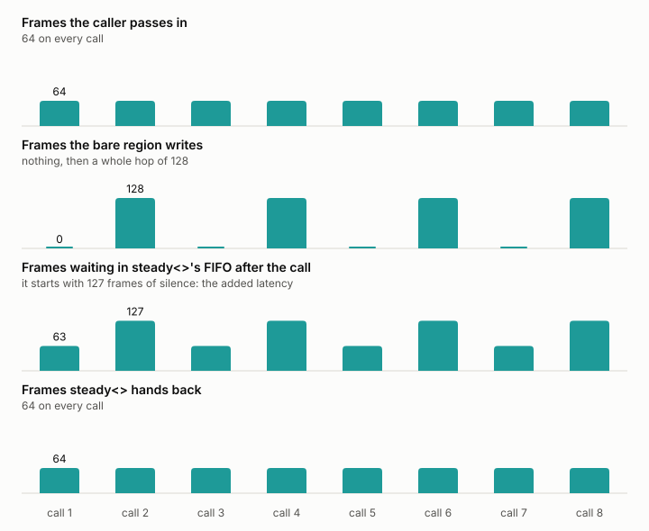

<!-- Copyright 2026 Timothy Place and the catenae contributors -->

# Bursts and buffering

An audio host calls your code with a block of frames and expects the same number back. It
chooses the block's size, and it does not wait. Some processing cannot answer on those
terms. A transform works on a whole block of its own size, and has nothing to give until
it is full. This chapter's constraint is a callback that must return n frames for n,
around a stage that works in blocks.

The example is a block stage of 128 frames, standing in for a transform-domain region (an
`stft`, a spectral gain and an `istft`, which arrive at a later milestone). It gathers 128
frames, then writes all 128 at once, halved. The host calls with 64 frames, half of that.

## What you would naturally write

You would call the stage from the callback and hand back what it wrote. Over a long run
the stage is 1:1: every frame in comes out. On a desktop that reads as "64 in, 64 out",
and the code looks finished.

When that fails you would put a queue after the stage, and the callback would take its 64
frames from it. You would choose two numbers: how many frames it holds, and how many it
starts with. The usual way is to guess, listen, and double the guess when it clicks.

Both versions rest on the stage's ratio, which is not the whole fact. Here is what the
stage says about itself.

```cpp
{{#include ../../examples/block_region.h:region}}
```

`rate_ratio` is 1:1. The four members after it say how that output *arrives*, and that is
where the trouble is.

## What it costs on the target

The measurement is a trace. The example calls the stage eight times with 64 frames and
prints how many frames came back. (Its `pull,` lines come later.)

```sh
cmake -S . -B build -DCMAKE_BUILD_TYPE=Release
cmake --build build
build/examples/catenae_example_bursts_and_buffering
```

```text
call,frames_in,bare_out,fifo_held,steady_out
1,64,0,63,64
2,64,128,127,64
3,64,0,63,64
4,64,128,127,64
5,64,0,63,64
6,64,128,127,64
7,64,0,63,64
8,64,128,127,64
pull,1,128
pull,2,0
pull,3,128
pull,4,0
CATENAE_EXAMPLE_DONE ok=1
```

Read the `bare_out` column: 0, 128, 0, 128. Every second call writes nothing. A callback
that must return 64 frames has none, and the listener hears whatever is in the output
buffer. On the other calls the stage has 128 frames for a callback that can hand back 64:
twice what the host's buffer holds.

Nothing here is slow, and nothing is wrong with the stage. The total is right: 512 frames
in, 512 out. The cost is in when the frames arrive, and a ratio cannot show that.

The queue is the right repair, and its two numbers are not a matter of taste. Start it too
empty and it runs dry on some call. Make it too small and a burst does not fit. Which call
fails depends on how the host's blocks fall against the stage's. A guess can pass every
test you ran and fail on the first host that opens with one odd-sized call.

The trace's last two columns are the queue with both numbers right. The rest of the
chapter derives them.

## What catenae does instead

A stage publishes how its output arrives, as four numbers counted from its reset state.

- `input_group` is the smallest block the stage always turns into exactly the frames it
  owes. Here it is 128, the hop.
- `max_shortfall` is how far the output can trail what is owed. Here, 127 frames: after
  127 frames in, nothing has come out.
- `max_lead` is how far the output can run ahead. Here, 0.
- `output_quantum` is the multiple every call writes in. Here, 128.

Each is defined on [the stage contract's page](api/stage_contract.html). A stage that
keeps pace frame by frame has a group of 1, and catenae calls it frame-synchronous. That
property is derived from the group, never declared.

A chain composes these numbers, like everything else, when its type is formed.

```cpp
{{#include ../../examples/bursts_and_buffering.cpp:bare}}
```

### A block the chain cannot keep pace with

Give that chain the host's blocks, a `std::array<float, 64>` in and another out, and
GCC 13's first error is:

```text
error: static assertion failed: catenae: a fixed block must be a whole number of the chain's input groups; wrap the chain in steady<>
```

Whole input groups are the only blocks the chain is certain to answer in full. The trace's
silent call is refused before there is an image to run it. The case
`tests/compile_fail/fixed_block_half_hop.cpp` pins the message on every CI leg.

### `steady`

The error names the repair. `steady` wraps a 1:1 configuration that writes in bursts and
presents one that is frame-synchronous.

```cpp
{{#include ../../examples/bursts_and_buffering.cpp:steady}}
```

Inside is the first section's queue, a FIFO, with both numbers taken from the
configuration it wraps.

- **What it starts with.** Reset primes the FIFO with `max_shortfall` frames of silence,
  rounded up to whole frames. The output can never be further behind than that, so the
  FIFO always holds the frames a call is owed.
- **What it holds.** It has room for the priming, for `max_lead` rounded up, and for one
  burst of the configuration's output.

The priming is latency: every frame comes out 127 frames later than the bare stage would
write it. That number is a constant of the type, `added_latency_frames`, added to the
chain's `exact_latency`. The assertions above read both. You neither choose the delay nor
measure it.



The figure is drawn from the trace. The FIFO starts with 127 frames of silence. On the
first call the region writes nothing and 64 frames leave: 63 remain. On the second, 128
arrive and 64 leave: 127 remain. `fifo_held` alternates between those two values, and
`steady_out` is always 64. The example also checks the samples: the steady output is the
bare output after 127 frames of silence, value for value.

The callback is then the one from [Stages and chains](stages_and_chains.md), its sizes
checked by the compiler.

```cpp
{{#include ../../examples/bursts_and_buffering.cpp:callback}}
```

### What `steady` does not do

It evens out the frame counts, not the work: every second call still carries a whole
block's arithmetic.

It also costs its latency. A host whose callback is a whole number of hops, aligned to
them, needs no `steady`. Two blocks of 128 frames pass the compile-time entry, and the
bare region answers each in full with nothing added.

And it wraps only a 1:1 configuration. It evens out frames, not rates, and nothing else
compiles.

### The exact pull

A callback also meets a block stage across a junction, the ring between two threads. It
asks for n frames, and the region writes 128 at a time. `fed_by`, the pull side, fills the
request exactly.

```cpp
{{#include ../../examples/bursts_and_buffering.cpp:pull}}
```

The trace's `pull,` lines are four 64-frame requests, each with the frames it pulled:
128, 0, 128, 0. A request makes at most one pull, sized to what the region needs, and none
when the holdover covers it: the region's second 64 frames wait there for the next
request. A junction may clock a servo or a fill policy from its pulls, so a request never
makes several.

The largest pull is a constant of the workspace's type: 128 frames, a hop. The bound from
any state is 191, 64 plus the 127 the region can trail by, but each pull takes whole hops,
so `fed_by` never finds frames the region holds unwritten. The producer pushes 64 at a
time, so the junction's target is at least 128 + 64 - 1 = 191. Both are asserted.

### Numbers that do not follow from the largest block

For a chain of block stages you would guess the largest block less one. The composed
numbers say otherwise; these are pinned in `tests/test_steady.cpp`.

| The configuration inside `steady` | Frames of priming |
|---|--:|
| A block of 128 | 127 |
| A block of 96 before a block of 128 | 191 |
| A block of 480 before a block of 512 | 959 |
| A block of 7 before a block of 5 | 10 |
| Down by 2, writing on a pair's last frame, then up by 2 | 1 |
| Down by 2, writing on a pair's first frame, then up by 2 | 0 |

Block sizes that do not nest need more than the largest burst: 191 frames for 96 before
128, not 127. The last two rows have the same ratio and the same input group, and differ
only in when the decimator writes. Writing late trails by a frame, and costs a frame of
latency. Writing early never trails. It can only run ahead, so it costs no latency, only
room in the FIFO for the frame it leads by.

In each row the steady form reproduces the straight run exactly, at its stated delay, in
every pattern of calls the tests try. One is a single odd call followed by full blocks,
the host that defeats a guess.

### What is checked, and when

The FIFO's two numbers are derived from what the configuration publishes, so they are as
right as those are. That the FIFO never runs short or over is one of the library's own
promises, checked at the audit level as `check::fifo_short` and `check::fifo_over`. The
boundary build, the one that ships, does not. A stage of your own that publishes a wrong
shortfall is caught by an audit build, and by the generic tests in
[Writing a stage](writing_a_stage.md).

The cards and the requirements are on [`steady`'s page](api/steady_8h.html) and
[`fed_by`'s](api/fed__by_8h.html). How a chain composes the four numbers is on
[the chain contract's page](api/chain_contract.html).
